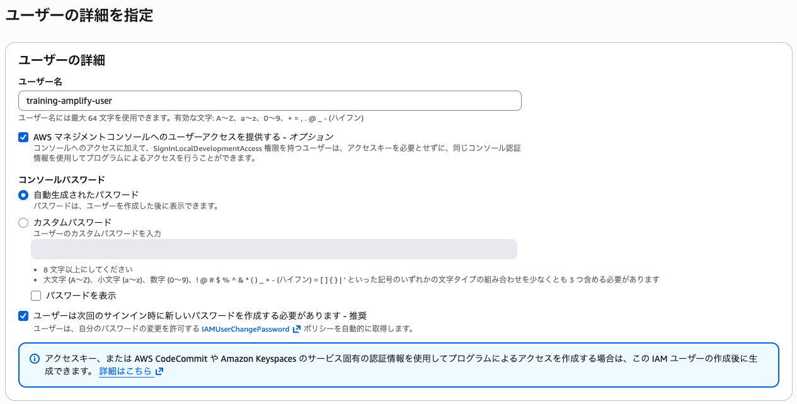
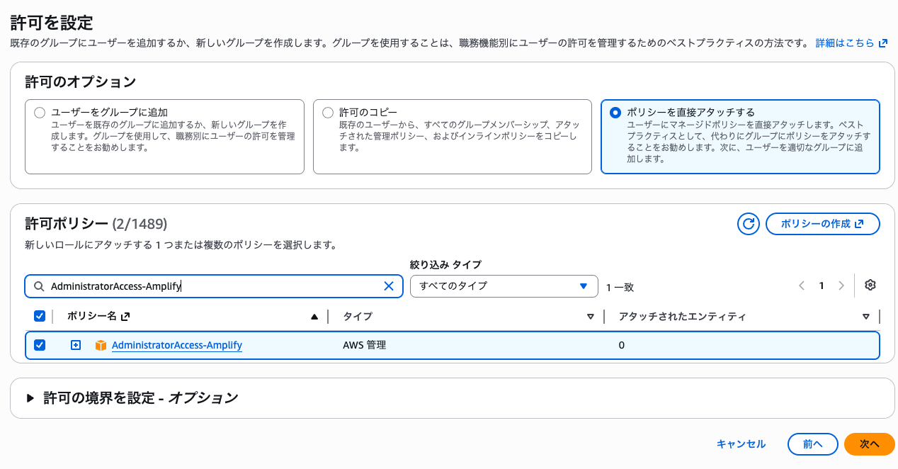
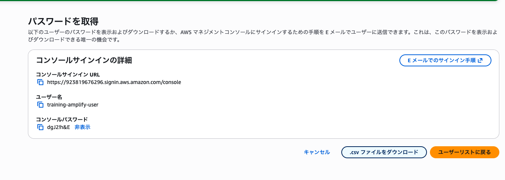
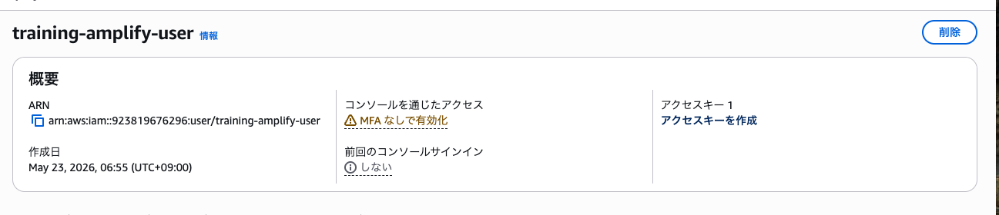
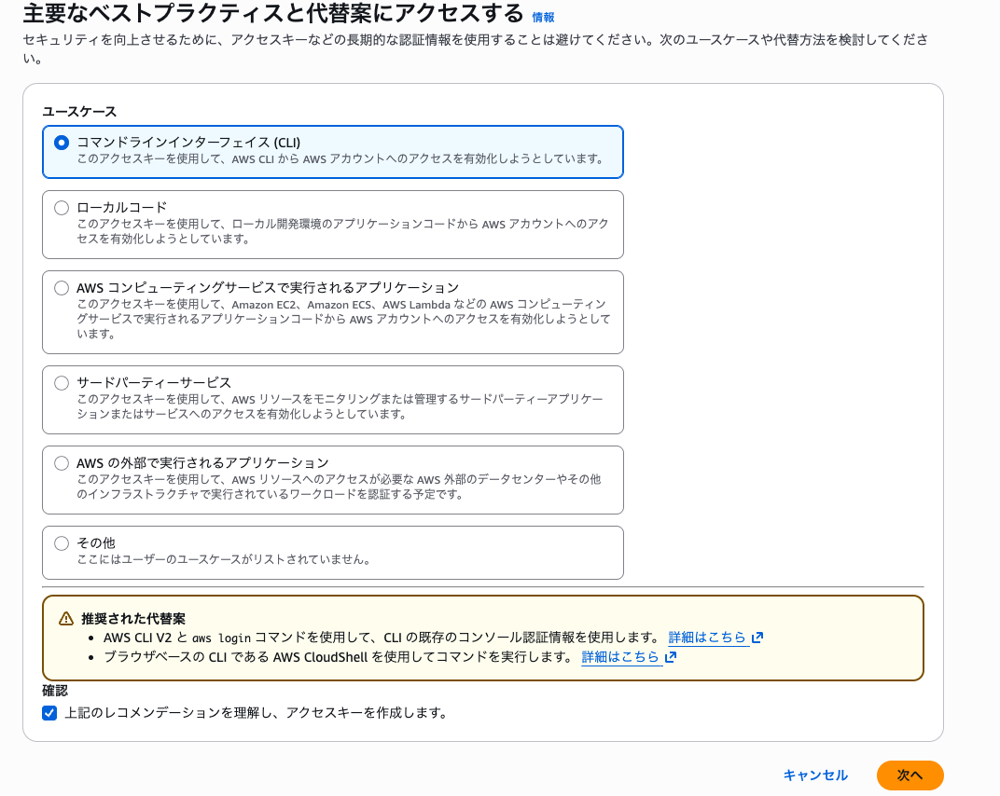
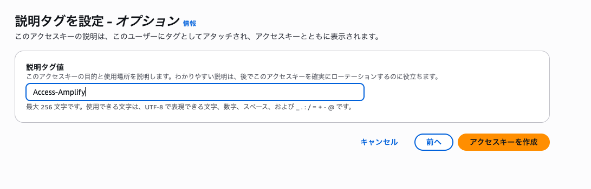
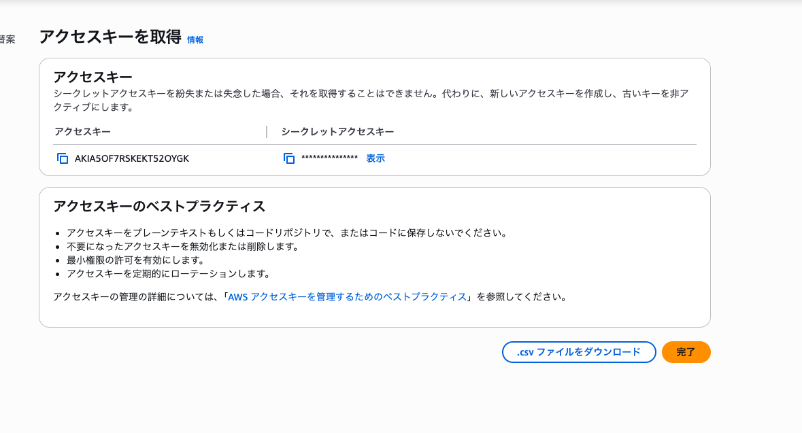
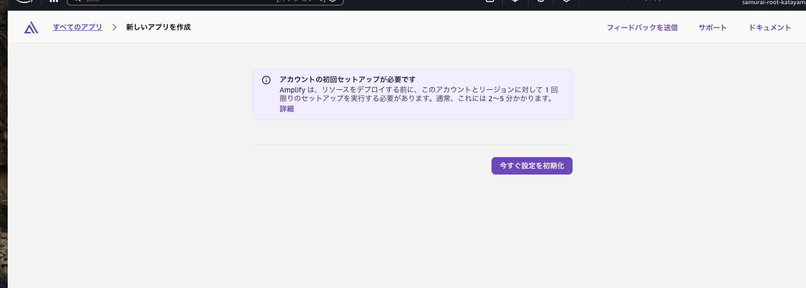
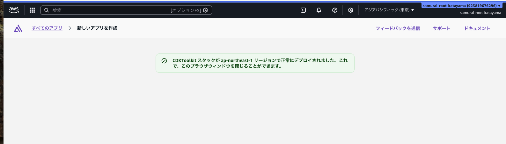

# ハンズオン 01: クラウド開発環境の初期設定

この資料は、全8回の学習事項のうち1つ目「クラウド開発環境の初期設定」のハンズオンです。

## 1. この回のゴール

- AWSとローカルPC（macOS）を接続できる
- Amplify Gen 2の初期化（Sandbox起動）ができる
- Reactプロジェクトを作成し、ローカルで起動確認できる

## 2. 前提条件

- AWSアカウント作成済み
- macOSが利用可能
- インターネット接続あり
- ターミナルが利用可能

## 3. 進行タイムライン（目安）

- 0:00-0:10 イントロ・ゴール確認
- 0:10-0:35 IAMユーザーとAccess Keyの準備
- 0:35-0:55 Volta/Node.js/Amplify Gen 2ツールセットアップ
- 0:55-1:20 React作成 + `ampx sandbox`
- 1:20-1:30 動作確認・振り返り

## 4. ハンズオン手順

### Step 0: 作業フォルダを作る

```bash
cd ./src
mkdir -p ./amplify-handson-01
cd ./amplify-handson-01
pwd
```

期待結果:

- 作業ディレクトリの絶対パスが表示される

---

### Step 1: AWS IAMユーザーを準備する

#### なぜIAMユーザーを作成するのか:

- ルートアカウントの常用を避けるため
	- ルートアカウントは権限が強すぎ、漏えい時の影響が非常に大きい
- 学習・開発用の操作権限を分離するため
	- 必要な操作だけを許可することで、誤操作や過剰権限のリスクを下げられる
- トラブル時の切り分けと対処をしやすくするため
	- IAMユーザー単位でAccess Keyの無効化・再発行ができ、影響範囲を限定できる

1. AWSマネジメントコンソールにサインインする
2. IAMサービスを開く
3. 学習用ユーザーを作成する（例: `training-amplify-user`）

4. 権限を付与する

推奨（学習用途）:

- `AdministratorAccess-Amplify`
- `IAMReadOnlyAccess`
- `AdministratorAccess`

注意（研修運用）:

- 研修中のセットアップ詰まりを避けるため、学習用途では一時的に `AdministratorAccess` の初期付与を許容してよい
- 研修終了後は、`AdministratorAccess` を必ず剥奪し、最小権限ポリシーに戻す

5. csvファイルをダウンロード


- ※ユーザ画面トップに戻る


6. Access Keyを発行する

7. 発行直後に以下を安全な場所へ控える

8. csvファイルをダウンロード
- `AWS_ACCESS_KEY_ID`
- `AWS_SECRET_ACCESS_KEY`

注意:
- Secret Access Keyは再表示できない
- 教材やGitにキーを貼り付けない
- 不要になったキーは削除する

---

### Step 2: VoltaでNode.js環境を整える

#### Voltaとは

Voltaは、Node.jsやnpmなどのJavaScript開発ツールのバージョン管理ツールです。

- プロジェクトごとにNode.jsのバージョン差異を吸収できる
- 複数案件を並行するときに、環境差分によるエラーを減らせる
- グローバルインストール時の権限トラブルを避けやすい

このハンズオンでは、受講者全員の開発環境をそろえるためにVoltaを利用します。

#### Node.jsとは

Node.jsは、JavaScriptをブラウザ外（ローカルPCやサーバー）で実行するための実行環境です。

- `npm`（パッケージ管理）を使ってライブラリを導入できる
- ReactやAmplify CLIなどの開発ツールを動かす土台になる
- フロントエンド開発でも必須となることが多い

つまり、今回の流れでは「VoltaでNode.jsを安定して管理し、その上でAmplify CLIとReact開発を進める」という関係になります。

#### 2-1. Voltaの確認（未導入ならインストール）

```bash
volta --version
```

`command not found` の場合:

```bash
curl https://get.volta.sh | bash
```

ターミナル再起動後に再確認:

```bash
volta --version
```

#### 2-2. Node.js LTSを導入

```bash
volta install node@lts
node -v
npm -v
```

期待結果:

- Node.jsとnpmのバージョンが表示される

---

### Step 3: Amplify Gen 2 ツールを準備する

#### AWS Amplifyとは

AWS Amplifyは、WebアプリやモバイルアプリをAWS上で素早く開発・公開するためのサービス群です。

- 認証、API、データ保存、ホスティングなどをまとめて扱える
- フロントエンド開発者がバックエンド連携まで進めやすい
- 小さく作って段階的に機能追加しやすい

このハンズオンでは、ReactアプリとAWSをつなぐ基盤としてAmplifyを利用します。

#### Amplify Gen 2 ツールとは

Amplify Gen 2では、バックエンドをTypeScriptコードで管理し、`ampx` コマンドで開発環境（Sandbox）を起動します。

- 対話ベースではなく、コードファーストで構成を管理できる
- ローカル開発中にクラウド環境を素早く立ち上げられる
- 新規プロジェクトの推奨方式として案内されている

このハンズオンでは、Step 6の `ampx sandbox` 実行前に、`create-amplify` でGen 2の雛形を作成します。

```bash
cd web
volta run npm create amplify@latest -- --yes
volta run npx ampx --version
```

期待結果:

- `amplify/` ディレクトリと `amplify_outputs.json` が生成される
- `ampx` のバージョンが表示される

補足:

- 依存関係の導入に数分かかる場合がある
- ネットワーク制限環境では、npmレジストリアクセス可否を確認する

---

### Step 4: AWS認証情報をローカルに設定する

```bash
aws --version
```

AWS CLIがない場合（Homebrew利用例）:

```bash
brew install awscli
aws --version
```

`brew: command not found` の場合:

方法A（Homebrewを導入してからインストール）:

```bash
/bin/bash -c "$(curl -fsSL https://raw.githubusercontent.com/Homebrew/install/HEAD/install.sh)"
```

導入後に実行:

```bash
brew install awscli
aws --version
```

方法B（Homebrewを使わずAWS CLI公式インストーラーを使用）:

```bash
curl "https://awscli.amazonaws.com/AWSCLIV2.pkg" -o "AWSCLIV2.pkg"
sudo installer -pkg AWSCLIV2.pkg -target /
aws --version
```

認証情報を設定:

```bash
aws configure
```

入力値:

- AWS Access Key ID: Step 1で発行した値
- AWS Secret Access Key: Step 1で発行した値
- Default region name: `ap-northeast-1`（東京）
- Default output format: `json`

疎通確認:

```bash
aws sts get-caller-identity
```

期待結果:

- `Account`, `Arn`, `UserId`を含むJSONが返る
```json
{
    "UserId": "AIDA5OF7RSKECV4EJ7L5O",
    "Account": "923819676296",
    "Arn": "arn:aws:iam::923819676296:user/training-amplify-user"
}
```

---

### Step 5: Reactプロジェクトを作成する

#### Reactとは

Reactは、Web画面を部品（コンポーネント）として組み立てるためのJavaScriptライブラリです。

- 画面を再利用しやすい単位で分割して開発できる
- 状態変更に応じて表示を更新しやすい
- Amplifyと組み合わせて、認証やAPI連携を段階的に追加しやすい
- iOSのアプリ内ブラウザ（WebView / SafariView）で表示するWebコンテンツとして利用できる

このハンズオンでは、以降のAmplify連携の土台としてReactプロジェクトを作成します。

#### アプリ内ブラウザとの関連:

- このStepで作るReactアプリが、次回以降にiOSアプリ内で読み込む表示対象になる
- WebView実装時は、React側の変更がそのままアプリ表示に反映される

#### Viteとは

Viteは、フロントエンド開発向けの高速な開発サーバー兼ビルドツールです。

- Reactなどの雛形プロジェクトを素早く作成できる
- 開発中の画面反映が速く、学習時の試行錯誤がしやすい
- 本番公開用のビルドにも対応している

このハンズオンでは、Reactプロジェクトをすぐ作って動かすためにViteを利用します。


#### Volta経由でVite + Reactを作成して利用:

```bash
volta run npm create vite@latest web -- --template react
```

期待結果:

- `http://localhost:5173` が表示され、初期画面がブラウザで開ける

```
Need to install the following packages:
create-vite@9.0.7
Ok to proceed? (y) y

> npx
> "create-vite" web --template react

│
◇  Install with npm and start now?
│  Yes
│
◇  Scaffolding project in /Users/tsuyoshi_katayama/........./src/amplify-handson-01/web...
│
◇  Installing dependencies with npm...

added 135 packages, and audited 136 packages in 14s

31 packages are looking for funding
  run `npm fund` for details

found 0 vulnerabilities
│
◇  Starting dev server...

> web@0.0.0 dev
> vite


  VITE v8.0.14  ready in 386 ms

  ➜  Local:   http://localhost:5173/
  ➜  Network: use --host to expose
  ➜  press h + enter to show help
```

停止方法:

- ターミナルで `Ctrl + C`

#### 備考：reactを再起動する方法
```
cd web
volta run npm run dev
```

---

### Step 6: Amplifyプロジェクトを初期化する
- ※　カレントディレクトリが./webであること
  - Reactプロジェクトルート（`web`）で実行:
  -  ターミナルの表示
    ```
    web %
    ```

```bash
volta run npx ampx sandbox
```

入力例（標準）:

- Select AWS profile: `default`
- Select region: `ap-northeast-1`

補足（Gen 2）:

- 初回実行時はSandbox作成に時間がかかる場合がある
- 実行後に出力される `amplify_outputs.json` は、フロントエンド連携に使用する
- `PathNotFoundError: ./amplify does not exist.` が出る場合は、Step 3 の `volta run npm create amplify@latest -- --yes` を先に実行する
- `The region ap-northeast-1 has not been bootstrapped` が出る場合は、AWSコンソールのAmplify画面で「今すぐ設定を初期化」を実行してから再実行する



期待結果:

- Sandboxが起動し、完了メッセージが表示される
  - 起動できているメッセージ
    ```bash
    Amplify Sandbox

    Identifier:   tsuyoshi_katayama
    Stack:        amplify-web-tsuyoshikatayama-sandbox-27e4e97ccc
    Region:       ap-northeast-1
    ```
  - 完了メッセージ
    ```bash
    ✔ Deployment completed in 241.529 seconds
    ```
  - 起動後の正常待機状態
    ```
    [Sandbox] Watching for file changes..
    ```
- `amplify/` ディレクトリが作成される
- `amplify_outputs.json` が生成される

確認コマンド:
- ※ 別ターミナルを開く

```bash
cd ./web
ls
ls amplify
```
  - ` auth            backend.ts      data            package.json    tsconfig.json `と表示されること
  - ※ `ls: amplify: No such file or directory`と表示されないこと

---

### Step 7: ローカル起動の最終確認

```bash
volta run npm run dev
```

確認ポイント:

- エラーなく開発サーバーが起動する
- React初期画面が表示される
- `amplify` フォルダが存在する


### 補足：再実行手順

#### 1. Web画面だけ再起動したい場合
1. web ディレクトリへ移動
2. 以下を実行
   - volta run npm run dev

#### 2.vSandbox と Web の両方を再起動したい場合
1. ターミナルAで web ディレクトリへ移動
2. 以下を実行して、起動したままにする
    - volta run npx ampx sandbox

3. ターミナルB（別ターミナル）で同じく web ディレクトリへ移動
4. 以下を実行
    - volta run npm run dev

#### 3. 停止方法
- 各ターミナルで Control + C
- ※ Exit Code 130 は手動停止なので正常です

## 5. つまずきポイントと対処

### 5-1. `ampx: command not found`

- 新しいターミナルを開く
- `volta run npx ampx --version` を実行して利用可否を確認する
- `volta run npm create amplify@latest -- --yes` を再実行し、`amplify/` 作成まで完了させる

### 5-4. `PathNotFoundError: ./amplify does not exist`

- `ampx sandbox` 実行前に `amplify/` 雛形が未作成の状態
- `cd web` のあとに `volta run npm create amplify@latest -- --yes` を実行する
- その後 `volta run npx ampx sandbox` を再実行する

### 5-2. `aws sts get-caller-identity` が失敗する

- Access Key/Secretの入力ミスを確認
- IAMユーザー権限不足を確認
- リージョン設定を `ap-northeast-1` に統一する

### 5-3. `volta run npm install` でエラー

- Node.jsバージョンを `node -v` で確認（LTS推奨）
- プロキシ環境の有無を確認
- ネットワーク制限がある場合は社内ネットワーク設定を確認

### 5-5. `[SSMCredentialsError] ssm:GetParameter ... AccessDeniedException`

- 原因: IAMユーザーに `ssm:GetParameter`（およびCDKブートストラップ参照に必要な権限）が不足している
- 研修環境では、講師側で学習用IAMユーザーに追加権限を付与してから再実行する

最小対応（例）:

- `AmazonSSMReadOnlyAccess` を追加
- それでも不足する場合は、学習用途として一時的に広い権限ポリシー（例: `AdministratorAccess`）で実施

再実行コマンド:

```bash
volta run npx ampx sandbox --profile default
```

補足:

- 権限を変更した直後は反映まで数十秒かかる場合がある
- 研修後は不要な広い権限を外し、最小権限へ戻す

### 5-6. `The region ap-northeast-1 has not been bootstrapped`

- 原因: 対象リージョンのAmplify/CDK初期セットアップが未実施
- AWSコンソールのAmplify画面で「今すぐ設定を初期化」を実行する
- 初期化完了後に、同じターミナルで再実行する

```bash
volta run npx ampx sandbox --profile default
```

補足:

- シェル環境変数でリージョンが上書きされる場合があるため、必要に応じて `echo $AWS_REGION` と `echo $AWS_DEFAULT_REGION` を確認する

## 6. 成果物チェックリスト

- [ ] AWS IAMユーザーの認証情報で `aws sts get-caller-identity` が成功
- [ ] Amplify Gen 2 ツールが利用可能（`volta run npx ampx --version`で確認）
- [ ] Reactプロジェクト `web` が作成済み
- [ ] `volta run npx ampx sandbox` が成功し `amplify_outputs.json` が生成済み
- [ ] `volta run npm run dev` でローカル起動できる

## 7. 次回への接続（学習事項 2 への橋渡し）

次回は「アプリへのWebView組み込み」です。
この回で作成したWebアプリをAmplify Hostingで公開し、iOSアプリ側（SwiftUI + WKWebView）から表示できるようにしていきます。

事前準備（任意）:

- `web` ディレクトリ構成を把握しておく
- React側で簡単なテキスト変更を1つ実施しておく
  - ヒント：
    - - ブラウザで` http://localhost:5173'を起動
    - src/App.jsx ファイルの`Get started`部分を `読売新聞東京本社 Swift 研修`に変更
    - ブラウザ画面で表示が自動更新されることを確認

## 8.ご注意

- IAM権限は最小権限が理想だが、初回はハンズオン進行を優先
- Secret Keyの扱い（漏えい防止）を必ず口頭で強調
