# ハンズオン 02: アプリへのWebView組み込み

この資料は、全8回の学習事項のうち2つ目「アプリへのWebView組み込み」のハンズオンです。

1回目（クラウド開発環境の初期設定）で作成した React + Amplify Gen 2 の土台を使って進めます。

## 1. この回のゴール

- ReactアプリをAmplify Hostingで公開できる
- SwiftUIで `WKWebView`（`UIViewRepresentable`）を実装できる
- iOSアプリ内で公開URLを読み込める
- ATS（App Transport Security）の基本を理解し、必要な設定ができる

## 2. 前提条件

- ハンズオン01が完了している
- `src/amplify-handson-01/web` が存在する
- `volta run npm run dev` でReactアプリを起動できる
- Xcodeが利用可能（iOS Simulator起動可）
- AWSコンソールへログイン可能
- AWSコンソールはハンズオン1で作成したIAMユーザーでログインする

### 2-1. Xcodeを新規インストールする（未導入の場合のみ）

1. App Storeを開き、`Xcode` を検索する
2. Apple提供の `Xcode` をインストールする（容量が大きいため時間に余裕を持つ）
3. インストール完了後、Xcodeを1回起動して追加コンポーネントの導入を完了する
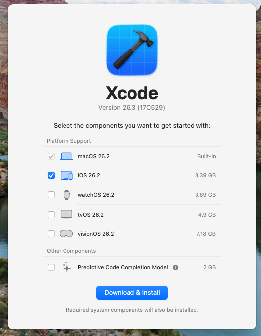
4. ターミナルで以下を実行し、Command Line Tools が有効か確認する

```bash
xcode-select -p
```

期待結果:

- `/Applications/Xcode.app/Contents/Developer` のようなパスが表示される

初回セットアップでエラーが出る場合:

```bash
sudo xcodebuild -runFirstLaunch
```

補足:

- 研修では、Xcode起動とiOS Simulator起動確認まで完了してからStep 0へ進む


## 3. 進行タイムライン（目安）

- 0:00-0:10 イントロ・ゴール確認
- 0:10-0:35 Reactアプリの表示確認と本番ビルド
- 0:35-1:00 Amplify Hosting公開
- 1:00-1:25 SwiftUIでWebView実装
- 1:25-1:35 ATS確認・動作検証・振り返り

## 4. ハンズオン手順

### Step 0: 前回成果物を確認する

```bash
cd ./src/amplify-handson-01/web
pwd
ls
```

確認ポイント:

- `amplify/` ディレクトリがある
- `amplify_outputs.json` がある
- `package.json` がある

---

### Step 1: React画面に識別用テキストを入れる

この後iOSで表示したとき、正しく最新のWebが読み込まれているか判別しやすくするため、見出し文言を1箇所変更します。

例（`src/App.jsx`）:

- 変更前: `<h1>Get started</h1>`
- 変更後: `<h2>Swift研修 ハンズオン02</h2>`

文字化け対応

1. `index.html` の `lang` を `ja` に変更する

```html
<html lang="ja">
```

2. `src/index.css` のフォント指定に日本語フォントを追加する

```css
  --sans:
    'Hiragino Sans', 'Hiragino Kaku Gothic ProN', 'Yu Gothic UI', 'Yu Gothic',
    'Noto Sans JP', system-ui, -apple-system, 'Segoe UI', Roboto, sans-serif;
  --heading:
    'Hiragino Sans', 'Hiragino Kaku Gothic ProN', 'Yu Gothic UI', 'Yu Gothic',
    'Noto Sans JP', system-ui, -apple-system, 'Segoe UI', Roboto, sans-serif;
```

ローカル確認:

```bash
volta run npm run dev
```

期待結果:

- `http://localhost:5173` で変更した文言が表示される

停止方法:

- ターミナルで `Ctrl + C`

---

### Step 2: 本番ビルドを作成する

```bash
volta run npm run build
ls dist
```

期待結果:

- `dist/` ディレクトリが生成される
- `index.html` と `assets/` が含まれる

補足:

- Amplify Hostingへは、ビルド済み成果物（`dist`）をアップロードする


---

### Step 3: Amplify Hostingで公開する（手動デプロイ）

1. ハンズオン1で作成したIAMユーザーでAWSコンソールにログインし、Amplify サービスを開く
2. 「テンプレートを使用して開始」
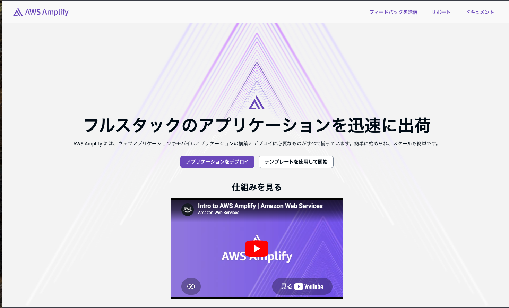
3. 【Gitなしでデプロイ】を選択して【次へ】
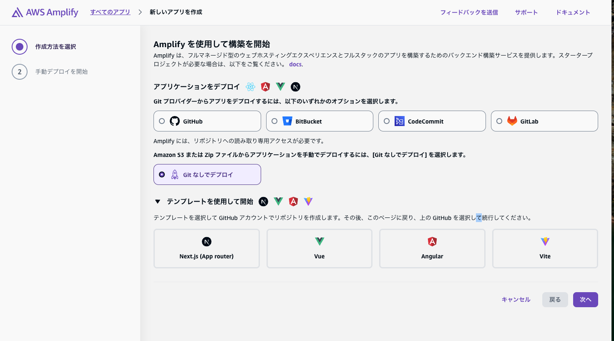
4. アプリケーションの名前とブランチ名を入力する
    - アプリケーションの名前
      - swift-handson02
    - ブランチ名
      - main
5. `dist` フォルダをzip化して、アップロード
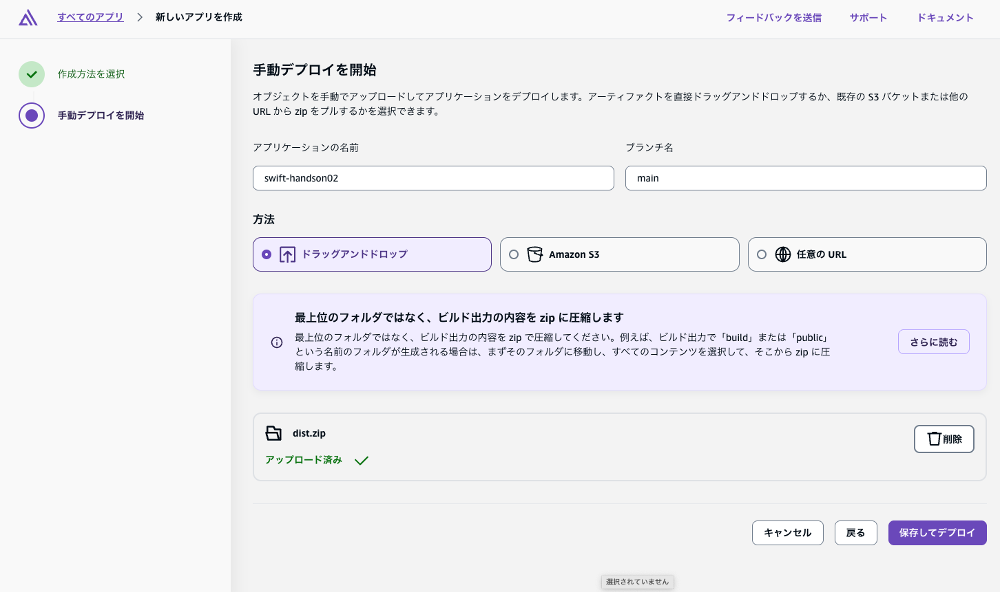
6. 【保存してデプロイ】をクリック
7. デプロイ完了後、発行されたURLを控える（例: `https://main.xxxxx.amplifyapp.com`）
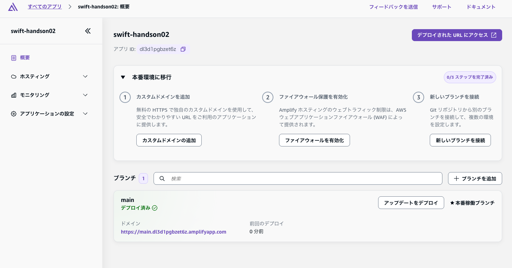

#### 参考：`dist` zip作成例:

```bash
cd ./dist
zip -r ../dist.zip .
cd ..
ls -l dist.zip
```

#### 期待結果:

- HTTPSで始まる公開URLにアクセスできる
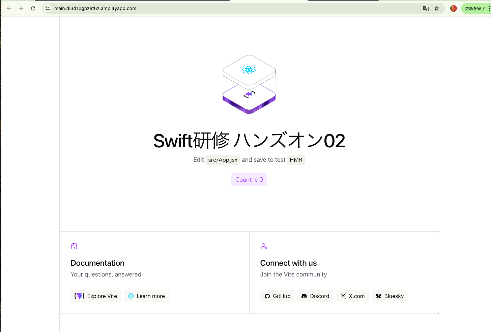

#### 補足:

- このハンズオンでは、Git連携デプロイは扱わず、手動デプロイで進める

---

### Step 4: SwiftUIプロジェクトを新規作成する

Xcodeで iOS App（SwiftUI）を新規作成し、以下の3ファイルを修正します。

#### 4-1. 新規作成:

1. Xcodeを起動する
    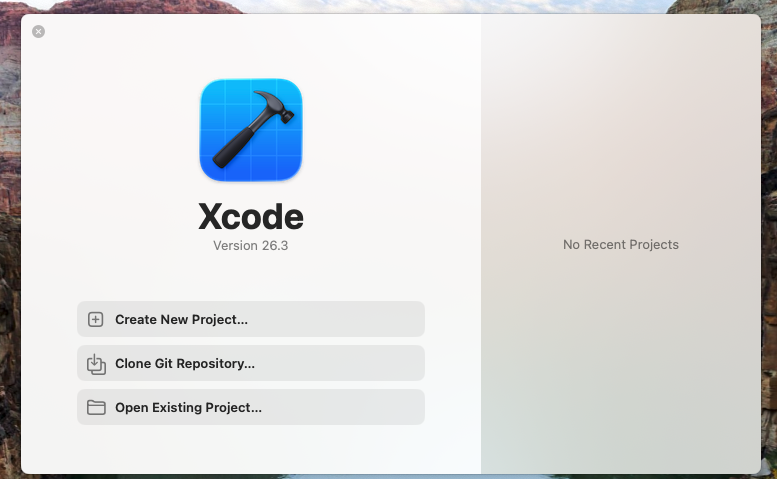
2. `Create a new project...` を選択する
3. iOS の `App` テンプレートを選択する
    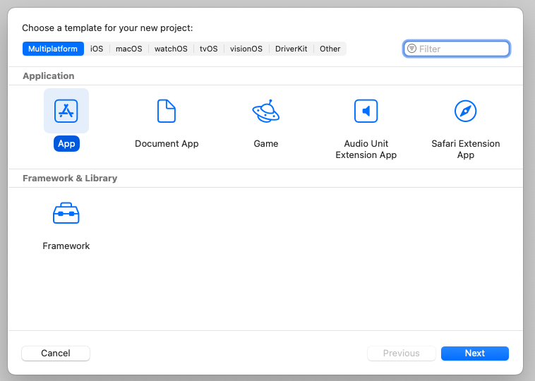
4. 下記内容を設定
    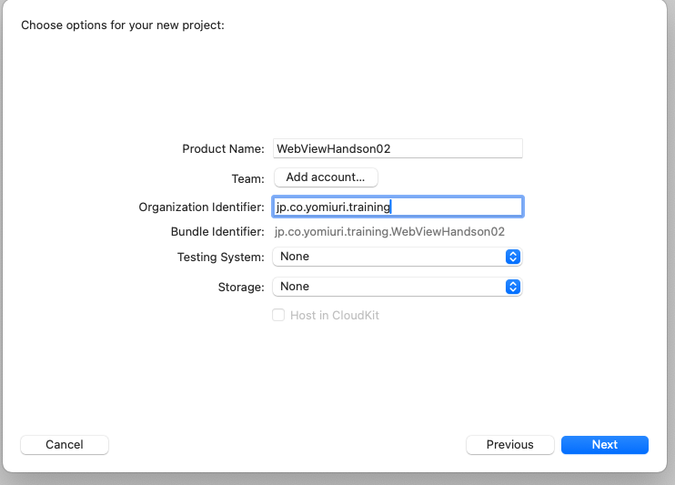
   - Product Name
     - WebViewHandson02
     - （英数字で分かる名前）
   - Team
     - 個人検証(シュミレーター実行)だけなら **None のままでOK**
     - 実機配布や署名が必要な場合だけ Apple ID を追加(4-4. 実機配布を試す（任意）参照)
   - Organization Identifier
     - jp.co.yomiuri.training
     - または com.<自分の名前>.training 形式
     - 逆ドメイン形式で入力します
   - Bundle Identifier
     - 自動生成されるので通常は変更不要
     - Organization Identifier + Product Name で決まります
   - Testing System
     - None でOK（研修ではテスト作成を省略）
   - Storage
     - None でOK（今回はデータ永続化を使わない）
   - Host in CloudKit
     - オフのままでOK（今回は使わない）
5. projectの保存先を設定して【Create】
   -  `src`フォルダを選択
6. 動作確認
  1. Target Deviceを`iOS Simulators`の`iPhone17`などを選択
   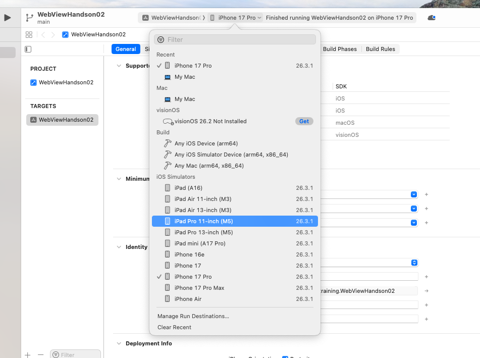
  2. 【▶️】ボタンを押す
  3. しばらくすると、シュミレーターが起動し、アプリが表示される
   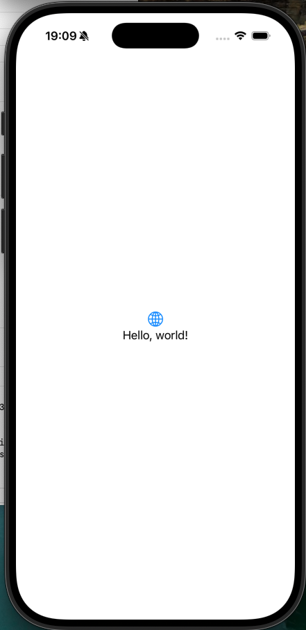
  4. 【◾️】ボタンで停止する

#### 4-2. ソースコード修正
##### 1. `WebViewHandson02App.swift`

```swift
import SwiftUI

@main
struct WebViewHandson02App: App {
  var body: some Scene {
    WindowGroup {
      ContentView()
    }
  }
}
```

##### 2. `WebView.swift`
- 右クリックにより`New Empty File`で作成して、renameする
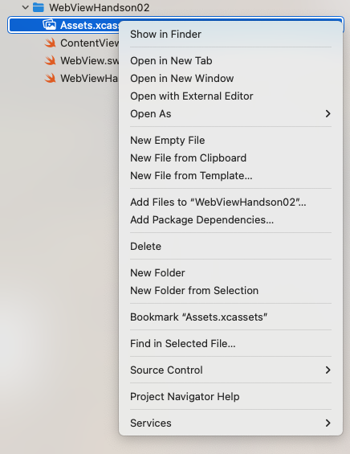

```swift
import SwiftUI
import WebKit

struct WebView: UIViewRepresentable {
    let url: URL

    func makeUIView(context: Context) -> WKWebView {
        let webView = WKWebView(frame: .zero)
        webView.allowsBackForwardNavigationGestures = true
        return webView
    }

    func updateUIView(_ uiView: WKWebView, context: Context) {
        let request = URLRequest(url: url)
        uiView.load(request)
    }
}
```

##### 3. `ContentView.swift`
- URL部分は、Amplify  Hostingでデプロイにより発行されたURLに書き換える
```swift
import SwiftUI

struct ContentView: View {
    private let hostedURL = URL(string: "https://main.xxxxx.amplifyapp.com")!

    var body: some View {
        NavigationStack {
            WebView(url: hostedURL)
                .navigationTitle("研修WebView")
                .navigationBarTitleDisplayMode(.inline)
                .ignoresSafeArea(edges: .bottom)
        }
    }
}

#Preview {
    ContentView()
}
```

##### 期待結果:

- Simulatorで起動すると、Amplify HostingのWeb画面がアプリ内に表示される
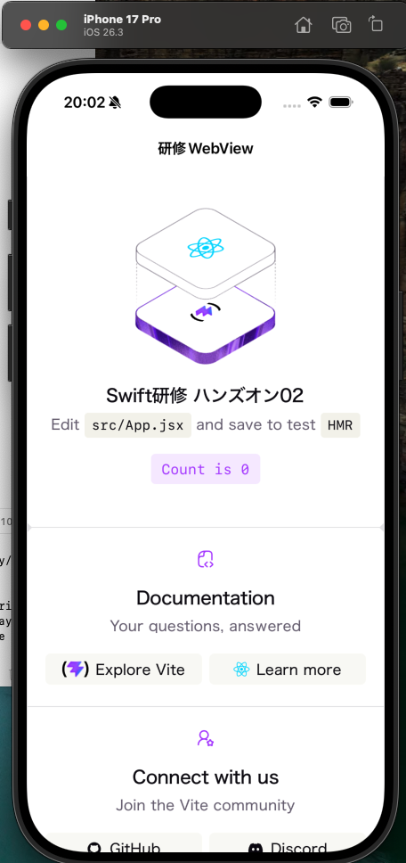

#### 4-4. 実機配布を試す（任意）
##### 実機(iPhone)でデバッグする場合の設定手順（必要に応じて実施）
   1. Xcode メニューの `Xcode > Settings... > Apple Accounts` を開く
   2. 【Add Apple Account....】をクリック
      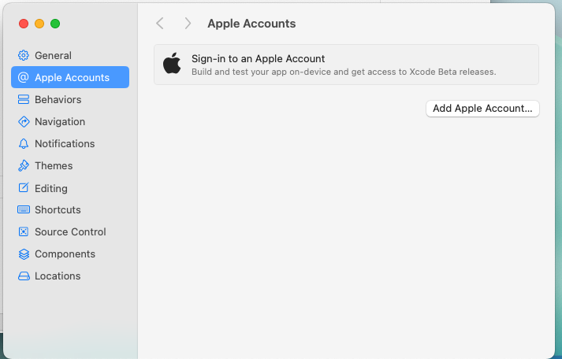
   3. AppleアカウントのEmailまたは電話番号を入力して【Next】
      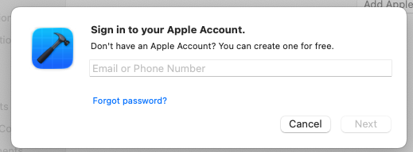
   4. パスワードを入力
   5. 一覧に `Personal Team` が表示されることを確認する
      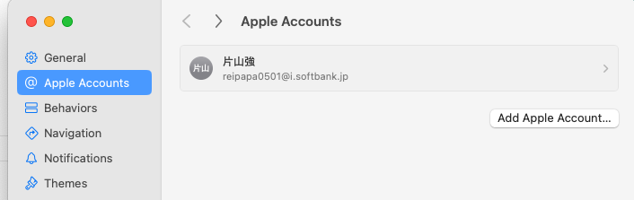
   6. プロジェクト画面へ戻り、左ペインで`WebViewHandsno2`を選択して、`Signing & Capabilities` を開く
      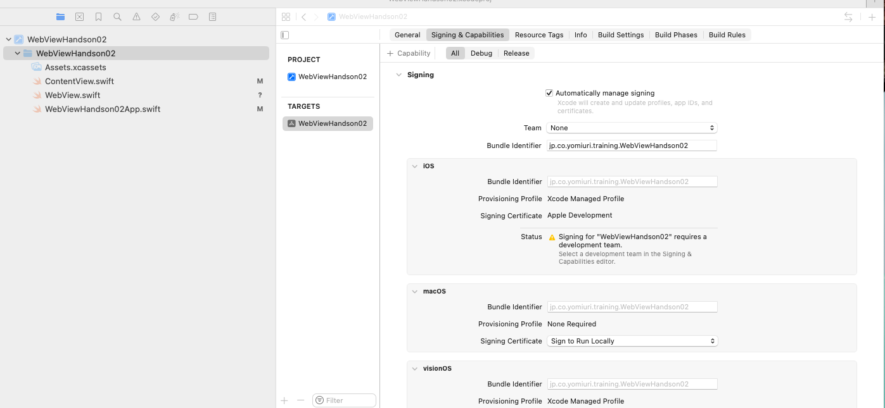
   7. `Automatically manage signing` を ON にする
   8. `Team` で追加した `Personal Team` を選択する
   9.  `Bundle Identifier` が重複しない値か確認する（重複時は末尾に氏名や日付を追加）
      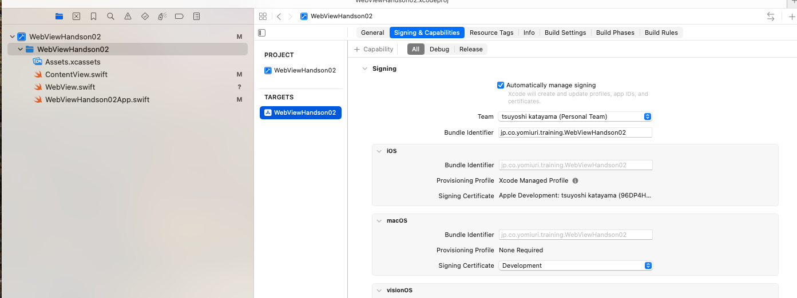
   10. 実機(iPhone)をMacに接続する
      - Mac、実機共に、信頼確認のダイアログが表示される
   11. 一覧より実機を選択する
      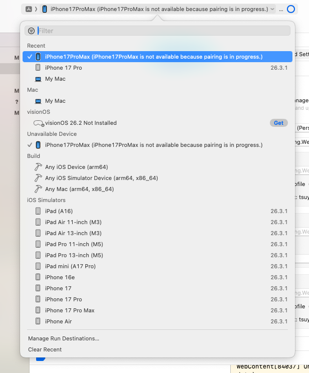
   12. 実行し、署名エラーが出ないことを確認する
        - 下記のダイアログが表示される場合は、実機がロック解除して、ケーブルの抜き差し、XCodeの再起動を行う
          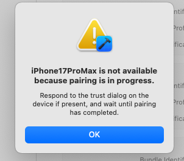
        - 下記のダイアログが出る場合は、実機で下記設定を行う
          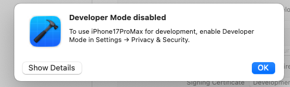
          1. 設定 → プライバシーとセキュリティ → デベロッパモード をON
              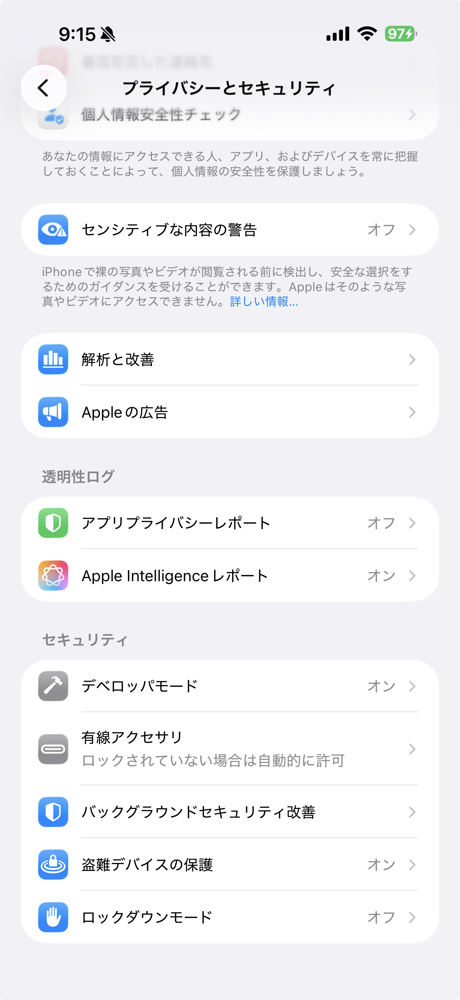
          2. iPhoneを再起動
             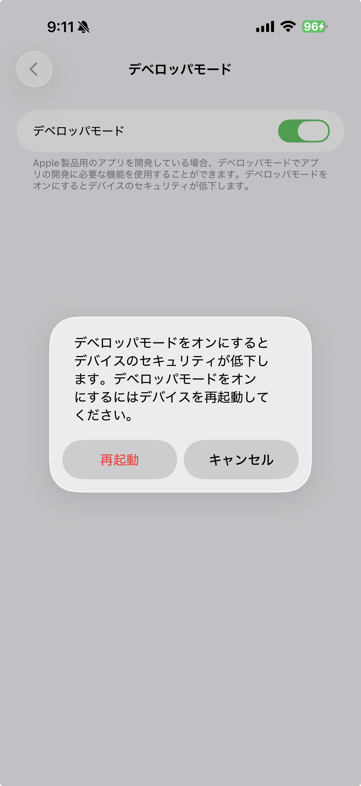
          3. 再起動後に表示される確認ダイアログで有効化を確定

##### 期待結果:

- 実機iPhone上でWebViewアプリが起動し、Amplify HostingのURLが表示される

##### 補足:
- 無料のApple Developerアカウントでも実機インストールは可能
- 実機検証では、iPhoneがインターネットに接続されていることを確認する

---

### Step 5: ATS（App Transport Security）を確認する（参考）

原則:

- `https://` のURLを読み込む場合、通常は追加設定なしで表示できる

今回の推奨:

- Amplify Hostingの `https://` URLのみを使う（ATS例外なし）

注意:

- 研修ではATS例外設定は扱わない
- `http://` URLは使用しない

---

### Step 6: 表示確認（チェック項目）

- 初回表示で白画面にならない
- 変更した識別テキストが見える
- 画面を再読み込みしても安定表示する
  - `App Switcher`でアプリの終了して、画面アイコンより再起動
  - 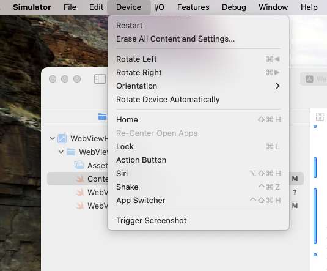

## 5. つまずきポイントと対処

### 5-1. WebViewが白画面のまま

- URLが正しいか確認（スペル、`https://` の有無）
- Amplify Hostingのデプロイ状態を確認（`Deployed`）
- Webアプリ側が404/500を返していないかブラウザで直接確認

### 5-2. `zip` アップロード後に古い画面が出る

- `dist` を再ビルドしてから再zip化する
- ブラウザキャッシュを無効化して再確認する
- ファイル名競合を避けるため、`dist.zip` を作り直す

再ビルド例:

```bash
rm -rf dist dist.zip
volta run npm run build
cd dist && zip -r ../dist.zip . && cd ..
```

### 5-3. `App Transport Security has blocked...` が出る

- 読み込みURLが `https://` になっているか確認
- URLを手入力した場合は `http://` になっていないか見直す
- Amplify Hostingの公開URLを再取得して貼り直す

### 5-4. Simulatorでは見えるが実機で見えない

- 実機ネットワーク制限（社内Wi-Fiポリシー）を確認
- URLが外部アクセス可能か確認
- 証明書エラーやプロキシの影響を確認

### 5-5. 実機配布で署名エラーが出る

- `Signing & Capabilities` の `Team` が未設定でないか確認
- `Bundle Identifier` が他アプリと重複していないか確認
- iPhone側で開発者モードが有効か確認する
- ケーブル接続不安定時は接続し直し、再ビルドする

## 6. 成果物チェックリスト

- [ ] Amplify Hostingの公開URLを取得できた
- [ ] `https://` URLでWeb画面を確認できた
- [ ] SwiftUIで `UIViewRepresentable` ベースの `WKWebView` を実装できた
- [ ] iOSアプリ内で公開Webを表示できた
- [ ] ATSの原則（https利用時は追加設定不要）を説明できる

## 7. 次回への接続（学習事項 3 への橋渡し）

次回は「NoSQLの構築とAPI疎通」です。
- 画面イメージ
  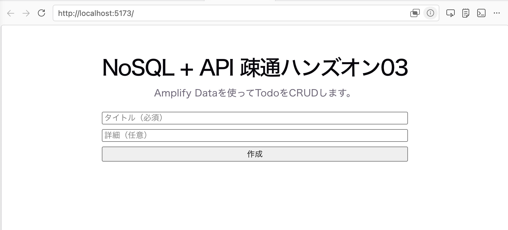


## 8. ご注意

- 研修用AWS環境のコスト管理のため、不要なHostingアプリは研修終了後に整理する
- 公開URLに機微情報を表示しない
- 本ハンズオンではhttpsのみを使用し、ATS例外は設定しない

## 9. 宿題

1. 画面(src/App.jsx)を変更して、Webを再ビルドしてAmplify Hostingへ再デプロイする
- ローカル確認
  - 実行コマンド: `volta run npm run dev`
- デプロイ
  - 実行コマンド: `volta run npm run build`
  - 実行コマンド: `cd dist && zip -r ../dist.zip . && cd ..`

1. iOSアプリで再表示し、現在の公開画面が表示できることを確認する
確認ポイント: WebViewが白画面にならず、公開中のWeb画面が表示されること

宿題チェックリスト:

- [ ] Amplify Hostingへ再デプロイした
- [ ] iOS WebViewで更新内容を確認した
