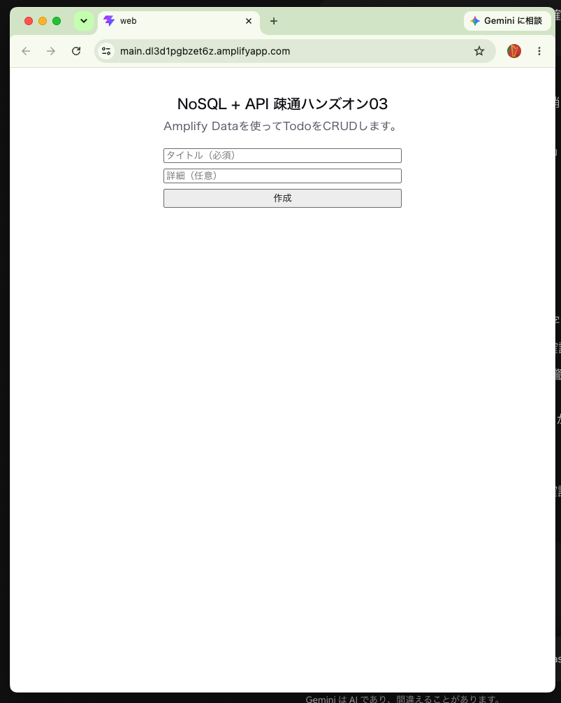
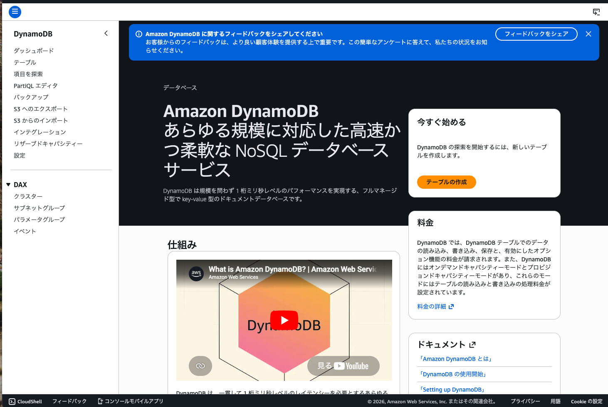
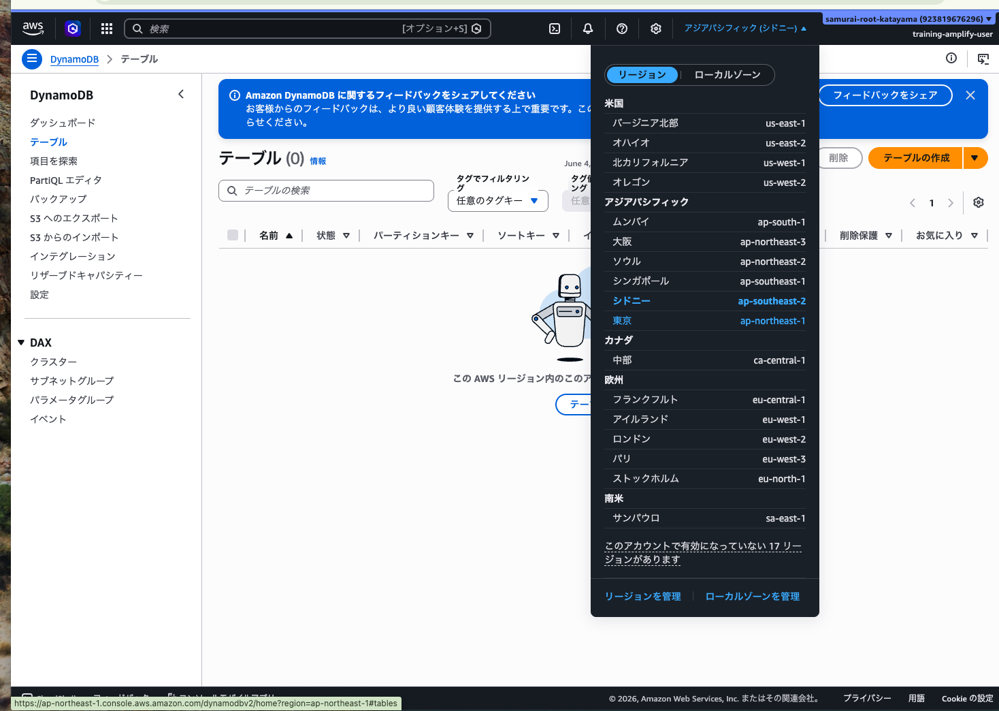
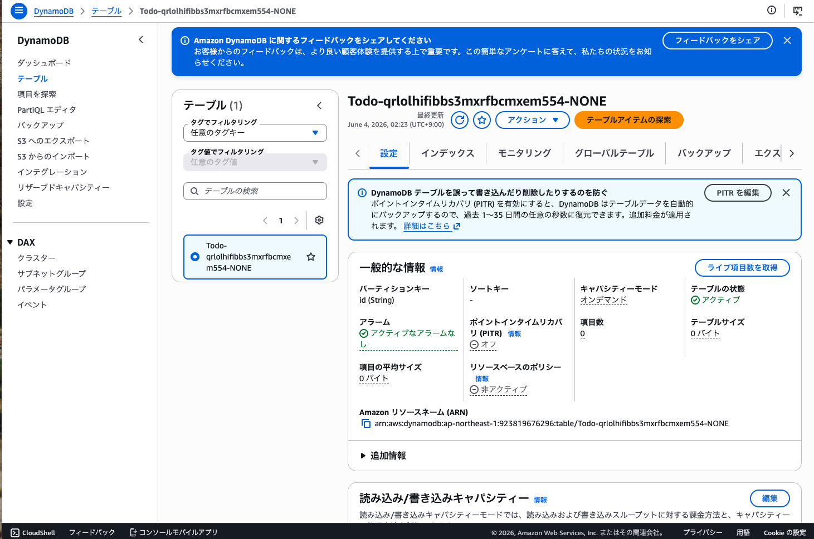
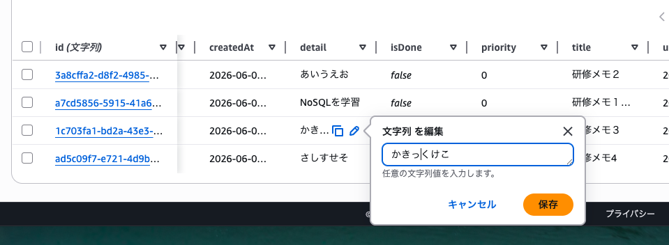

# ハンズオン 03: NoSQLの構築とAPI疎通

この資料は、全8回の学習事項のうち3つ目「NoSQLの構築とAPI疎通」のハンズオンです。

2回目（アプリへのWebView組み込み）まで完了している前提で進めます。

## 1. この回のゴール

- Amplify Gen 2でNoSQL（DynamoDB）テーブル定義を理解できる
- GraphQL APIを通じて、ReactからCRUD（作成・一覧・更新・削除）ができる
- ローカル画面でAPI疎通を確認できる
- 次回以降の認証学習につながる「Public権限でのデータ操作」の位置づけを理解できる

## 2. 前提条件

- ハンズオン01が完了している
- ハンズオン02が完了している
- 以下フォルダが存在する
  - `src/amplify-handson-01/web`
- AWSコンソールにログインできる
- 研修で利用するIAMユーザーのAWS認証情報がローカル設定済み
- Node.js / npm / Volta が利用可能

## 3. 進行タイムライン（目安: 90分）

- 0:00-0:10 イントロ・ゴール確認
- 0:10-0:25 既存構成の確認とSandbox起動
- 0:25-0:45 NoSQLスキーマ定義（GraphQLモデル）
- 0:45-1:15 ReactからのCRUD実装
- 1:15-1:25 API疎通確認（操作テスト）
- 1:25-1:30 振り返り

## 4. ハンズオン手順

### Step 0: 作業ディレクトリへ移動

```bash
cd ./src/amplify-handson-01/web
pwd
ls
```

確認ポイント:

- `amplify/` がある
- `amplify_outputs.json` がある
- `src/` がある

---

### Step 1: Amplify Sandboxを起動する

この回では、Amplify Gen 2のSandboxを使ってバックエンド定義をクラウドに反映しながら進めます。

```bash
volta run npx ampx sandbox
```

期待結果:

- ターミナルにSandboxの起動ログが表示される
- `amplify_outputs.json` が最新化される

補足:

- Sandboxは起動中にコード変更を検知し、バックエンド差分を反映する
- このターミナルは開いたままにする（停止は `Ctrl + C`）

---

### Step 2: NoSQLスキーマを定義する

今回は、Todoデータを扱う最小構成のモデルを定義します。

編集対象:

- `amplify/data/resource.ts`

例（置き換え）:

```ts
import { type ClientSchema, a, defineData } from '@aws-amplify/backend';

const schema = a.schema({
  Todo: a
    .model({
      title: a.string().required(),
      detail: a.string(),
      isDone: a.boolean().default(false),
      priority: a.integer().default(0),
    })
    .authorization((allow) => [allow.guest()]),
});

export type Schema = ClientSchema<typeof schema>;

export const data = defineData({
  schema,
  authorizationModes: {
    defaultAuthorizationMode: 'identityPool',
  },
});
```

解説:

- `a.model(...)` がNoSQLテーブル相当の論理定義
- テーブル名はAmplifyが自動生成する（例: `Todo-<apiId>-NONE`）
  - `Todo` は `a.schema({ Todo: ... })` のモデル名
  - `<apiId>` は作成されたGraphQL API ID
  - `NONE` はSandbox環境名（環境によって値が変わる）
- `allow.guest()` で未ログインユーザーにもCRUDを許可
- 次回以降に認証を追加したとき、このルールを段階的に制限していく

期待結果:

- 保存後、Sandboxログに差分反映が表示される

---

### Step 3: フロントエンドでAmplifyを初期化する

編集対象:

- `src/main.jsx`

例（追記）:

```jsx
import { StrictMode } from 'react'
import { createRoot } from 'react-dom/client'
import { Amplify } from 'aws-amplify'
import outputs from '../amplify_outputs.json'
import './index.css'
import App from './App.jsx'

Amplify.configure(outputs)

createRoot(document.getElementById('root')).render(
  <StrictMode>
    <App />
  </StrictMode>,
)
```

解説:

- `amplify_outputs.json` からAPIエンドポイント情報を読み込む
- `Amplify.configure(outputs)` がAPI接続の土台になる

---

### Step 4: ReactでCRUD画面を実装する

編集対象:

- `src/App.jsx`
- `src/App.css`
- `src/components/TodoTable.jsx`

#### 1. `src/App.jsx`

```jsx
import { useEffect, useState } from 'react'
import { generateClient } from 'aws-amplify/data'
import { Hub } from 'aws-amplify/utils'
import TodoTable from './components/TodoTable'
import './App.css'

const client = generateClient()
const TABLE_REFRESH_INTERVAL_MS = 5000

function App() {
  // 入力値・編集状態・一覧データをまとめて管理する。
  const [todos, setTodos] = useState([])
  const [title, setTitle] = useState('')
  const [detail, setDetail] = useState('')
  const [editingTodoId, setEditingTodoId] = useState(null)
  const [editingTitle, setEditingTitle] = useState('')
  const [editingDetail, setEditingDetail] = useState('')

  // 最新一覧を取得する共通処理。
  const loadTodos = async () => {
    const { data, errors } = await client.models.Todo.list({
      sortDirection: 'DESC',
    })

    if (errors) {
      console.error(errors)
      return
    }

    setTodos(data)
  }

  useEffect(() => {
    // 初回表示時のロード + 定期ポーリング + Hub購読をまとめて初期化する。
    const initializeTodos = async () => {
      await loadTodos()
    }

    void initializeTodos()

    const intervalId = window.setInterval(() => {
      loadTodos()
    }, TABLE_REFRESH_INTERVAL_MS)

    // Data更新イベントを購読し、別タブ更新も反映する
    const cancel = Hub.listen('api', () => {
      loadTodos()
    })

    return () => {
      window.clearInterval(intervalId)
      cancel()
    }
  }, [])

  useEffect(() => {
    // モーダル表示中のみ背景スクロールを無効化する。
    if (!editingTodoId) return

    const previousOverflow = document.body.style.overflow
    document.body.style.overflow = 'hidden'

    return () => {
      document.body.style.overflow = previousOverflow
    }
  }, [editingTodoId])

  // 新規Todoを作成して一覧を再取得する。
  const createTodo = async (event) => {
    event.preventDefault()

    if (!title.trim()) return

    const { errors } = await client.models.Todo.create({
      title: title.trim(),
      detail: detail.trim(),
      isDone: false,
      priority: 0,
    })

    if (errors) {
      console.error(errors)
      return
    }

    setTitle('')
    setDetail('')
    await loadTodos()
  }

  // 完了状態をトグル更新して一覧を再取得する。
  const toggleTodo = async (todo) => {
    const { errors } = await client.models.Todo.update({
      id: todo.id,
      isDone: !todo.isDone,
    })

    if (errors) {
      console.error(errors)
      return
    }

    await loadTodos()
  }

  // 選択行の値を編集フォームへコピーする。
  const startEditingTodo = (todo) => {
    setEditingTodoId(todo.id)
    setEditingTitle(todo.title ?? '')
    setEditingDetail(todo.detail ?? '')
  }

  // 編集フォームを閉じてローカル状態を初期化する。
  const cancelEditingTodo = () => {
    setEditingTodoId(null)
    setEditingTitle('')
    setEditingDetail('')
  }

  // 編集内容を保存して一覧を再取得する。
  const updateTodo = async (event) => {
    event.preventDefault()

    if (!editingTodoId || !editingTitle.trim()) return

    const { errors } = await client.models.Todo.update({
      id: editingTodoId,
      title: editingTitle.trim(),
      detail: editingDetail.trim(),
    })

    if (errors) {
      console.error(errors)
      return
    }

    cancelEditingTodo()
    await loadTodos()
  }

  // 確認ダイアログの承認後に削除を実行する。
  const deleteTodo = async (id) => {
    const confirmed = window.confirm('このTodoを削除しますか？')

    if (!confirmed) return

    const { errors } = await client.models.Todo.delete({ id })

    if (errors) {
      console.error(errors)
      return
    }

    await loadTodos()
  }

  return (
    // フォーム・モーダル・テーブルの3領域で画面を構成する。
    <main style={{ maxWidth: 720, margin: '40px auto', padding: '0 16px' }}>
      <h2>NoSQL + API 疎通ハンズオン03</h2>
      <p>Amplify Dataを使ってTodoをCRUDします。</p>

      <form onSubmit={createTodo} style={{ display: 'grid', gap: 8, marginTop: 20 }}>
        <input
          value={title}
          onChange={(e) => setTitle(e.target.value)}
          placeholder="タイトル（必須）"
        />
        <input
          value={detail}
          onChange={(e) => setDetail(e.target.value)}
          placeholder="詳細（任意）"
        />
        <button type="submit">作成</button>
      </form>

      {editingTodoId && (
        <div
          role="presentation"
          onClick={cancelEditingTodo}
          style={{
            position: 'fixed',
            inset: 0,
            backgroundColor: 'rgba(15, 23, 42, 0.58)',
            display: 'grid',
            placeItems: 'center',
            padding: 16,
            zIndex: 50,
          }}
        >
          <div
            role="dialog"
            aria-modal="true"
            aria-labelledby="edit-todo-title"
            onClick={(event) => event.stopPropagation()}
            style={{
              width: 'min(100%, 560px)',
              borderRadius: 20,
              background: '#fff',
              padding: 24,
              boxShadow: '0 24px 80px rgba(15, 23, 42, 0.28)',
            }}
          >
            <form onSubmit={updateTodo} style={{ display: 'grid', gap: 12 }}>
              <div>
                <h3 id="edit-todo-title" style={{ margin: 0 }}>
                  選択中のTodoを編集
                </h3>
                <p style={{ margin: '8px 0 0', color: '#475569' }}>
                  タイトルと詳細を更新できます。
                </p>
              </div>
              <input
                value={editingTitle}
                onChange={(e) => setEditingTitle(e.target.value)}
                placeholder="タイトル（必須）"
              />
              <input
                value={editingDetail}
                onChange={(e) => setEditingDetail(e.target.value)}
                placeholder="詳細（任意）"
              />
              <div style={{ display: 'flex', gap: 8, justifyContent: 'flex-end' }}>
                <button type="button" onClick={cancelEditingTodo}>
                  キャンセル
                </button>
                <button type="submit">更新</button>
              </div>
            </form>
          </div>
        </div>
      )}

      <TodoTable
        todos={todos}
        onToggleTodo={toggleTodo}
        onStartEditingTodo={startEditingTodo}
        onDeleteTodo={deleteTodo}
      />
    </main>
  )
}

export default App
```

#### 2. `src/App.css`

```css
.counter {
  font-size: 16px;
  padding: 5px 10px;
  border-radius: 5px;
  color: var(--accent);
  background: var(--accent-bg);
  border: 2px solid transparent;
  transition: border-color 0.3s;
  margin-bottom: 24px;

  &:hover {
    border-color: var(--accent-border);
  }
  &:focus-visible {
    outline: 2px solid var(--accent);
    outline-offset: 2px;
  }
}

.hero {
  position: relative;

  .base,
  .framework,
  .vite {
    inset-inline: 0;
    margin: 0 auto;
  }

  .base {
    width: 170px;
    position: relative;
    z-index: 0;
  }

  .framework,
  .vite {
    position: absolute;
  }

  .framework {
    z-index: 1;
    top: 34px;
    height: 28px;
    transform: perspective(2000px) rotateZ(300deg) rotateX(44deg) rotateY(39deg)
      scale(1.4);
  }

  .vite {
    z-index: 0;
    top: 107px;
    height: 26px;
    width: auto;
    transform: perspective(2000px) rotateZ(300deg) rotateX(40deg) rotateY(39deg)
      scale(0.8);
  }
}

#center {
  display: flex;
  flex-direction: column;
  gap: 25px;
  place-content: center;
  place-items: center;
  flex-grow: 1;

  @media (max-width: 1024px) {
    padding: 32px 20px 24px;
    gap: 18px;
  }
}

#next-steps {
  display: flex;
  border-top: 1px solid var(--border);
  text-align: left;

  & > div {
    flex: 1 1 0;
    padding: 32px;
    @media (max-width: 1024px) {
      padding: 24px 20px;
    }
  }

  .icon {
    margin-bottom: 16px;
    width: 22px;
    height: 22px;
  }

  @media (max-width: 1024px) {
    flex-direction: column;
    text-align: center;
  }
}

#docs {
  border-right: 1px solid var(--border);

  @media (max-width: 1024px) {
    border-right: none;
    border-bottom: 1px solid var(--border);
  }
}

#next-steps ul {
  list-style: none;
  padding: 0;
  display: flex;
  gap: 8px;
  margin: 32px 0 0;

  .logo {
    height: 18px;
  }

  a {
    color: var(--text-h);
    font-size: 16px;
    border-radius: 6px;
    background: var(--social-bg);
    display: flex;
    padding: 6px 12px;
    align-items: center;
    gap: 8px;
    text-decoration: none;
    transition: box-shadow 0.3s;

    &:hover {
      box-shadow: var(--shadow);
    }
    .button-icon {
      height: 18px;
      width: 18px;
    }
  }

  @media (max-width: 1024px) {
    margin-top: 20px;
    flex-wrap: wrap;
    justify-content: center;

    li {
      flex: 1 1 calc(50% - 8px);
    }

    a {
      width: 100%;
      justify-content: center;
      box-sizing: border-box;
    }
  }
}

#spacer {
  height: 88px;
  border-top: 1px solid var(--border);
  @media (max-width: 1024px) {
    height: 48px;
  }
}

.ticks {
  position: relative;
  width: 100%;

  &::before,
  &::after {
    content: '';
    position: absolute;
    top: -4.5px;
    border: 5px solid transparent;
  }

  &::before {
    left: 0;
    border-left-color: var(--border);
  }
  &::after {
    right: 0;
    border-right-color: var(--border);
  }
}

.todo-table {
  font-size: 0.675rem;
}

.todo-table button {
  font-size: inherit;
}
```

#### 3. `src/components/TodoTable.jsx`

```jsx
const STATUS_DONE = '\u2611\uFE0F'
const STATUS_TODO = '\uFF0D'

// 一覧表示専用コンポーネント。操作イベントは親から受け取る。
function TodoTable({ todos, onToggleTodo, onStartEditingTodo, onDeleteTodo }) {
  return (
    <div className="todo-table-wrapper" style={{ marginTop: 24, overflowX: 'auto' }}>
      <table
        className="todo-table"
        style={{
          width: '100%',
          borderCollapse: 'collapse',
          background: '#fff',
          borderRadius: 12,
          overflow: 'hidden',
        }}
      >
        <thead>
          <tr style={{ background: '#e2e8f0' }}>
            <th
              style={{
                textAlign: 'left',
                padding: '12px 16px',
                borderBottom: '1px solid #cbd5e1',
              }}
            >
              タイトル
            </th>
            <th
              style={{
                textAlign: 'left',
                padding: '12px 16px',
                borderBottom: '1px solid #cbd5e1',
              }}
            >
              詳細
            </th>
            <th
              style={{
                textAlign: 'left',
                padding: '12px 16px',
                borderBottom: '1px solid #cbd5e1',
              }}
            >
              状態
            </th>
            <th
              style={{
                textAlign: 'left',
                padding: '12px 16px',
                borderBottom: '1px solid #cbd5e1',
              }}
            >
              操作
            </th>
          </tr>
        </thead>
        <tbody>
          {todos.map((todo) => (
            <tr key={todo.id}>
              <td
                style={{
                  padding: '12px 16px',
                  borderBottom: '1px solid #e2e8f0',
                  fontWeight: 600,
                }}
              >
                {todo.title}
              </td>
              <td style={{ padding: '12px 16px', borderBottom: '1px solid #e2e8f0' }}>
                {todo.detail || '-'}
              </td>
              <td style={{ padding: '12px 16px', borderBottom: '1px solid #e2e8f0' }}>
                <span aria-label={todo.isDone ? '完了' : '未完了'}>
                  {todo.isDone ? STATUS_DONE : STATUS_TODO}
                </span>
              </td>
              <td style={{ padding: '12px 16px', borderBottom: '1px solid #e2e8f0' }}>
                <div style={{ display: 'flex', flexWrap: 'wrap', gap: 8 }}>
                  <button type="button" onClick={() => onToggleTodo(todo)}>
                    {todo.isDone ? '未完了にする' : '完了にする'}
                  </button>
                  <button type="button" onClick={() => onStartEditingTodo(todo)}>
                    編集
                  </button>
                  <button type="button" onClick={() => onDeleteTodo(todo.id)}>
                    削除
                  </button>
                </div>
              </td>
            </tr>
          ))}
        </tbody>
      </table>
    </div>
  )
}

export default TodoTable
```

解説:

- `client.models.Todo.create` で作成
- `client.models.Todo.list` で一覧取得
- `client.models.Todo.update` で更新
- `client.models.Todo.delete` で削除

---

### Step 5: ローカルで疎通確認する

別ターミナルで実行:

```bash
cd ./src/amplify-handson-01/web
volta run npm run dev
```

ブラウザで確認:

- `http://localhost:5173`

確認シナリオ:

1. タイトルに `研修メモ1`、詳細に `API疎通確認` を入力して作成する
2. 一覧に追加したデータが表示されることを確認する
3. ブラウザを再読み込みしても同じデータが表示されることを確認する
4. `完了切替` ボタンを押し、`未完了` から `完了` に変わることを確認する
5. `削除` ボタンを押し、一覧から消えることを確認する

CRUD対応表:

- Create: 新しいTodoを作成できる
- Read: 作成したTodoを一覧で取得できる
- Update: 完了状態を変更できる
- Delete: Todoを削除できる

期待結果:

- 4つの操作すべてがブラウザ上で確認できる
- 画面表示とバックエンドのデータ状態が一致している
- NoSQLとAPIが双方向に連携していることを説明できる

---

### Step 6: WebView側で最新Webを確認する

ハンズオン02で作成したiOSアプリから確認する場合は、Webを再ビルドして再デプロイします。

```bash
cd ./src/amplify-handson-01/web
volta run npm run build
cd dist && zip -r ../dist.zip . && cd ..
ls -l dist.zip
```

その後、Amplify Hostingへ再アップロードし、発行URLをiOS WebViewで表示確認します。



---

## 5. Amplify側でアップロードされた値を確認する方法

ここでは、ブラウザ操作で登録・更新したTodoデータが、Amplify（DynamoDB）側に保存されているかを確認します。

### 5-1. AWSコンソールからDynamoDBのデータを確認する

1. AWSコンソールで `DynamoDB` を開く

2. 左メニューの `テーブル` を開く
3. AWSコンソールのリージョンが `ap-northeast-1`（東京）に切り替え

4. ハンズオン03で作成された `Todo` モデルに対応するテーブルを選択する


  - 補足（テーブル名の見方）:

    - テーブル名はAmplifyの自動生成（例: `Todo-<apiId>-NONE`）
    - 先頭の `Todo` は `a.schema({ Todo: ... })` のモデル名
    - 目的のテーブルが見つからない場合は、リージョンと `Todo-` で始まる名前を確認する

5. `テーブルアイテムの探索` を開く
6. 画面で作成した `title`, `detail`, `isDone` の値を確認する
7. 「詳細」の内容を編集する
  
8. ブラウザ、iPhoneで確認する

確認ポイント:

- 追加したTodoが1件ずつ項目として保存されている
- `完了切替` 実行後に `isDone` が `true/false` で更新される
- `削除` 実行後に対象項目が表示されなくなる

### 5-2. 反映されないときのチェック

- `ampx sandbox` が起動中か確認する
- `amplify_outputs.json` が最新化されているか確認する

---


## 6. 解説

### 6-1. NoSQLとGraphQLについて

- NoSQL（今回のDynamoDB）は、行と列を固定するRDBとは異なり、柔軟なスキーマでデータを扱える
- GraphQLは、フロントエンドから「必要な項目だけ」を取得・更新できるAPIの問い合わせ言語
- このハンズオンでは、`Todo` モデルをNoSQLに保存し、GraphQL経由でCRUDしている
- つまり「保存先はNoSQL」「操作窓口はGraphQL」という役割分担になる

### 6-2. CRUDのリクエストとレスポンス

- Create（作成）
  - リクエスト: `createTodo` mutation に `title`, `detail`, `isDone`, `priority` を送る
  - レスポンス: 作成された `id` を含むTodoオブジェクトが返る
- Read（一覧取得）
  - リクエスト: `listTodos` query を送る
  - レスポンス: Todo配列（items）と必要に応じてページング情報が返る
- Update（更新）
  - リクエスト: `updateTodo` mutation に `id` と更新したい項目（例: `isDone`）を送る
  - レスポンス: 更新後のTodoオブジェクトが返る
- Delete（削除）
  - リクエスト: `deleteTodo` mutation に対象の `id` を送る
  - レスポンス: 削除されたTodo（または `id`）が返る

補足:

- 画面側では `client.models.Todo.create/list/update/delete` を呼ぶだけで、内部的に上記のGraphQLリクエストが実行される
- そのため、UI操作後に一覧を再取得すると、レスポンス内容を画面に反映できる

## 7. つまずきポイントと対処

### 7-1. `UnauthorizedException` や `Not Authorized` が出る

- `authorizationModes.defaultAuthorizationMode` が `identityPool` か確認
- モデルに `allow.guest()` が設定されているか確認
- `amplify_outputs.json` が最新化されているか確認（Sandbox再起動）

### 7-2. 作成できるが一覧が空になる

- `list()` 呼び出し結果の `errors` をコンソールで確認
- `title` が空文字になっていないか確認
- フィールド名がスキーマと一致しているか確認

### 7-3. スキーマ変更後に反映されない

- `ampx sandbox` の起動ターミナルが停止していないか確認
- 保存後ログに差分反映が出ているか確認
- 反映されない場合はSandboxを再起動する

### 7-4. 画面で `client.models` が `undefined` になる

- `src/main.jsx` の `Amplify.configure(outputs)` の有無を確認
- `amplify_outputs.json` のimportパスを確認

## 8. 成果物チェックリスト

- [ ] `amplify/data/resource.ts` でTodoモデルを定義できた
- [ ] Sandboxでバックエンド差分を反映できた
- [ ] React画面でTodoの作成・一覧・更新・削除ができた
- [ ] ローカルブラウザでAPI疎通を確認できた
- [ ] 3回目の目的（NoSQL構築とAPI疎通）を説明できる

## 9. この回のまとめ

- NoSQLモデル定義は `amplify/data/resource.ts` が起点
- フロントエンドは `Amplify.configure(outputs)` でAPI接続設定を行う
- Public権限でのCRUDを先に体験すると、次回の認証導入時に差分を理解しやすい
