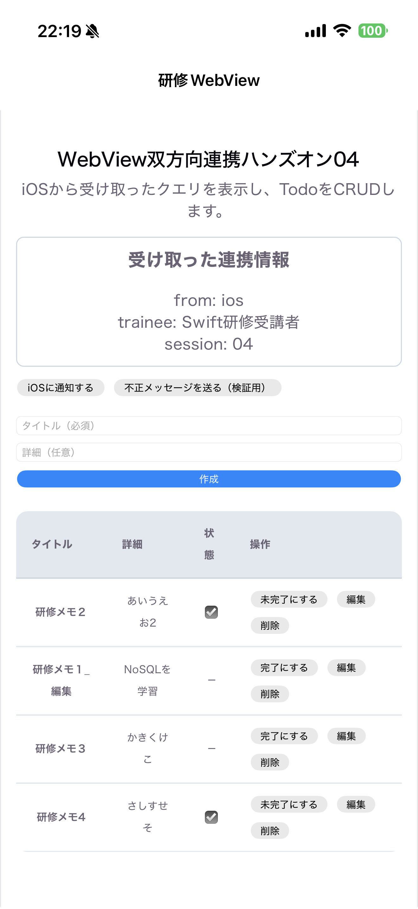
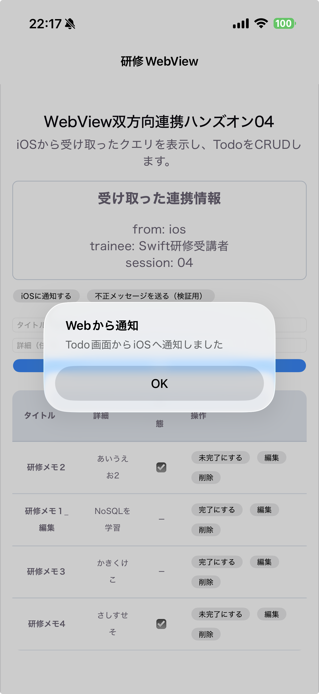
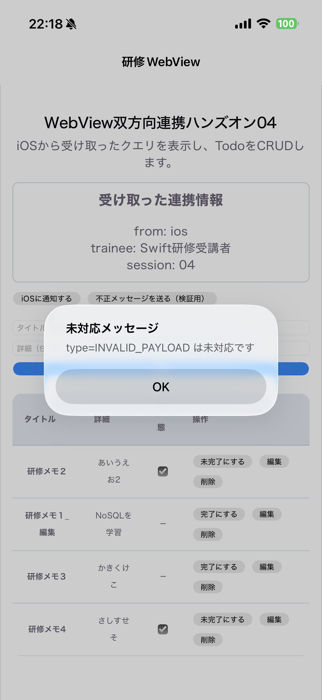
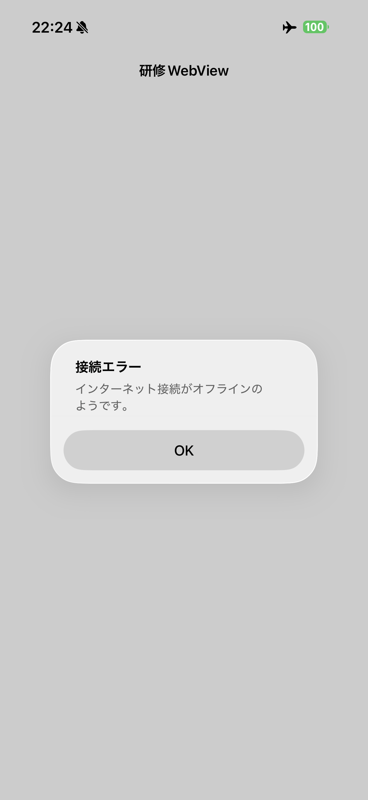
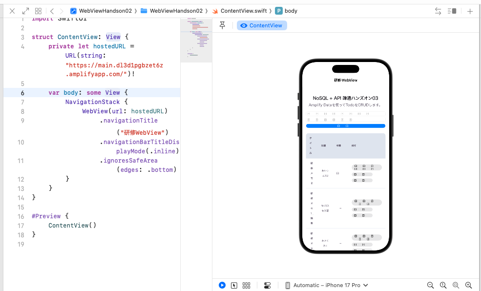
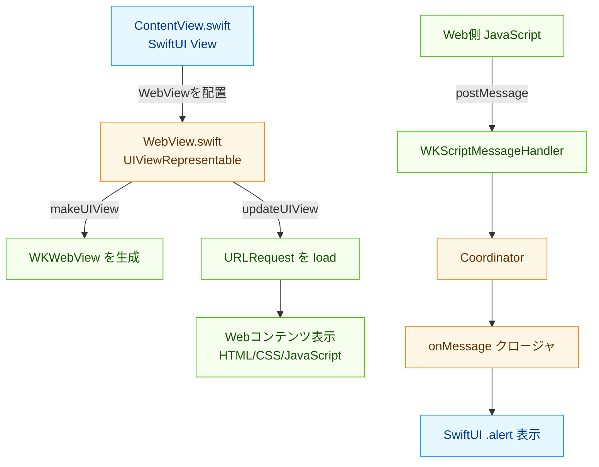

# ハンズオン 04: WebView双方向連携とエラーハンドリング

この資料は、全8回の学習事項のうち4つ目「WebView双方向連携とエラーハンドリング」のハンズオンです。

3回目（NoSQLの構築とAPI疎通）まで完了している前提で進めます。

## 1. この回のゴール

- iOSアプリからWebViewへクエリパラメータを渡せる
- Web側（React）でクエリパラメータを取得し、画面に反映できる
- Web側からiOS側へメッセージを送信できる（`WKScriptMessageHandler`）
- 通信失敗・不正メッセージ・画面遷移失敗時のエラーハンドリングを実装できる
- 次回以降の認証（Cognito）導入時に必要な「境界の責務」を説明できる

## 2. 前提条件

- ハンズオン01〜03が完了している
- 以下フォルダが存在する
	- `src/amplify-handson-01/web`
	- `src/WebViewHandson02`
- `volta run npx ampx sandbox` が実行可能で、NoSQL連携の画面が動作している
- Xcodeで `WebViewHandson02` をシミュレータ起動できる
- Amplify Hosting のURL（`https://...amplifyapp.com`）が利用可能

## 3. 進行タイムライン（目安: 90分）

- 0:00-0:10 イントロ・双方向連携の全体像
- 0:10-0:25 iOS → Web（クエリパラメータ受け渡し）
- 0:25-0:55 Web → iOS（JSメッセージ送信・受信）
- 0:55-1:15 エラーハンドリング実装（Web側/iOS側）
- 1:15-1:25 動作確認シナリオ実施
- 1:25-1:30 振り返り

## 4. ハンズオン手順

### Step 0: 作業ディレクトリを確認する

Web側:

```bash
cd ./src/amplify-handson-01/web
pwd
ls
```

iOS側:

```bash
cd ../WebViewHandson02
pwd
ls
```

確認ポイント:

- Web側に `src/App.jsx` がある
- iOS側に `WebViewHandson02/WebView.swift` と `WebViewHandson02/ContentView.swift` がある

---

### Step 1: iOSからWebへクエリパラメータを渡す

このStepでは、iOSアプリ起動時にWebViewへ次の情報を渡します。
- `from=ios`
- `trainee=Swift研修受講者`
- `session=04`
※ iOSから from / trainee / session をクエリとして渡す

編集対象:

- `src/WebViewHandson02/WebViewHandson02/ContentView.swift`

変更点の説明:

- `WebView` に渡す URL を、クエリ付きの `hostedURLWithQuery` に変える
- `onMessage` クロージャで Web → iOS の通知を受け取る
- 受信した値を SwiftUI の `.alert` で表示する

実装例:

```swift
import SwiftUI

struct ContentView: View {
    private let hostedBaseURL = URL(string: "https://main.dl3d1pgbzet6z.amplifyapp.com/")!

    // アラートの表示状態を @State で管理する
    @State private var alertTitle = ""
    @State private var alertMessage = ""
    @State private var isAlertPresented = false

    private var hostedURLWithQuery: URL {
        var components = URLComponents(url: hostedBaseURL, resolvingAgainstBaseURL: false)!
        components.queryItems = [
            URLQueryItem(name: "from",    value: "ios"),
            URLQueryItem(name: "trainee", value: "Swift研修受講者"),
            URLQueryItem(name: "session", value: "04"),
        ]
        return components.url ?? hostedBaseURL
    }

    var body: some View {
        NavigationStack {
            // onMessage クロージャで Web → iOS のメッセージを受け取る
            WebView(url: hostedURLWithQuery) { title, message in
                alertTitle   = title
                alertMessage = message
                isAlertPresented = true
            }
            .navigationTitle("研修WebView")
            .navigationBarTitleDisplayMode(.inline)
            .ignoresSafeArea(edges: .bottom)
            // UIAlertController の代わりに SwiftUI 標準の .alert を使う
            .alert(alertTitle, isPresented: $isAlertPresented) {
                Button("OK", role: .cancel) {}
            } message: {
                Text(alertMessage)
            }
        }
    }
}

#Preview {
    ContentView()
}
```

#### 期待結果:
- WebViewが `?from=ios&trainee=...&session=04` 付きURLで開く

#### 差分表示（ハンズオン04のStep0→Step1）:

```diff
@@
-    private let hostedURL = URL(string: "https://main.dl3d1pgbzet6z.amplifyapp.com/")!
+    private let hostedBaseURL = URL(string: "https://main.dl3d1pgbzet6z.amplifyapp.com/")!
+
+    @State private var alertTitle = ""
+    @State private var alertMessage = ""
+    @State private var isAlertPresented = false
+
+    private var hostedURLWithQuery: URL {
+        var components = URLComponents(url: hostedBaseURL, resolvingAgainstBaseURL: false)!
+        components.queryItems = [
+            URLQueryItem(name: "from", value: "ios"),
+            URLQueryItem(name: "trainee", value: "Swift研修受講者"),
+            URLQueryItem(name: "session", value: "04"),
+        ]
+        return components.url ?? hostedBaseURL
+    }
@@
-            WebView(url: hostedURL)
+            WebView(url: hostedURLWithQuery) { title, message in
+                alertTitle = title
+                alertMessage = message
+                isAlertPresented = true
+            }
             .navigationTitle("研修WebView")
             .navigationBarTitleDisplayMode(.inline)
             .ignoresSafeArea(edges: .bottom)
+            .alert(alertTitle, isPresented: $isAlertPresented) {
+                Button("OK", role: .cancel) {}
+            } message: {
+                Text(alertMessage)
+            }
```

---

### Step 2: Web側でクエリパラメータを受け取り表示する

編集対象:

- `src/amplify-handson-01/web/src/App.jsx`

実装方針:

- 既存のTodo CRUDはそのまま残す
- ページ上部に「受け取った連携情報」エリアを追加する

完全なコード例（`src/App.jsx`・Step2時点）:

```jsx
import { useEffect, useState } from 'react'
import { generateClient } from 'aws-amplify/data'
import { Hub } from 'aws-amplify/utils'
import TodoTable from './components/TodoTable'
import './App.css'

const client = generateClient()
const TABLE_REFRESH_INTERVAL_MS = 5000

function App() {
    const [todos, setTodos] = useState([])
    const [title, setTitle] = useState('')
    const [detail, setDetail] = useState('')
    const [editingTodoId, setEditingTodoId] = useState(null)
    const [editingTitle, setEditingTitle] = useState('')
    const [editingDetail, setEditingDetail] = useState('')

    // Step2追加: iOSから渡されたクエリを初期状態として保持する
    const [launchParams] = useState(() => {
        const params = new URLSearchParams(window.location.search)
        return {
            from: params.get('from') ?? '-',
            trainee: params.get('trainee') ?? '-',
            session: params.get('session') ?? '-',
        }
    })

    const loadTodos = async () => {
        const { data, errors } = await client.models.Todo.list({
            sortDirection: 'DESC',
        })

        if (errors) {
            console.error(errors)
            return
        }

        setTodos(data)
    }

    useEffect(() => {
        const initializeTodos = async () => {
            await loadTodos()
        }

        void initializeTodos()

        const intervalId = window.setInterval(() => {
            loadTodos()
        }, TABLE_REFRESH_INTERVAL_MS)

        const cancel = Hub.listen('api', () => {
            loadTodos()
        })

        return () => {
            window.clearInterval(intervalId)
            cancel()
        }
    }, [])

    useEffect(() => {
        if (!editingTodoId) return

        const previousOverflow = document.body.style.overflow
        document.body.style.overflow = 'hidden'

        return () => {
            document.body.style.overflow = previousOverflow
        }
    }, [editingTodoId])

    const createTodo = async (event) => {
        event.preventDefault()

        if (!title.trim()) return

        const { errors } = await client.models.Todo.create({
            title: title.trim(),
            detail: detail.trim(),
            isDone: false,
            priority: 0,
        })

        if (errors) {
            console.error(errors)
            return
        }

        setTitle('')
        setDetail('')
        await loadTodos()
    }

    const toggleTodo = async (todo) => {
        const { errors } = await client.models.Todo.update({
            id: todo.id,
            isDone: !todo.isDone,
        })

        if (errors) {
            console.error(errors)
            return
        }

        await loadTodos()
    }

    const startEditingTodo = (todo) => {
        setEditingTodoId(todo.id)
        setEditingTitle(todo.title ?? '')
        setEditingDetail(todo.detail ?? '')
    }

    const cancelEditingTodo = () => {
        setEditingTodoId(null)
        setEditingTitle('')
        setEditingDetail('')
    }

    const updateTodo = async (event) => {
        event.preventDefault()

        if (!editingTodoId || !editingTitle.trim()) return

        const { errors } = await client.models.Todo.update({
            id: editingTodoId,
            title: editingTitle.trim(),
            detail: editingDetail.trim(),
        })

        if (errors) {
            console.error(errors)
            return
        }

        cancelEditingTodo()
        await loadTodos()
    }

    const deleteTodo = async (id) => {
        const confirmed = window.confirm('このTodoを削除しますか？')

        if (!confirmed) return

        const { errors } = await client.models.Todo.delete({ id })

        if (errors) {
            console.error(errors)
            return
        }

        await loadTodos()
    }

    return (
        <main style={{ maxWidth: 720, margin: '40px auto', padding: '0 16px' }}>
            <h2>WebView双方向連携ハンズオン04</h2>
            <p>iOSから受け取ったクエリを表示し、TodoをCRUDします。</p>

            <section style={{ marginTop: 16, padding: 12, border: '1px solid #cbd5e1', borderRadius: 8 }}>
                <h3 style={{ marginTop: 0 }}>受け取った連携情報</h3>
                <p>from: {launchParams.from}</p>
                <p>trainee: {launchParams.trainee}</p>
                <p>session: {launchParams.session}</p>
            </section>

            <form onSubmit={createTodo} style={{ display: 'grid', gap: 8, marginTop: 20 }}>
                <input
                    value={title}
                    onChange={(e) => setTitle(e.target.value)}
                    placeholder='タイトル（必須）'
                />
                <input
                    value={detail}
                    onChange={(e) => setDetail(e.target.value)}
                    placeholder='詳細（任意）'
                />
                <button type='submit'>作成</button>
            </form>

            {editingTodoId && (
                <div
                    role='presentation'
                    onClick={cancelEditingTodo}
                    style={{
                        position: 'fixed',
                        inset: 0,
                        backgroundColor: 'rgba(15, 23, 42, 0.58)',
                        display: 'grid',
                        placeItems: 'center',
                        padding: 16,
                        zIndex: 50,
                    }}
                >
                    <div
                        role='dialog'
                        aria-modal='true'
                        aria-labelledby='edit-todo-title'
                        onClick={(event) => event.stopPropagation()}
                        style={{
                            width: 'min(100%, 560px)',
                            borderRadius: 20,
                            background: '#fff',
                            padding: 24,
                            boxShadow: '0 24px 80px rgba(15, 23, 42, 0.28)',
                        }}
                    >
                        <form onSubmit={updateTodo} style={{ display: 'grid', gap: 12 }}>
                            <div>
                                <h3 id='edit-todo-title' style={{ margin: 0 }}>
                                    選択中のTodoを編集
                                </h3>
                                <p style={{ margin: '8px 0 0', color: '#475569' }}>
                                    タイトルと詳細を更新できます。
                                </p>
                            </div>
                            <input
                                value={editingTitle}
                                onChange={(e) => setEditingTitle(e.target.value)}
                                placeholder='タイトル（必須）'
                            />
                            <input
                                value={editingDetail}
                                onChange={(e) => setEditingDetail(e.target.value)}
                                placeholder='詳細（任意）'
                            />
                            <div style={{ display: 'flex', gap: 8, justifyContent: 'flex-end' }}>
                                <button type='button' onClick={cancelEditingTodo}>
                                    キャンセル
                                </button>
                                <button type='submit'>更新</button>
                            </div>
                        </form>
                    </div>
                </div>
            )}

            <TodoTable
                todos={todos}
                onToggleTodo={toggleTodo}
                onStartEditingTodo={startEditingTodo}
                onDeleteTodo={deleteTodo}
            />
        </main>
    )
}

export default App
```

補足:

- Step3では、このコードに「iOSへメッセージ送信する関数」と送信ボタンを追加する。

差分だけ示す（ハンズオン04のStep1→Step2）:
- ここでの Step1 は、ハンズオン03最終時点と同等の `src/amplify-handson-01/web/src/App.jsx`（現行ベース）を指します。

```diff
@@
 function App() {
+  const [launchParams] = useState(() => {
+    const params = new URLSearchParams(window.location.search)
+    return {
+      from: params.get('from') ?? '-',
+      trainee: params.get('trainee') ?? '-',
+      session: params.get('session') ?? '-',
+    }
+  })
@@
     return (
         <main>
+      <section>
+        <h3>受け取った連携情報</h3>
+        <p>from: {launchParams.from}</p>
+        <p>trainee: {launchParams.trainee}</p>
+        <p>session: {launchParams.session}</p>
+      </section>
```

期待結果:

- iOSから渡した値がWeb画面に表示される

---

### Step 3: WebからiOSへメッセージ送信する

ここから双方向連携です。Web側で `window.webkit.messageHandlers.trainingBridge.postMessage(...)` を呼びます。

完全なコード例（`src/App.jsx`・Step3時点）:

```jsx
import { useEffect, useState } from 'react'
import { generateClient } from 'aws-amplify/data'
import { Hub } from 'aws-amplify/utils'
import TodoTable from './components/TodoTable'
import './App.css'

const client = generateClient()
const TABLE_REFRESH_INTERVAL_MS = 5000

function App() {
    const [todos, setTodos] = useState([])
    const [title, setTitle] = useState('')
    const [detail, setDetail] = useState('')
    const [editingTodoId, setEditingTodoId] = useState(null)
    const [editingTitle, setEditingTitle] = useState('')
    const [editingDetail, setEditingDetail] = useState('')

    const [launchParams] = useState(() => {
        const params = new URLSearchParams(window.location.search)
        return {
            from: params.get('from') ?? '-',
            trainee: params.get('trainee') ?? '-',
            session: params.get('session') ?? '-',
        }
    })

    // Step3追加: Web → iOS へメッセージ送信
    const sendMessageToIOS = (type, payload) => {
        try {
            if (!window.webkit?.messageHandlers?.trainingBridge) {
                window.alert('iOS連携ハンドラが見つかりません（ブラウザ表示時は想定内）')
                return
            }

            window.webkit.messageHandlers.trainingBridge.postMessage({
                type,
                payload,
                sentAt: new Date().toISOString(),
            })
        } catch (error) {
            console.error('postMessage失敗', error)
            window.alert('iOSへの送信に失敗しました')
        }
    }

    const loadTodos = async () => {
        const { data, errors } = await client.models.Todo.list({
            sortDirection: 'DESC',
        })

        if (errors) {
            console.error(errors)
            return
        }

        setTodos(data)
    }

    useEffect(() => {
        const initializeTodos = async () => {
            await loadTodos()
        }

        void initializeTodos()

        const intervalId = window.setInterval(() => {
            loadTodos()
        }, TABLE_REFRESH_INTERVAL_MS)

        const cancel = Hub.listen('api', () => {
            loadTodos()
        })

        return () => {
            window.clearInterval(intervalId)
            cancel()
        }
    }, [])

    useEffect(() => {
        if (!editingTodoId) return

        const previousOverflow = document.body.style.overflow
        document.body.style.overflow = 'hidden'

        return () => {
            document.body.style.overflow = previousOverflow
        }
    }, [editingTodoId])

    const createTodo = async (event) => {
        event.preventDefault()

        if (!title.trim()) return

        const { errors } = await client.models.Todo.create({
            title: title.trim(),
            detail: detail.trim(),
            isDone: false,
            priority: 0,
        })

        if (errors) {
            console.error(errors)
            return
        }

        setTitle('')
        setDetail('')
        await loadTodos()
    }

    const toggleTodo = async (todo) => {
        const { errors } = await client.models.Todo.update({
            id: todo.id,
            isDone: !todo.isDone,
        })

        if (errors) {
            console.error(errors)
            return
        }

        await loadTodos()
    }

    const startEditingTodo = (todo) => {
        setEditingTodoId(todo.id)
        setEditingTitle(todo.title ?? '')
        setEditingDetail(todo.detail ?? '')
    }

    const cancelEditingTodo = () => {
        setEditingTodoId(null)
        setEditingTitle('')
        setEditingDetail('')
    }

    const updateTodo = async (event) => {
        event.preventDefault()

        if (!editingTodoId || !editingTitle.trim()) return

        const { errors } = await client.models.Todo.update({
            id: editingTodoId,
            title: editingTitle.trim(),
            detail: editingDetail.trim(),
        })

        if (errors) {
            console.error(errors)
            return
        }

        cancelEditingTodo()
        await loadTodos()
    }

    const deleteTodo = async (id) => {
        const confirmed = window.confirm('このTodoを削除しますか？')

        if (!confirmed) return

        const { errors } = await client.models.Todo.delete({ id })

        if (errors) {
            console.error(errors)
            return
        }

        await loadTodos()
    }

    return (
        <main style={{ maxWidth: 720, margin: '40px auto', padding: '0 16px' }}>
            <h2>WebView双方向連携ハンズオン04</h2>
            <p>iOSから受け取ったクエリを表示し、TodoをCRUDします。</p>

            <section style={{ marginTop: 16, padding: 12, border: '1px solid #cbd5e1', borderRadius: 8 }}>
                <h3 style={{ marginTop: 0 }}>受け取った連携情報</h3>
                <p>from: {launchParams.from}</p>
                <p>trainee: {launchParams.trainee}</p>
                <p>session: {launchParams.session}</p>
            </section>

            <div style={{ display: 'flex', gap: 8, marginTop: 12 }}>
                <button
                    type='button'
                    onClick={() =>
                        sendMessageToIOS('OPEN_ALERT', {
                            title: 'Webから通知',
                            message: 'Todo画面からiOSへ通知しました',
                        })
                    }
                >
                    iOSに通知する
                </button>

                <button
                    type='button'
                    onClick={() => sendMessageToIOS('INVALID_PAYLOAD', 'これは不正ペイロード')}
                >
                    不正メッセージを送る（検証用）
                </button>
            </div>

            <form onSubmit={createTodo} style={{ display: 'grid', gap: 8, marginTop: 20 }}>
                <input
                    value={title}
                    onChange={(e) => setTitle(e.target.value)}
                    placeholder='タイトル（必須）'
                />
                <input
                    value={detail}
                    onChange={(e) => setDetail(e.target.value)}
                    placeholder='詳細（任意）'
                />
                <button type='submit'>作成</button>
            </form>

            {editingTodoId && (
                <div
                    role='presentation'
                    onClick={cancelEditingTodo}
                    style={{
                        position: 'fixed',
                        inset: 0,
                        backgroundColor: 'rgba(15, 23, 42, 0.58)',
                        display: 'grid',
                        placeItems: 'center',
                        padding: 16,
                        zIndex: 50,
                    }}
                >
                    <div
                        role='dialog'
                        aria-modal='true'
                        aria-labelledby='edit-todo-title'
                        onClick={(event) => event.stopPropagation()}
                        style={{
                            width: 'min(100%, 560px)',
                            borderRadius: 20,
                            background: '#fff',
                            padding: 24,
                            boxShadow: '0 24px 80px rgba(15, 23, 42, 0.28)',
                        }}
                    >
                        <form onSubmit={updateTodo} style={{ display: 'grid', gap: 12 }}>
                            <div>
                                <h3 id='edit-todo-title' style={{ margin: 0 }}>
                                    選択中のTodoを編集
                                </h3>
                                <p style={{ margin: '8px 0 0', color: '#475569' }}>
                                    タイトルと詳細を更新できます。
                                </p>
                            </div>
                            <input
                                value={editingTitle}
                                onChange={(e) => setEditingTitle(e.target.value)}
                                placeholder='タイトル（必須）'
                            />
                            <input
                                value={editingDetail}
                                onChange={(e) => setEditingDetail(e.target.value)}
                                placeholder='詳細（任意）'
                            />
                            <div style={{ display: 'flex', gap: 8, justifyContent: 'flex-end' }}>
                                <button type='button' onClick={cancelEditingTodo}>
                                    キャンセル
                                </button>
                                <button type='submit'>更新</button>
                            </div>
                        </form>
                    </div>
                </div>
            )}

            <TodoTable
                todos={todos}
                onToggleTodo={toggleTodo}
                onStartEditingTodo={startEditingTodo}
                onDeleteTodo={deleteTodo}
            />
        </main>
    )
}

export default App
```

補足:

- 通常ブラウザ（`localhost:5173`）では `window.webkit` が存在しないため、警告表示で正常
- iOS WebView上でのみネイティブハンドラに到達する

差分だけ示す（ハンズオン04のStep2→Step3）:

- 比較元の Step2 は、このページ内の「Step 2 完全なコード例（`src/App.jsx`・Step2時点）」を指します。

```diff
@@
 function App() {
+  // Step3追加: Web → iOS へメッセージ送信
+  const sendMessageToIOS = (type, payload) => {
+    try {
+      if (!window.webkit?.messageHandlers?.trainingBridge) {
+        window.alert('iOS連携ハンドラが見つかりません（ブラウザ表示時は想定内）')
+        return
+      }
+
+      window.webkit.messageHandlers.trainingBridge.postMessage({
+        type,
+        payload,
+        sentAt: new Date().toISOString(),
+      })
+    } catch (error) {
+      console.error('postMessage失敗', error)
+      window.alert('iOSへの送信に失敗しました')
+    }
+  }
@@
     return (
         <main>
+      <div style={{ display: 'flex', gap: 8, marginTop: 12 }}>
+        <button
+          type='button'
+          onClick={() =>
+            sendMessageToIOS('OPEN_ALERT', {
+              title: 'Webから通知',
+              message: 'Todo画面からiOSへ通知しました',
+            })
+          }
+        >
+          iOSに通知する
+        </button>
+
+        <button
+          type='button'
+          onClick={() => sendMessageToIOS('INVALID_PAYLOAD', 'これは不正ペイロード')}
+        >
+          不正メッセージを送る（検証用）
+        </button>
+      </div>
```

---

### Step 4: iOS側でWebメッセージを受信する

編集対象:

- `src/WebViewHandson02/WebViewHandson02/WebView.swift`

変更点の説明:

- `WKWebView` を SwiftUI に埋め込む `UIViewRepresentable` を用意する
- `Coordinator` を `@MainActor` 付きで実装し、Web からの通知を受ける
- `WKScriptMessageHandler` と `WKNavigationDelegate` を `Coordinator` にまとめる
- `dismantleUIView` でハンドラ登録を解除して後始末する

```diff
@@
 import SwiftUI
+@preconcurrency import WebKit

 struct WebView: UIViewRepresentable {
+    var onMessage: (String, String) -> Void
+    func makeCoordinator() -> Coordinator { Coordinator(onMessage: onMessage) }
+    @MainActor final class Coordinator: NSObject {}
 }
```

#### Swift 6 対応のポイント

| 対応箇所 | 方法 | 理由 |
| --- | --- | --- |
| `Coordinator` クラス | `@MainActor` を付与 | UI 更新をメインスレッドで型安全に保証する |
| WebKit import | `@preconcurrency import WebKit` を使う | WKWebKit の API はまだ Swift 6 の並行処理注釈が未付与のため |
| アラート表示 | コールバック方式（`onMessage`）に変更 | `UIApplication.shared` への直接アクセスを排除し、SwiftUI の `.alert` に委ねる |

実装例:

```swift
import SwiftUI
@preconcurrency import WebKit

// MARK: - WebView

struct WebView: UIViewRepresentable {
    let url: URL
    /// Web → iOS へのメッセージコールバック。引数は (タイトル, 本文)。
    var onMessage: (String, String) -> Void

    func makeCoordinator() -> Coordinator {
        Coordinator(onMessage: onMessage)
    }

    func makeUIView(context: Context) -> WKWebView {
        let userContentController = WKUserContentController()
        userContentController.add(context.coordinator, name: "trainingBridge")

        let configuration = WKWebViewConfiguration()
        configuration.userContentController = userContentController

        let webView = WKWebView(frame: .zero, configuration: configuration)
        webView.navigationDelegate = context.coordinator
        webView.allowsBackForwardNavigationGestures = true
        return webView
    }

    func updateUIView(_ uiView: WKWebView, context: Context) {
        // URLが変わったときだけ読み込む（不要な再読み込みを防ぐ）
        guard uiView.url != url else { return }
        uiView.load(URLRequest(url: url))
    }

    static func dismantleUIView(_ uiView: WKWebView, coordinator: Coordinator) {
        // WebView 破棄時にハンドラを解放してメモリリークを防ぐ
        uiView.configuration.userContentController
            .removeScriptMessageHandler(forName: "trainingBridge")
    }

    // MARK: - Coordinator

    /// UIKit/WebKit デリゲートをまとめるクラス。
    /// @MainActor を付けることで、コールバック呼び出しをメインスレッドで保証する。
    @MainActor
    final class Coordinator: NSObject {
        private let onMessage: (String, String) -> Void

        init(onMessage: @escaping (String, String) -> Void) {
            self.onMessage = onMessage
        }
    }
}

// MARK: - WKScriptMessageHandler（Web → iOS 受信）

// WebKit 側の並行処理注釈が未整備なため、import 側で @preconcurrency を付ける
extension WebView.Coordinator: WKScriptMessageHandler {
    func userContentController(
        _ userContentController: WKUserContentController,
        didReceive message: WKScriptMessage
    ) {
        guard message.name == "trainingBridge" else { return }

        // body が辞書型かつ type が文字列であることを確認する
        guard let body = message.body as? [String: Any],
              let type = body["type"] as? String else {
            onMessage("受信エラー", "メッセージ形式が不正です")
            return
        }

        switch type {
        case "OPEN_ALERT":
            let payload = body["payload"] as? [String: Any]
            let title   = payload?["title"]   as? String ?? "Web通知"
            let text    = payload?["message"] as? String ?? "メッセージを受信しました"
            onMessage(title, text)
        default:
            onMessage("未対応メッセージ", "type=\(type) は未対応です")
        }
    }
}

// MARK: - WKNavigationDelegate（読み込みエラー検知）

extension WebView.Coordinator: WKNavigationDelegate {
    /// ページ読み込み中のエラー（例: ネットワーク切断）
    func webView(_ webView: WKWebView, didFail navigation: WKNavigation!, withError error: Error) {
        onMessage("読み込み失敗", error.localizedDescription)
    }

    /// 接続開始前のエラー（例: ホスト名解決失敗、URL 不正）
    func webView(
        _ webView: WKWebView,
        didFailProvisionalNavigation navigation: WKNavigation!,
        withError error: Error
    ) {
        onMessage("接続エラー", error.localizedDescription)
    }
```

- 「不正メッセージを送る」を押すと、受信エラーまたは未対応メッセージとして通知される

差分だけ示す（ハンズオン04のStep3→Step4）:

- 比較元の Step3 は、このページ内の Step3終了時点の `src/WebViewHandson02/WebViewHandson02/WebView.swift` を指します。

```diff
@@
 import SwiftUI
-import WebKit
+@preconcurrency import WebKit
@@
 struct WebView: UIViewRepresentable {
     let url: URL
+    /// Web → iOS へのメッセージコールバック。引数は (タイトル, 本文)。
+    var onMessage: (String, String) -> Void
+
+    func makeCoordinator() -> Coordinator {
+        Coordinator(onMessage: onMessage)
+    }
@@
     func makeUIView(context: Context) -> WKWebView {
-        let webView = WKWebView(frame: .zero)
+        let userContentController = WKUserContentController()
+        userContentController.add(context.coordinator, name: "trainingBridge")
+
+        let configuration = WKWebViewConfiguration()
+        configuration.userContentController = userContentController
+
+        let webView = WKWebView(frame: .zero, configuration: configuration)
+        webView.navigationDelegate = context.coordinator
         webView.allowsBackForwardNavigationGestures = true
         return webView
     }
@@
     func updateUIView(_ uiView: WKWebView, context: Context) {
-        let request = URLRequest(url: url)
-        uiView.load(request)
+        if uiView.url != url {
+            uiView.load(URLRequest(url: url))
+        }
     }
+
+    static func dismantleUIView(_ uiView: WKWebView, coordinator: Coordinator) {
+        // WebView 破棄時にハンドラを解放してメモリリークを防ぐ
+        uiView.configuration.userContentController
+            .removeScriptMessageHandler(forName: "trainingBridge")
+    }
+
+    @MainActor
+    final class Coordinator: NSObject {
+        private let onMessage: (String, String) -> Void
+
+        init(onMessage: @escaping (String, String) -> Void) {
+            self.onMessage = onMessage
+        }
+    }
 }
+
+extension WebView.Coordinator: WKScriptMessageHandler {
+    func userContentController(
+        _ userContentController: WKUserContentController,
+        didReceive message: WKScriptMessage
+    ) {
+        guard message.name == "trainingBridge" else { return }
+        guard let body = message.body as? [String: Any],
+              let type = body["type"] as? String else {
+            onMessage("受信エラー", "メッセージ形式が不正です")
+            return
+        }
+
+        switch type {
+        case "OPEN_ALERT":
+            let payload = body["payload"] as? [String: Any]
+            let title   = payload?["title"]   as? String ?? "Web通知"
+            let text    = payload?["message"] as? String ?? "メッセージを受信しました"
+            onMessage(title, text)
+        default:
+            onMessage("未対応メッセージ", "type=\(type) は未対応です")
+        }
+    }
+}
+
+extension WebView.Coordinator: WKNavigationDelegate {
+    func webView(_ webView: WKWebView, didFail navigation: WKNavigation!, withError error: Error) {
+        onMessage("読み込み失敗", error.localizedDescription)
+    }
+
+    func webView(
+        _ webView: WKWebView,
+        didFailProvisionalNavigation navigation: WKNavigation!,
+        withError error: Error
+    ) {
+        onMessage("接続エラー", error.localizedDescription)
+    }
+}
```

---

### Step 5: Web側のエラー表示を追加する

既存のCRUD処理では `console.error` のみになっている箇所があるため、ユーザーにも見えるエラー表示を追加します。

`App.jsx` 追加例:

```jsx
const [uiError, setUiError] = useState('')

const safeExecute = async (fn, fallbackMessage) => {
	try {
		setUiError('')
		await fn()
	} catch (error) {
		console.error(error)
		setUiError(fallbackMessage)
	}
}
```

表示例:

```jsx
{uiError ? (
	<p style={{ color: '#b91c1c', background: '#fee2e2', padding: 8, borderRadius: 6 }}>
		{uiError}
	</p>
) : null}
```

使い方例:

- `createTodo`, `updateTodo`, `deleteTodo`, `loadTodos` の非同期処理を `safeExecute` 経由に置き換える

差分だけ示す（ハンズオン04のStep4→Step5）:

- 比較元の Step4 は、このページ内の Step4終了時点の `src/amplify-handson-01/web/src/App.jsx` を指します。

```diff
@@
 function App() {
+  const [uiError, setUiError] = useState('')
@@
+  const safeExecute = async (fn, fallbackMessage) => {
+    try {
+      setUiError('')
+      await fn()
+    } catch (error) {
+      console.error(error)
+      setUiError(fallbackMessage)
+    }
+  }
@@
    const loadTodos = async () => {
-    const { data, errors } = await client.models.Todo.list({
-      sortDirection: 'DESC',
-    })
-
-    if (errors) {
-      console.error(errors)
-      return
-    }
-
-    setTodos(data)
+    await safeExecute(async () => {
+      const { data, errors } = await client.models.Todo.list({
+        sortDirection: 'DESC',
+      })
+
+      if (errors) {
+        throw new Error('Todo一覧の取得に失敗しました')
+      }
+
+      setTodos(data)
+    }, 'Todo一覧の取得に失敗しました')
    }
@@
    const createTodo = async (event) => {
      event.preventDefault()

      if (!title.trim()) return
@@
-    const { errors } = await client.models.Todo.create({
-      title: title.trim(),
-      detail: detail.trim(),
-      isDone: false,
-      priority: 0,
-    })
-
-    if (errors) {
-      console.error(errors)
-      return
-    }
-
-    setTitle('')
-    setDetail('')
-    await loadTodos()
+    await safeExecute(async () => {
+      const { errors } = await client.models.Todo.create({
+        title: title.trim(),
+        detail: detail.trim(),
+        isDone: false,
+        priority: 0,
+      })
+
+      if (errors) {
+        throw new Error('Todoの作成に失敗しました')
+      }
+
+      setTitle('')
+      setDetail('')
+      await loadTodos()
+    }, 'Todoの作成に失敗しました')
    }
@@
      return (
            <main>
+      {uiError ? (
+        <p style={{ color: '#b91c1c', background: '#fee2e2', padding: 8, borderRadius: 6 }}>
+          {uiError}
+        </p>
+      ) : null}
 ```

期待結果:

- API失敗時に画面上で失敗理由を把握できる
- 「コンソールを開かないと気づけない」状態を避けられる

---

### Step 6: デプロイとiOS再確認

Web側変更を反映するため、再ビルドしてHostingに再デプロイします。

```bash
cd ./src/amplify-handson-01/web
volta run npm run build
cd dist && zip -r ../dist.zip . && cd ..
ls -l dist.zip
```

その後、Amplify Hostingへ `dist.zip` をアップロードし、iOSアプリを再起動して確認します。

確認シナリオ:

1. iOSで画面起動後、`from/trainee/session` が表示される

2. 「iOSに通知する」でネイティブアラート表示

3. 「不正メッセージを送る」で未対応メッセージのネイティブアラートが表示される

4. ネットワーク切断時に接続エラーまたは読み込み失敗のネイティブアラートが表示される

- ※ネットワークを切断してから再起動して確認する
---

## 5. 解説

### 5-1. 双方向連携の責務分離

- iOS側の責務
	- WebViewの生成
	- 受信ハンドラ登録
	- 受信データの妥当性検証
	- `onMessage` コールバックを通じたアラート表示（SwiftUI の `.alert`）
- Web側の責務
	- パラメータ表示
	- ユーザー操作起点でのメッセージ送信
	- 送信失敗時のフォールバック表示

#### Swift 6 対応について初心者向け補足

- **`@MainActor`** — 「このクラスの処理は常にメインスレッドで実行する」という宣言。`UILabel` の変更など UI 操作はメインスレッドからしか行ってはいけないので、`Coordinator` 全体に付けることで詴やかに保証できる。
- **`@preconcurrency`** — Apple の SDK（WKWebKit 等）は Swift 6 の並行処理注釈がまだ一部未付与。`@preconcurrency import WebKit` と書くことで、関連警告を抑えつつ将来のSDK更新に追従しやすくなる。

### 5-2. なぜメッセージ形式を固定するのか

- `type` と `payload` を固定すると、拡張時に破壊的変更を減らせる
- 次回以降で認証情報や画面遷移指示を扱う際にも流用しやすい

推奨フォーマット:

```json
{
	"type": "OPEN_ALERT",
	"payload": {
		"title": "Webから通知",
		"message": "Todo画面からiOSへ通知しました"
	},
	"sentAt": "2026-06-08T00:00:00.000Z"
}
```

### 5-3. エラーハンドリングの基本方針

- 失敗を握りつぶさない
- ユーザー向けメッセージと開発者向けログを分離する
- 「再実行で回復可能か」を明示する

---

## 6. つまずきポイントと対処

### 6-1. Webから送ってもiOSで受信できない

- `trainingBridge` のハンドラ名がWebとiOSで一致しているか確認
- `WKWebViewConfiguration` に `userContentController` を設定しているか確認
- `makeUIView` で `userContentController.add(context.coordinator, ...)` を呈びているか確認
- `WebView` の初期化時に `onMessage` クロージャを渡しているか確認（`ContentView` 側）
- シミュレータを再起動してキャッシュをクリアする

### 6-2. ブラウザで `window.webkit` が `undefined`

- 正常動作（iOS WebView外では存在しない）
- ガード文でフォールバックメッセージを出す

### 6-3. クエリパラメータが文字化けする

- `URLComponents` と `URLQueryItem` を使って生成しているか確認
- 手書きのURL連結（文字列結合）を避ける

### 6-4. アラートが二重表示される

- `updateUIView` が複数回呼ばれることを考慮し、同じURL再読込を抑制する
- 必要に応じて、前回URLと比較して `load` を制御する

### 6-5. 読み込み失敗エラーの再現ができない

- シミュレータのネットワークをオフ
- 存在しないサブドメインを指定
- 一時的にURLを `https://example.invalid` に変更して挙動確認

### 6-6. `Extra trailing closure passed in call` が出る

主な原因:

- `ContentView` 側で `WebView(url: ...) { title, message in ... }` と trailing closure を渡している
- しかし `WebView` 側の定義が `let url: URL` のみで、`onMessage` クロージャを受け取らない

対処:

- 双方向連携を使う場合
    - `WebView` に `var onMessage: (String, String) -> Void` を追加する
    - `makeCoordinator()` と `Coordinator(onMessage:)` を実装し、`WKScriptMessageHandler` で `onMessage` を呼ぶ
- 単純なWeb表示だけでよい場合
    - `ContentView` 側の trailing closure を削除し、`WebView(url: hostedURLWithQuery)` のみを呼ぶ

確認ポイント:

- `WebView` 初期化と定義の引数数が一致していること
- 修正後に `ContentView.swift` / `WebView.swift` のエラーが消えること

## 7. 成果物チェックリスト

- [ ] iOSからWebへクエリパラメータを渡せた
- [ ] Web画面で受け取った値を表示できた
- [ ] WebからiOSへ `postMessage` で通知できた
- [ ] 不正メッセージをiOS側で検知できた
- [ ] 読み込み失敗時のアラート表示を確認できた
- [ ] 双方向連携の責務分離を説明できる

## 8. この回のまとめ

- WebView連携は「URLで初期値を渡す」「メッセージでイベント連携する」の2段構成で考えると整理しやすい
- エラーハンドリングは、正常系実装と同時に入れると後工程のデバッグ負荷を減らせる
- 次回の認証導入時は、このメッセージ基盤を使ってログイン状態連携へ発展できる

## 9. 講師メモ

- 受講者が詰まりやすいのは「iOSでしか `window.webkit` が動かない」点
- 先にブラウザ検証を行い、iOS固有処理はガード付きで実装させると進行が安定する
- 余裕があれば、`type` を増やして `OPEN_TODO_DETAIL` などの拡張課題に進める

## 10. 基礎知識: Swiftソースの読み方

ここでは、WebViewハンズオンで使う3ファイルの役割と構造を、初心者向けに整理します。

### 10-1. `ContentView.swift`

#### 役割

- 画面レイアウトを組み立てる「親ビュー」
- どのWeb URLを表示するかを決めて `WebView` に渡す
- タイトル表示や余白調整など、見た目の設定を担当する

#### ファイルの構造

1. `struct ContentView: View`
    - SwiftUI画面の定義本体
2. URL定義（例: `hostedURL`）
    - 読み込むWebページのURL
3. `var body: some View`
    - `NavigationStack` の中に `WebView(url: ...)` を配置
    - `.navigationTitle(...)` などの修飾子で画面を整える
4. `#Preview`
    - Xcodeのプレビュー表示用
      - 1. メニューで Editor > Canvas をオン
      - 2. 右側Canvasの Resume を押す
      - 3. プレビューが表示される
    


```swift
import SwiftUI

struct ContentView: View {
    private let hostedURL = URL(string: "https://main.dl3d1pgbzet6z.amplifyapp.com/")!

    var body: some View {
        NavigationStack {
            WebView(url: hostedURL)
                .navigationTitle("研修WebView")
                .navigationBarTitleDisplayMode(.inline)
                .ignoresSafeArea(edges: .bottom)
        }
    }
}

#Preview {
    ContentView()
}

```

#### 各修飾子の内容（`ContentView`）

| 修飾子 | 何をするか | この教材での意味 |
| --- | --- | --- |
| `.navigationTitle("研修WebView")` | ナビゲーションバーのタイトル文字列を設定する | 画面上部に「今どの画面か」を明示する |
| `.navigationBarTitleDisplayMode(.inline)` | タイトルの表示サイズ・配置を指定する | 大きいタイトルではなく、コンパクトな1行タイトルに固定する |
| `.ignoresSafeArea(edges: .bottom)` | Safe Area の制約を無視して描画範囲を広げる | 下端（ホームインジケータ付近）までWebViewを広げ、表示領域を最大化する |

補足（双方向連携版で使う修飾子）:

- `.alert(title, isPresented: $flag) { ... } message: { ... }`
    - 役割: 条件が `true` のときにアラートを表示する
    - この教材での意味: Web→iOSメッセージ受信時の通知を、UIKitではなくSwiftUI標準機能で表示する

---

### 10-2. `WebView.swift`

#### SwiftUIとUIKitとは

- SwiftUI
    - Appleが提供する宣言的UIフレームワーク
    - 「どんな見た目にしたいか」を宣言すると、状態変化に合わせて自動で再描画される
    - `View` 構造体や修飾子（`.navigationTitle` など）を組み合わせて画面を作る
- UIKit
    - 従来から使われている命令的UIフレームワーク
    - `UIViewController` / `UIView` を中心に、画面更新を手続き的に制御する
    - `WKWebView` など、成熟した部品が豊富にある

#### 「宣言的」と「命令的」を直感的に理解する

- 宣言的（SwiftUI）
  - 例え: 「最終的にこういう料理にしたい」と完成形を伝えるイメージ
  - 特徴: 状態が変わると、必要な見た目更新をフレームワーク側が面倒を見てくれる
- 命令的（UIKit）
  - 例え: 「包丁で切って、鍋で炒めて、皿に盛る」と手順を1つずつ指示するイメージ
  - 特徴: いつ・どこを・どう更新するかを自分で明示的に書く

ミニコード比較:

```swift
// 宣言的（SwiftUI）: 画面の「あるべき姿」を書く
Text(isLoggedIn ? "ログイン中" : "未ログイン")
```

```swift
// 命令的（UIKit）: 画面更新の手順を都度書く
if isLoggedIn {
    statusLabel.text = "ログイン中"
} else {
    statusLabel.text = "未ログイン"
}
```

ポイント:

- 宣言的は「結果中心（What）」
- 命令的は「手順中心（How）」
- 今回は、画面全体はSwiftUI（宣言的）、Web表示コアはUIKit（命令的）を組み合わせて使っている

この教材での関係:

- 画面全体のレイアウトは SwiftUI（`ContentView`）で組む
- Web表示本体は UIKit の `WKWebView` を使う
- `UIViewRepresentable` を使って、UIKit部品をSwiftUIの中に埋め込む

つまり、`WebView.swift` は **SwiftUI（新しいUI記法）とUIKit（Web表示部品）をつなぐアダプタ** の役割を担います。

#### 図: SwiftUI → UIViewRepresentable → WKWebView の流れ



見方:

- 図の左側が「**画面表示の流れ**」（SwiftUIからWeb描画まで）
- 図の右側が「**双方向連携の戻り経路**」（WebイベントがiOS UIへ戻る流れ）

#### 役割

- SwiftUIとUIKitの橋渡し
- `WKWebView` を生成して、実際にWebページを読み込む
- 必要に応じて、Webからのメッセージ受信や読み込みエラー検知を行う

#### ファイルの構造

1. `struct WebView: UIViewRepresentable`
    - UIKitのViewをSwiftUIに組み込むための型
2. `makeUIView(context:)`
    - `WKWebView` を生成する（初期化処理）
3. `updateUIView(_:context:)`
    - URL変更時などに再読み込みする（更新処理）
4. （拡張時）`Coordinator`
    - `WKScriptMessageHandler` / `WKNavigationDelegate` の受け口
    - Web→iOSメッセージやエラー通知を処理する

#### 修飾子ではないが重要なAPI（`WebView.swift`）

| API | いつ呼ばれるか | 何をするか | 実装のポイント |
| --- | --- | --- | --- |
| `makeUIView(context:)` | SwiftUIが `WebView` を初回表示するとき | `WKWebView` インスタンスを生成して返す | 初期設定（ジェスチャ有効化、delegate設定、message handler登録）をここで行う |
| `updateUIView(_:context:)` | 状態変更でSwiftUIがViewを更新するとき | 既存 `WKWebView` に新しい内容を反映する | 毎回 `load()` すると無駄な再読み込みになるため、URL比較で必要時のみ読み込む |
| `dismantleUIView(_:coordinator:)` | 画面破棄・差し替え時 | 生成済みUIViewの後片付けを行う | `removeScriptMessageHandler` で登録を解除し、リークや重複通知を防ぐ |

補足:

- `makeUIView` は「作成」、`updateUIView` は「更新」、`dismantleUIView` は「破棄時クリーンアップ」の役割分担と覚えると理解しやすい。
- 双方向連携を入れる場合、登録は `makeUIView`、解除は `dismantleUIView` に対で書くのが基本。

```swift
import SwiftUI
import WebKit

struct WebView: UIViewRepresentable {
    let url: URL

    func makeUIView(context: Context) -> WKWebView {
        let webView = WKWebView(frame: .zero)
        webView.allowsBackForwardNavigationGestures = true
        return webView
    }

    func updateUIView(_ uiView: WKWebView, context: Context) {
        let request = URLRequest(url: url)
        uiView.load(request)
    }
}
```

---

### 10-3. `WebViewHandson02App.swift`

補足:
- 質問文の `WebViewHandson02.swift` は、現在のプロジェクト構成では `WebViewHandson02App.swift` を指します。

#### 役割

- アプリの起動地点（エントリーポイント）
- 最初に表示する画面を `ContentView()` に決める

#### ファイルの構造

1. `@main`
    - この型がアプリの開始点であることを示す
2. `struct WebViewHandson02App: App`
    - アプリ全体の設定
3. `var body: some Scene`
    - `WindowGroup` を作り、その中で `ContentView()` を表示

---

### 10-4. Webコンテンツを表示するしくみ

Web表示は、次の順で動作します。

1. アプリ起動
    - `WebViewHandson02App.swift` が起動し、`ContentView` を表示する
2. 画面構築
    - `ContentView.swift` が `WebView(url: ...)` を配置する
3. WebView生成
    - `WebView.swift` の `makeUIView` で `WKWebView` を作る
4. URL読み込み
    - `updateUIView` で `URLRequest` を作成し、`webView.load(request)` を実行する
5. レンダリング
    - `WKWebView` がHTML/CSS/JavaScriptを取得して画面に描画する

#### 双方向連携まで含めた場合の流れ

- iOS → Web
  - URLクエリ（例: `?from=ios`）を付けて初期値を渡す
- Web → iOS
  - `window.webkit.messageHandlers.trainingBridge.postMessage(...)` で通知する
  - iOS側の `WKScriptMessageHandler` で受信し、SwiftUIのアラート表示などに繋ぐ

#### 初心者向けの覚え方

- `App` ファイル: 「どの画面から始めるか」
- `ContentView`: 「画面をどう並べるか」
- `WebView`: 「Webをどう読み込むか」

この3層に分けて考えると、修正箇所を迷いにくくなります。