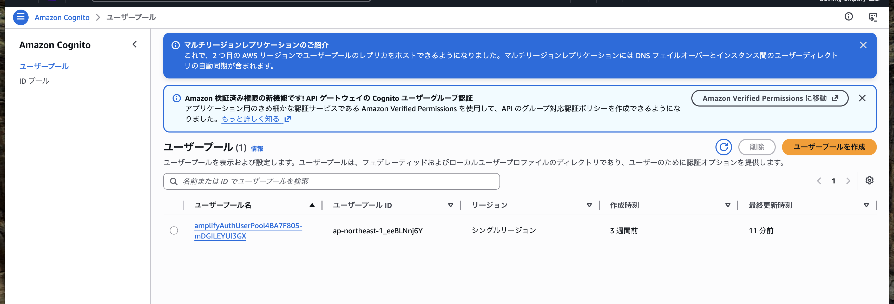
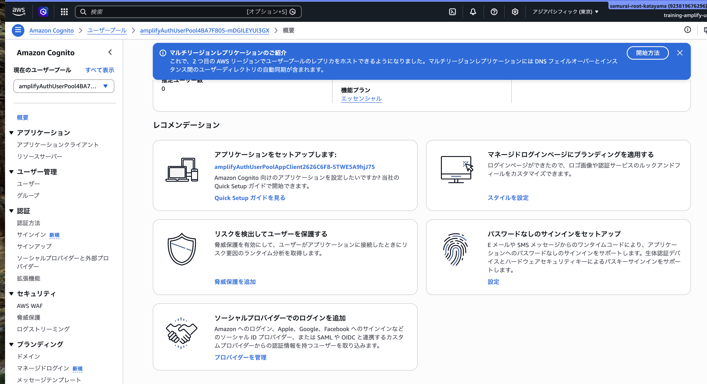
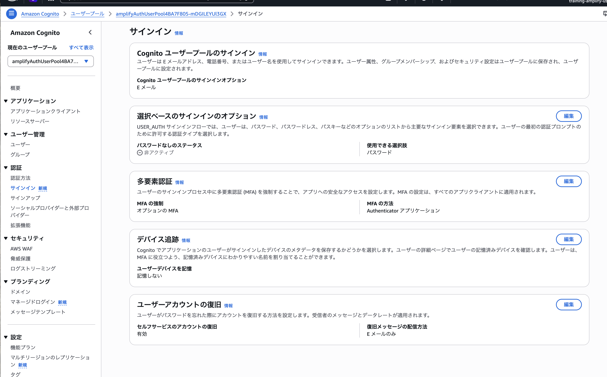

# ハンズオン 05: 高度な認証基盤とMFA設定

この資料は、全8回の学習事項のうち5つ目「高度な認証基盤とMFA設定」のハンズオン下書きです。

4回目（WebView双方向連携とエラーハンドリング）まで完了している前提で進めます。

## 1. この回のゴール

- Amplify Gen 2で認証基盤（Cognito）を構成できる
- Emailを使った検証コード確認フローを理解できる
- MFAの有効化方針（必須/任意）と設定差分を説明できる
- 次回のログイン画面実装に向けたバックエンド前提を整えられる

## 2. 前提条件

- ハンズオン01〜04が完了している
- 以下フォルダが存在する
  - src/amplify-handson-01/web
- AWSコンソールにログインできる
- ローカルでNode.js / npm / Voltaが利用できる
- amplify/auth/resource.ts が存在する（初期のemailログイン設定）

## 3. 進行タイムライン（目安: 90分）

- 0:00-0:10 イントロ・認証の全体像
- 0:10-0:30 認証設定の確認と方針整理（MFA必須/任意）
- 0:30-0:55 Amplify Auth設定の更新
- 0:55-1:15 Sandbox反映・Cognitoコンソール確認
- 1:15-1:25 検証コードフローの動作確認
- 1:25-1:30 振り返り

## 4. ハンズオン手順

### Step 0: 作業ディレクトリへ移動

```bash
cd ./src/amplify-handson-01/web
pwd
ls
```

確認ポイント:

- amplify/ がある
- amplify/auth/resource.ts がある
- amplify_outputs.json がある

---

### Step 1: いまの認証設定を確認する

編集対象:

- amplify/auth/resource.ts
- amplify/backend.ts

確認観点:
- amplify/auth/resource.ts
  - loginWith.email が true になっているか
- amplify/backend.ts
  - auth が定義されているか
  - data リソースとの同居構成になっているか

解説:

- この時点では「メールアドレスでサインインできる土台」がある
- ここへMFAポリシーを追加して、認証強度を上げる

---

### Step 2: MFA方針を決める

研修では、次の2パターンを比較して理解します。

- パターンA（推奨）: OPTIONAL
  - 学習時に詰まりにくく、段階的に検証しやすい
  - 今回実施するパターン
- パターンB（セキュリティ重視）: REQUIRED
  - すべてのユーザーに追加認証を要求する

補足:

- 「サインアップ時のメール検証コード」は本人確認
- 「サインイン時のMFAコード」は追加認証
- 目的が異なるため、分けて説明する

---

### Step 3: Sandboxを起動する

次のStepでファイル変更を自動反映させるため、先にSandboxを起動します。

```bash
volta run npx ampx sandbox
```

確認ポイント:

- 初回起動時のログ例:
  ```
  ✔ Backend synthesized
  ✔ Type checks completed
  ✔ Built and published assets
  ✔ Deployment completed
  AppSync API endpoint = https://...
  [Sandbox] Watching for file changes...
  File written: amplify_outputs.json
  ```
- エラーなくデプロイ完了する
- `amplify_outputs.json` が生成される（webディレクトリ直下）
- `[Sandbox] Watching for file changes...` が表示され、待機状態になる

補足:

- このターミナルは開いたままにする
- 次のStepは別ターミナルで作業する
- 停止する場合は Ctrl + C

---

### Step 4: AuthリソースにMFA設定を追加する

編集対象:

- amplify/auth/resource.ts

例（下書き）:

```ts
import { defineAuth } from '@aws-amplify/backend';

export const auth = defineAuth({
  loginWith: {
    email: true,
  },
  multifactor: {
    mode: 'OPTIONAL',
    totp: true,
  },
});
```

運用メモ:

- 研修ではまず OPTIONAL で進め、理解後に REQUIRED へ切り替えると差分が追いやすい
- REQUIRED にする場合は mode を REQUIRED に変更する

期待結果:

- 保存後、Step 3で起動したSandboxターミナルに差分デプロイログが表示される:
  ```
  [Sandbox] Triggered due to a file update event: amplify/auth/resource.ts
  ✔ Backend synthesized in 0.4 seconds
  ✔ Type checks completed in 5.04 seconds
  ✔ Built and published assets
  ✔ Deployment completed in 53.732 seconds
  AppSync API endpoint = https://...
  [Sandbox] Watching for file changes...
  File written: amplify_outputs.json
  ```
- エラーなくデプロイ完了する
- `amplify_outputs.json` が自動更新され、以下の項目が追加される:
  ```json
  {
    "auth": {
      "mfa_methods": [
        "TOTP"
      ],
      "mfa_configuration": "OPTIONAL",
      // ... その他の認証設定
    }
  }
  ```
  - `mfa_methods`: TOTP（時間ベースのワンタイムパスワード）が利用可能
  - `mfa_configuration`: MFAがOPTIONAL（任意）に設定されている

---

### Step 5: Cognitoコンソールで設定を確認する

#### 5-1. 対象のUser Pool IDを確認する

```bash
cat amplify_outputs.json | grep user_pool_id
```

期待結果:
```json
"user_pool_id": "ap-northeast-1_eeBLNnj6Y",
```

このIDをメモする。

#### 5-2. Cognitoコンソールで確認する

1. AWSコンソールで **Cognito** サービスを開く
   - 検索バーに「Cognito」と入力して選択
   - リージョンを`東京`に変更
2. 左メニューから **ユーザープール** を選択
  
3. 一覧から、5-1で確認したUser Pool IDと一致するプールを探す
   - 例: `ap-northeast-1_eeBLNnj6Y`
   - 複数ある場合は、IDで絞り込む
4. 該当するUser Poolをクリックして詳細を開く
  

#### 5-3. MFA設定を確認する

1. User Pool詳細画面の左メニューから **サインイン** を選択
   - または **認証** → **多要素認証** の順に選択
  
2. **多要素認証（MFA）** セクションで以下を確認
   - **MFAの実施**: **オプション** になっていることを確認
   - **MFA方法**: **Authenticator アプリケーション** が有効になっていることを確認

確認観点:

以下の3つが一致していることを確認する：

| 項目 | コード（resource.ts） | amplify_outputs.json | Cognitoコンソール |
|------|---------------------|---------------------|------------------|
| MFA実施方針 | `mode: 'OPTIONAL'` | `"mfa_configuration": "OPTIONAL"` | **MFAの実施: オプション** |
| MFA方法 | `totp: true` | `"mfa_methods": ["TOTP"]` | **Authenticator アプリケーション** |

- 3つすべてが整合していれば、設定が正しく反映されている
- 不一致がある場合は、Sandboxログを確認してデプロイエラーがないか確認する

---

### Step 6: この回で完了した内容の確認

この回では、MFA設定を含む認証基盤の構築を完了しました。以下を確認します：

#### 6-1. バックエンド設定の確認

以下3箇所で設定が一致していることを再確認：

1. **コード**: `amplify/auth/resource.ts` に `multifactor` 設定が追加されている
2. **設定ファイル**: `amplify_outputs.json` に `mfa_methods` と `mfa_configuration` が含まれている
3. **AWSコンソール**: Cognitoで「MFAの実施: オプション」「Authenticator アプリケーション」が有効

#### 6-2. 認証フローの整理

次回のログイン実装に向けて、認証フローを整理する：

```
【サインアップフロー】
1. ユーザーがメールアドレスとパスワードを入力
2. Cognitoにユーザー登録
3. 登録したメールアドレスに検証コードが送信される
4. ユーザーが6桁の検証コードを入力
5. メールアドレスが確認され、アカウントが有効化される

【サインインフロー（MFA: OPTIONAL の場合）】
1. ユーザーがメールアドレスとパスワードを入力
2. Cognitoで認証
3. （MFA未設定の場合）そのままサインイン完了
4. （MFA設定済みの場合）TOTPコードの入力を要求
5. 認証済みセッション確立
```

補足:
- この回ではバックエンド設定のみ完了
- 次回（6回目）で、上記フローを実装する画面を構築する

---

次回（6回目：ログインフローと擬似OTP）で扱う実装:

- Amplify UIでのログイン画面構築
- コード入力UI（6桁）
- ログイン状態の保持確認

## 5. つまずきポイントと対処

### 5-1. SandboxでAuth更新エラーが出る

- resource.ts の構文エラーがないか確認
- mode の値が正しいか確認（OPTIONAL / REQUIRED）
- 一度 Ctrl + C で停止し、再度 sandbox を起動する

### 5-2. Cognitoに設定が反映されない

- 正しいAWSアカウントで作業しているか確認
- 複数環境がある場合、対象プロジェクトのUser Poolを確認
- sandboxログに失敗イベントがないか確認

### 5-3. MFAとメール検証の違いが混乱する

- メール検証: 新規登録ユーザーの本人確認
- MFA: サインイン時の追加要素認証
- 役割を別々に図で説明して整理する

## 6. まとめ

- Amplify Gen 2で認証基盤をコード管理できる
- MFAはOPTIONALから始めると学習導入しやすい
- 次回は本設定を前提に、ログインUIとコード入力の実装に進む

---

## 7. 講師メモ（下書き）

- 受講者環境差分で詰まりやすいのは、AWSアカウントの取り違えとsandbox停止
- 4回目は「実装量」より「認証フロー理解」を優先する
- REQUIREDは最後に差分デモとして見せると理解が定着しやすい
