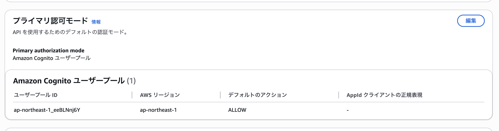
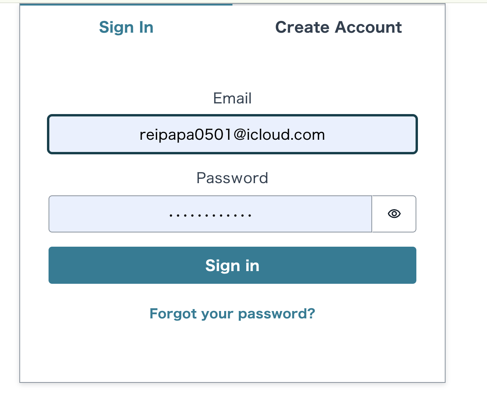
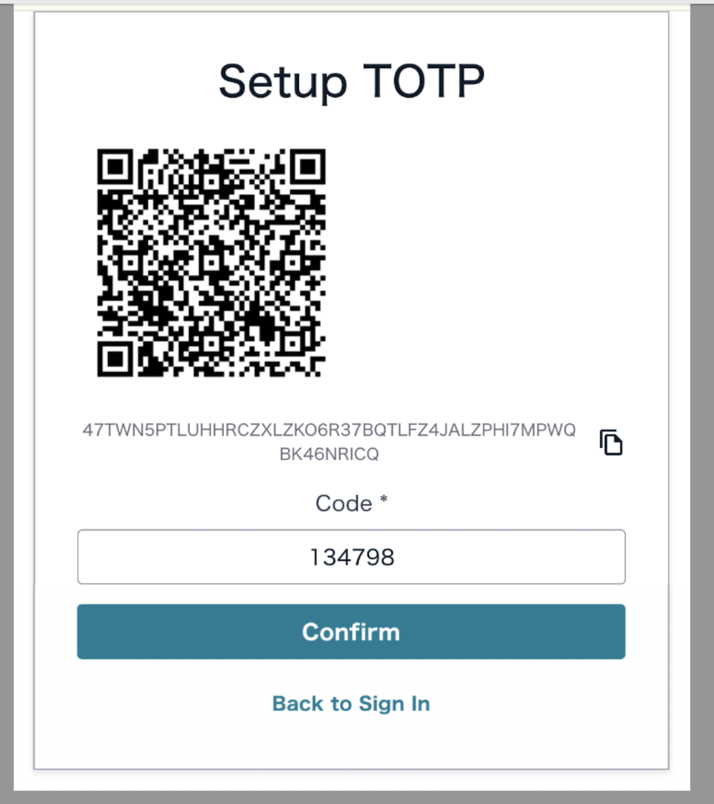
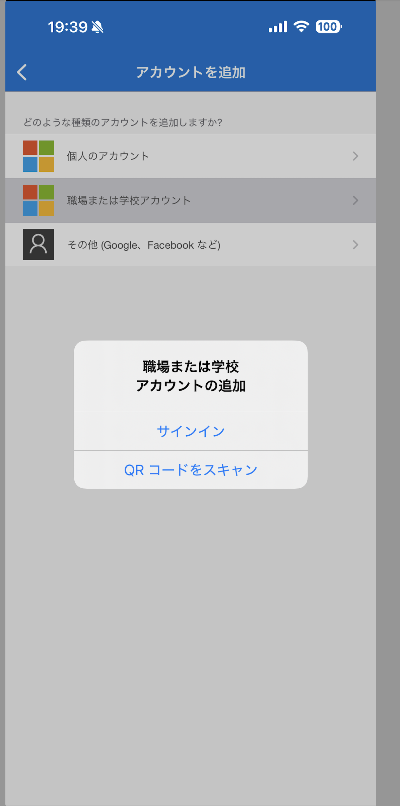

# ハンズオン 06: ログインフローと擬似OTP

この資料は、全8回の学習事項のうち6つ目「ログインフローと擬似OTP」のハンズオンです。

5回目（高度な認証基盤とMFA設定）まで完了している前提で進めます。

## 1. この回のゴール

- Amplify UIライブラリを使ってログイン画面を構築できる
- サインアップ時のEmail検証コード（6桁OTP）の入力・確認処理を実装できる
- TOTP（認証アプリ）を使用したMFAを体験できる
- MFA OPTIONALとREQUIREDの違いを体験できる
- ログイン状態の保持（Auth Session）を確認できる
- サインアップからサインインまでの一連のフローを体験できる
- Amplify Hostingに認証機能付きWebアプリをデプロイできる
- iOSアプリのWebViewから、認証フローを含むWebアプリにアクセスできる
- WebViewの認証セッションがブラウザと独立していることを確認できる
- 次回以降の実装に向けた認証連携の基礎を理解できる

## 2. 前提条件

- ハンズオン01〜05が完了している
- 以下フォルダが存在する
  - `src/amplify-handson-01/web`
  - `src/WebViewHandson02`（Step 11で使用）
- Amplify Authが構成されている（Cognito + MFA設定済み）
- Amplify Hosting に `swift-handson02` アプリが作成済み（ap-southeast-2リージョン）
- Sandbox（`volta run npx ampx sandbox`）が実行可能
- Node.js / npm / Voltaが利用できる
- Xcode がインストール済み（Step 11で使用）

## 3. 進行タイムライン（目安: 140分）

- 0:00-0:10 イントロ・認証フローの全体像
- 0:10-0:40 コンポーネント化の実装（Step 1）
- 0:40-0:50 Amplify UIライブラリのインストール（Step 2）
- 0:50-1:00 データモデルの認証設定を更新（Step 3）
- 1:00-1:20 ログイン画面の実装（Step 4）
- 1:20-1:35 サインアップフローの体験（Step 5）
- 1:35-1:50 サインインフローの体験（Step 6）
- 1:50-2:05 MFA必須設定の体験（Step 7）
- 2:05-2:20 Amplify Hosting再デプロイとiOSアプリ確認（Step 11）
- 2:20-2:30 振り返り

## 4. ハンズオン手順

### 事前確認: Cognitoにユーザーが登録されていないことを確認する

ハンズオンを開始する前に、現在のCognitoユーザープールにユーザーが登録されていないことを確認します。

#### 方法1: AWSマネジメントコンソールから確認（推奨）

1. **AWSアカウントにログイン**
   - ブラウザで [https://console.aws.amazon.com/cognito/v2/home](https://console.aws.amazon.com/cognito/v2/home) を開く
   - Root userまたはIAMユーザーでログイン

2. **リージョンの確認**
   - 画面右上のリージョンを確認
   - Sandboxで使用しているリージョンに切り替え（通常は`us-east-1`や`ap-northeast-1`など）

3. **Cognitoサービスを開く**
   - 左側のナビゲーションから「User pools」を選択
   - または検索バーで「Cognito」と入力して選択

4. **ユーザープールを確認**
   - `amplify-...`で始まるプール名を探す
   - プール名をクリックして詳細を表示

5. **ユーザー数を確認**
   - 「Users」タブを開く
   - ユーザー一覧が空（0 users）であることを確認

**確認ポイント:**
- ユーザー一覧が空であれば、ハンズオンを開始できます
- ユーザーが存在する場合は、削除するか、別のユーザー名でサインアップしてください

#### 方法2: AWS CLIから確認

ターミナルから以下のコマンドで確認することもできます。

```bash
# ユーザープールIDを確認
aws cognito-idp list-user-pools --max-results 10 --region us-east-1

# ユーザー一覧を取得（USER_POOL_IDは上記で確認したIDに置き換え）
aws cognito-idp list-users --user-pool-id USER_POOL_ID --region us-east-1
```

**期待される出力:**
```json
{
  "Users": []
}
```

ユーザーが存在しない（空の配列）ことを確認したら、次のStepに進みます。

---

### Step 0: 作業ディレクトリへ移動

```bash
cd ./src/amplify-handson-01/web
pwd
ls
```

確認ポイント:

- `amplify/` がある
- `amplify_outputs.json` がある
- `package.json` がある

---

### Step 1: 再利用可能なコンポーネントを作成する

ハンズオン04で実装したWebView双方向連携機能と、編集モーダルを別コンポーネントとして作成します。
コンポーネント化により、コードの保守性と再利用性が向上します。

まず、現在のApp.jsxの状態を確認してから、コンポーネントを作成します。

#### 1-1. 現在のApp.jsxを確認する

コンポーネントを作成する前に、現在のApp.jsxの状態を確認します。

現在の`src/App.jsx`の内容:

```jsx
import { useEffect, useState } from 'react'
import { generateClient } from 'aws-amplify/data'
import { Hub } from 'aws-amplify/utils'
import TodoTable from './components/TodoTable'
import './App.css'

const client = generateClient()
const TABLE_REFRESH_INTERVAL_MS = 5000

function App() {
  const [uiError, setUiError] = useState('')

  const safeExecute = async (fn, fallbackMessage) => {
    try {
      setUiError('')
      await fn()
    } catch (error) {
      console.error(error)
      setUiError(fallbackMessage)
    }
  }

  // 入力値・編集状態・一覧データをまとめて管理する。
  const [todos, setTodos] = useState([])
  const [title, setTitle] = useState('')
  const [detail, setDetail] = useState('')
  const [editingTodoId, setEditingTodoId] = useState(null)
  const [editingTitle, setEditingTitle] = useState('')
  const [editingDetail, setEditingDetail] = useState('')

  // Step2追加: iOSから渡されたクエリを保持する（ハンズオン04）
  const [launchParams] = useState(() => {
    const params = new URLSearchParams(window.location.search)
    return {
      from: params.get('from') ?? '-',
      trainee: params.get('trainee') ?? '-',
      session: params.get('session') ?? '-',
    }
  })

  // Step3追加: Web → iOS へメッセージ送信（ハンズオン04）
  const sendMessageToIOS = (type, payload) => {
    try {
      if (!window.webkit?.messageHandlers?.trainingBridge) {
        window.alert('iOS連携ハンドラが見つかりません（ブラウザ表示時は想定内）')
        return
      }

      window.webkit.messageHandlers.trainingBridge.postMessage({
        type,
        payload,
        sentAt: new Date().toISOString(),
      })
    } catch (error) {
      console.error('postMessage失敗', error)
      window.alert('iOSへの送信に失敗しました')
    }
  }

  // 最新一覧を取得する共通処理。
  const loadTodos = async () => {
    await safeExecute(async () => {
      const { data, errors } = await client.models.Todo.list({
        sortDirection: 'DESC',
      })

      if (errors) {
        throw new Error('Todo一覧の取得に失敗しました')
      }

      setTodos(data)
    }, 'Todo一覧の取得に失敗しました')
  }

  useEffect(() => {
    // 初回表示時のロード + 定期ポーリング + Hub購読をまとめて初期化する。
    const initializeTodos = async () => {
      await loadTodos()
    }

    void initializeTodos()

    const intervalId = window.setInterval(() => {
      loadTodos()
    }, TABLE_REFRESH_INTERVAL_MS)

    // Data更新イベントを購読し、別タブ更新も反映する
    const cancel = Hub.listen('api', () => {
      loadTodos()
    })

    return () => {
      window.clearInterval(intervalId)
      cancel()
    }
  }, [])

  useEffect(() => {
    // モーダル表示中のみ背景スクロールを無効化する。
    if (!editingTodoId) return

    const previousOverflow = document.body.style.overflow
    document.body.style.overflow = 'hidden'

    return () => {
      document.body.style.overflow = previousOverflow
    }
  }, [editingTodoId])

  // 新規Todoを作成して一覧を再取得する。
  const createTodo = async (event) => {
    event.preventDefault()

    if (!title.trim()) return

    await safeExecute(async () => {
      const { errors } = await client.models.Todo.create({
        title: title.trim(),
        detail: detail.trim(),
        isDone: false,
        priority: 0,
      })

      if (errors) {
        throw new Error('Todoの作成に失敗しました')
      }

      setTitle('')
      setDetail('')
      await loadTodos()
    }, 'Todoの作成に失敗しました')
  }

  // 完了状態をトグル更新して一覧を再取得する。
  const toggleTodo = async (todo) => {
    const { errors } = await client.models.Todo.update({
      id: todo.id,
      isDone: !todo.isDone,
    })

    if (errors) {
      console.error(errors)
      return
    }

    await loadTodos()
  }

  // 選択行の値を編集フォームへコピーする。
  const startEditingTodo = (todo) => {
    setEditingTodoId(todo.id)
    setEditingTitle(todo.title ?? '')
    setEditingDetail(todo.detail ?? '')
  }

  // 編集フォームを閉じてローカル状態を初期化する。
  const cancelEditingTodo = () => {
    setEditingTodoId(null)
    setEditingTitle('')
    setEditingDetail('')
  }

  // 編集内容を保存して一覧を再取得する。
  const updateTodo = async (event) => {
    event.preventDefault()

    if (!editingTodoId || !editingTitle.trim()) return

    const { errors } = await client.models.Todo.update({
      id: editingTodoId,
      title: editingTitle.trim(),
      detail: editingDetail.trim(),
    })

    if (errors) {
      console.error(errors)
      return
    }

    cancelEditingTodo()
    await loadTodos()
  }

  // 確認ダイアログの承認後に削除を実行する。
  const deleteTodo = async (id) => {
    const confirmed = window.confirm('このTodoを削除しますか？')

    if (!confirmed) return

    const { errors } = await client.models.Todo.delete({ id })

    if (errors) {
      console.error(errors)
      return
    }

    await loadTodos()
  }

  return (
    // フォーム・モーダル・テーブルの3領域で画面を構成する。
    <main style={{ maxWidth: 720, margin: '40px auto', padding: '0 16px' }}>
      {uiError ? (
        <p style={{ color: '#b91c1c', background: '#fee2e2', padding: 8, borderRadius: 6 }}>
          {uiError}
        </p>
      ) : null}

      <h2>WebView双方向連携ハンズオン04</h2>
      <p>iOSから受け取ったクエリを表示し、TodoをCRUDします。</p>

      {/* step2: iOSから渡されたクエリを表示 */}
      <section style={{ marginTop: 16, padding: 12, border: '1px solid #cbd5e1', borderRadius: 8 }}>
        <h3 style={{ marginTop: 0 }}>受け取った連携情報</h3>
        <p>from: {launchParams.from}</p>
        <p>trainee: {launchParams.trainee}</p>
        <p>session: {launchParams.session}</p>
      </section>

      <div style={{ display: 'flex', gap: 8, marginTop: 12 }}>
        <button
          type='button'
          onClick={() =>
            sendMessageToIOS('OPEN_ALERT', {
              title: 'Webから通知',
              message: 'Todo画面からiOSへ通知しました',
            })
          }
        >
          iOSに通知する
        </button>

        <button
          type='button'
          onClick={() => sendMessageToIOS('INVALID_PAYLOAD', 'これは不正ペイロード')}
        >
          不正メッセージを送る（検証用）
        </button>
      </div>

      <form onSubmit={createTodo} style={{ display: 'grid', gap: 8, marginTop: 20 }}>
        <input
          value={title}
          onChange={(e) => setTitle(e.target.value)}
          placeholder="タイトル（必須）"
        />
        <input
          value={detail}
          onChange={(e) => setDetail(e.target.value)}
          placeholder="詳細（任意）"
        />
        <button type="submit">作成</button>
      </form>

      {editingTodoId && (
        <div
          role="presentation"
          onClick={cancelEditingTodo}
          style={{
            position: 'fixed',
            inset: 0,
            backgroundColor: 'rgba(15, 23, 42, 0.58)',
            display: 'grid',
            placeItems: 'center',
            padding: 16,
            zIndex: 50,
          }}
        >
          <div
            role="dialog"
            aria-modal="true"
            aria-labelledby="edit-todo-title"
            onClick={(event) => event.stopPropagation()}
            style={{
              width: 'min(100%, 560px)',
              borderRadius: 20,
              background: '#fff',
              padding: 24,
              boxShadow: '0 24px 80px rgba(15, 23, 42, 0.28)',
            }}
          >
            <form onSubmit={updateTodo} style={{ display: 'grid', gap: 12 }}>
              <div>
                <h3 id="edit-todo-title" style={{ margin: 0 }}>
                  選択中のTodoを編集
                </h3>
                <p style={{ margin: '8px 0 0', color: '#475569' }}>
                  タイトルと詳細を更新できます。
                </p>
              </div>
              <input
                value={editingTitle}
                onChange={(e) => setEditingTitle(e.target.value)}
                placeholder="タイトル（必須）"
              />
              <input
                value={editingDetail}
                onChange={(e) => setEditingDetail(e.target.value)}
                placeholder="詳細（任意）"
              />
              <div style={{ display: 'flex', gap: 8, justifyContent: 'flex-end' }}>
                <button type="button" onClick={cancelEditingTodo}>
                  キャンセル
                </button>
                <button type="submit">更新</button>
              </div>
            </form>
          </div>
        </div>
      )}

      <TodoTable
        todos={todos}
        onToggleTodo={toggleTodo}
        onStartEditingTodo={startEditingTodo}
        onDeleteTodo={deleteTodo}
      />
    </main>
  )
}

export default App
```

**確認ポイント:**

- ハンズオン04の機能（WebView連携）が含まれている
- 編集モーダルがインライン実装されている（長いコード）
- 複数の状態変数で管理されている

次のステップで、この状態を改善するためにコンポーネントを作成します。

---

#### 1-2. WebViewBridgeコンポーネントを作成

新規ファイル作成:

- `src/components/WebViewBridge.jsx`

実装内容:

```jsx
import { useState } from 'react'

/**
 * WebView双方向連携コンポーネント
 * iOSからのクエリパラメータ取得とiOSへのメッセージ送信機能を提供
 * ハンズオン04で実装した機能
 */
function WebViewBridge() {
  // iOSから渡されたクエリパラメータを取得
  const [launchParams] = useState(() => {
    const params = new URLSearchParams(window.location.search)
    return {
      from: params.get('from') ?? '-',
      trainee: params.get('trainee') ?? '-',
      session: params.get('session') ?? '-',
    }
  })

  // Web → iOS へメッセージ送信
  const sendMessageToIOS = (type, payload) => {
    try {
      if (!window.webkit?.messageHandlers?.trainingBridge) {
        window.alert('iOS連携ハンドラが見つかりません（ブラウザ表示時は想定内）')
        return
      }

      window.webkit.messageHandlers.trainingBridge.postMessage({
        type,
        payload,
        sentAt: new Date().toISOString(),
      })
    } catch (error) {
      console.error('postMessage失敗', error)
      window.alert('iOSへの送信に失敗しました')
    }
  }

  return (
    <div style={{ marginTop: 16 }}>
      {/* iOSから渡されたクエリを表示 */}
      <section
        style={{
          padding: 12,
          border: '1px solid #cbd5e1',
          borderRadius: 8,
          marginBottom: 12,
        }}
      >
        <h3 style={{ marginTop: 0, fontSize: '1rem' }}>受け取った連携情報</h3>
        <p style={{ margin: '4px 0', fontSize: '0.9rem' }}>from: {launchParams.from}</p>
        <p style={{ margin: '4px 0', fontSize: '0.9rem' }}>trainee: {launchParams.trainee}</p>
        <p style={{ margin: '4px 0', fontSize: '0.9rem' }}>session: {launchParams.session}</p>
      </section>

      {/* iOSへメッセージを送信するボタン */}
      <div style={{ display: 'flex', gap: 8, flexWrap: 'wrap' }}>
        <button
          type="button"
          onClick={() =>
            sendMessageToIOS('OPEN_ALERT', {
              title: 'Webから通知',
              message: 'Todo画面からiOSへ通知しました',
            })
          }
        >
          iOSに通知する
        </button>

        <button
          type="button"
          onClick={() => sendMessageToIOS('INVALID_PAYLOAD', 'これは不正ペイロード')}
        >
          不正メッセージを送る（検証用）
        </button>
      </div>
    </div>
  )
}

export default WebViewBridge
```

#### 1-3. TodoEditModalコンポーネントを作成

新規ファイル作成:

- `src/components/TodoEditModal.jsx`

実装内容:

```jsx
import { useState, useEffect } from 'react'

/**
 * Todo編集モーダルコンポーネント
 * Todo項目の編集機能を提供
 */
function TodoEditModal({ todo, onClose, onUpdate }) {
  const [title, setTitle] = useState('')
  const [detail, setDetail] = useState('')

  // todo変更時にフォーム値を更新
  useEffect(() => {
    if (todo) {
      setTitle(todo.title ?? '')
      setDetail(todo.detail ?? '')
    }
  }, [todo])

  // モーダル表示中のみ背景スクロールを無効化
  useEffect(() => {
    if (!todo) return

    const previousOverflow = document.body.style.overflow
    document.body.style.overflow = 'hidden'

    return () => {
      document.body.style.overflow = previousOverflow
    }
  }, [todo])

  const handleSubmit = async (event) => {
    event.preventDefault()

    if (!title.trim()) return

    await onUpdate({
      id: todo.id,
      title: title.trim(),
      detail: detail.trim(),
    })

    onClose()
  }

  // モーダルが表示されていない場合は何も表示しない
  if (!todo) return null

  return (
    <div
      role="presentation"
      onClick={onClose}
      style={{
        position: 'fixed',
        inset: 0,
        backgroundColor: 'rgba(15, 23, 42, 0.58)',
        display: 'grid',
        placeItems: 'center',
        padding: 16,
        zIndex: 50,
      }}
    >
      <div
        role="dialog"
        aria-modal="true"
        aria-labelledby="edit-todo-title"
        onClick={(event) => event.stopPropagation()}
        style={{
          width: 'min(100%, 560px)',
          borderRadius: 20,
          background: '#fff',
          padding: 24,
          boxShadow: '0 24px 80px rgba(15, 23, 42, 0.28)',
        }}
      >
        <form onSubmit={handleSubmit} style={{ display: 'grid', gap: 12 }}>
          <div>
            <h3 id="edit-todo-title" style={{ margin: 0 }}>
              選択中のTodoを編集
            </h3>
            <p style={{ margin: '8px 0 0', color: '#475569' }}>
              タイトルと詳細を更新できます。
            </p>
          </div>
          <input
            value={title}
            onChange={(e) => setTitle(e.target.value)}
            placeholder="タイトル（必須）"
          />
          <input
            value={detail}
            onChange={(e) => setDetail(e.target.value)}
            placeholder="詳細（任意）"
          />
          <div style={{ display: 'flex', gap: 8, justifyContent: 'flex-end' }}>
            <button type="button" onClick={onClose}>
              キャンセル
            </button>
            <button type="submit">更新</button>
          </div>
        </form>
      </div>
    </div>
  )
}

export default TodoEditModal
```

**このコンポーネントの役割:**

- Todo編集機能を独立したコンポーネントとして提供
- `todo` プロパティで編集対象を受け取る
- `onClose` で閉じる処理を委譲
- `onUpdate` で更新処理を委譲
- 背景スクロールの無効化を自動管理

#### 1-4. これらのコンポーネントの役割

**WebViewBridge:**
- iOSから渡されたクエリパラメータ（`from`, `trainee`, `session`）を取得・表示
- iOSへメッセージを送信する機能を提供
- 独立したコンポーネントなので、簡単に有効化/無効化できる

**TodoEditModal:**
- Todo編集UI/UXを独立して管理
- 親コンポーネントでの状態管理をシンプル化
- 再利用性が高い

#### 1-5. 作成したコンポーネントの動作確認

コンポーネントを作成した後、次のStepに進む前に動作確認を行うことを推奨します。

**確認方法:**

1. **開発サーバーが起動していることを確認**
   ```bash
   # 別ターミナルで実行済みの場合はスキップ
   npm run dev
   ```

2. **ブラウザで動作確認**
   - `http://localhost:5173` にアクセス
   - 既存のTodo機能が正常に動作することを確認
   - 編集モーダルが表示されることを確認（まだコンポーネント化前）

3. **コンポーネントファイルの確認**
   ```bash
   # 作成したファイルが存在するか確認
   ls src/components/WebViewBridge.jsx
   ls src/components/TodoEditModal.jsx
   ```

**期待される状態:**

- ✅ `WebViewBridge.jsx` が作成されている
- ✅ `TodoEditModal.jsx` が作成されている
- ✅ 既存のアプリが正常に動作している（Step 1-1の状態のまま）
- ⚠️ まだコンポーネントは使用されていない（次のStep 1-6で組み込む）

この時点では、コンポーネントは作成しただけで、まだApp.jsxには組み込まれていません。次のStep 1-6で、これらのコンポーネントを実際に組み込んで動作確認を行います。

---

#### 1-6. コンポーネントを組み込んだApp.jsxの実装と動作確認

作成したコンポーネントを実際にApp.jsxに組み込み、動作確認を行います。
**このステップでは、まだ認証機能は追加しません。**コンポーネント化の効果を確認することが目的です。

##### 1-6-1. App.jsxを編集してコンポーネントを組み込む

編集対象:
- `src/App.jsx`

実装内容:

```jsx
import { useEffect, useState } from 'react'
import { generateClient } from 'aws-amplify/data'
import { Hub } from 'aws-amplify/utils'
import TodoTable from './components/TodoTable'
import './App.css'

const client = generateClient()
const TABLE_REFRESH_INTERVAL_MS = 5000

function App() {
  const [uiError, setUiError] = useState('')

  const safeExecute = async (fn, fallbackMessage) => {
    try {
      setUiError('')
      await fn()
    } catch (error) {
      console.error(error)
      setUiError(fallbackMessage)
    }
  }

  // 入力値・編集状態・一覧データをまとめて管理する。
  const [todos, setTodos] = useState([])
  const [title, setTitle] = useState('')
  const [detail, setDetail] = useState('')
  const [editingTodoId, setEditingTodoId] = useState(null)
  const [editingTitle, setEditingTitle] = useState('')
  const [editingDetail, setEditingDetail] = useState('')

  // Step2追加: iOSから渡されたクエリを保持する（ハンズオン04）
  const [launchParams] = useState(() => {
    const params = new URLSearchParams(window.location.search)
    return {
      from: params.get('from') ?? '-',
      trainee: params.get('trainee') ?? '-',
      session: params.get('session') ?? '-',
    }
  })

  // Step3追加: Web → iOS へメッセージ送信（ハンズオン04）
  const sendMessageToIOS = (type, payload) => {
    try {
      if (!window.webkit?.messageHandlers?.trainingBridge) {
        window.alert('iOS連携ハンドラが見つかりません（ブラウザ表示時は想定内）')
        return
      }

      window.webkit.messageHandlers.trainingBridge.postMessage({
        type,
        payload,
        sentAt: new Date().toISOString(),
      })
    } catch (error) {
      console.error('postMessage失敗', error)
      window.alert('iOSへの送信に失敗しました')
    }
  }

  // 最新一覧を取得する共通処理。
  const loadTodos = async () => {
    await safeExecute(async () => {
      const { data, errors } = await client.models.Todo.list({
        sortDirection: 'DESC',
      })

      if (errors) {
        throw new Error('Todo一覧の取得に失敗しました')
      }

      setTodos(data)
    }, 'Todo一覧の取得に失敗しました')
  }

  useEffect(() => {
    // 初回表示時のロード + 定期ポーリング + Hub購読をまとめて初期化する。
    const initializeTodos = async () => {
      await loadTodos()
    }

    void initializeTodos()

    const intervalId = window.setInterval(() => {
      loadTodos()
    }, TABLE_REFRESH_INTERVAL_MS)

    // Data更新イベントを購読し、別タブ更新も反映する
    const cancel = Hub.listen('api', () => {
      loadTodos()
    })

    return () => {
      window.clearInterval(intervalId)
      cancel()
    }
  }, [])

  useEffect(() => {
    // モーダル表示中のみ背景スクロールを無効化する。
    if (!editingTodoId) return

    const previousOverflow = document.body.style.overflow
    document.body.style.overflow = 'hidden'

    return () => {
      document.body.style.overflow = previousOverflow
    }
  }, [editingTodoId])

  // 新規Todoを作成して一覧を再取得する。
  const createTodo = async (event) => {
    event.preventDefault()

    if (!title.trim()) return

    await safeExecute(async () => {
      const { errors } = await client.models.Todo.create({
        title: title.trim(),
        detail: detail.trim(),
        isDone: false,
        priority: 0,
      })

      if (errors) {
        throw new Error('Todoの作成に失敗しました')
      }

      setTitle('')
      setDetail('')
      await loadTodos()
    }, 'Todoの作成に失敗しました')
  }

  // 完了状態をトグル更新して一覧を再取得する。
  const toggleTodo = async (todo) => {
    const { errors } = await client.models.Todo.update({
      id: todo.id,
      isDone: !todo.isDone,
    })

    if (errors) {
      console.error(errors)
      return
    }

    await loadTodos()
  }

  // 選択行の値を編集フォームへコピーする。
  const startEditingTodo = (todo) => {
    setEditingTodoId(todo.id)
    setEditingTitle(todo.title ?? '')
    setEditingDetail(todo.detail ?? '')
  }

  // 編集フォームを閉じてローカル状態を初期化する。
  const cancelEditingTodo = () => {
    setEditingTodoId(null)
    setEditingTitle('')
    setEditingDetail('')
  }

  // 編集内容を保存して一覧を再取得する。
  const updateTodo = async (event) => {
    event.preventDefault()

    if (!editingTodoId || !editingTitle.trim()) return

    const { errors } = await client.models.Todo.update({
      id: editingTodoId,
      title: editingTitle.trim(),
      detail: editingDetail.trim(),
    })

    if (errors) {
      console.error(errors)
      return
    }

    cancelEditingTodo()
    await loadTodos()
  }

  // 確認ダイアログの承認後に削除を実行する。
  const deleteTodo = async (id) => {
    const confirmed = window.confirm('このTodoを削除しますか？')

    if (!confirmed) return

    const { errors } = await client.models.Todo.delete({ id })

    if (errors) {
      console.error(errors)
      return
    }

    await loadTodos()
  }

  return (
    // フォーム・モーダル・テーブルの3領域で画面を構成する。
    <main style={{ maxWidth: 720, margin: '40px auto', padding: '0 16px' }}>
      {uiError ? (
        <p style={{ color: '#b91c1c', background: '#fee2e2', padding: 8, borderRadius: 6 }}>
          {uiError}
        </p>
      ) : null}

      <h2>WebView双方向連携ハンズオン04</h2>
      <p>iOSから受け取ったクエリを表示し、TodoをCRUDします。</p>

      {/* step2: iOSから渡されたクエリを表示 */}
      <section style={{ marginTop: 16, padding: 12, border: '1px solid #cbd5e1', borderRadius: 8 }}>
        <h3 style={{ marginTop: 0 }}>受け取った連携情報</h3>
        <p>from: {launchParams.from}</p>
        <p>trainee: {launchParams.trainee}</p>
        <p>session: {launchParams.session}</p>
      </section>

      <div style={{ display: 'flex', gap: 8, marginTop: 12 }}>
        <button
          type='button'
          onClick={() =>
            sendMessageToIOS('OPEN_ALERT', {
              title: 'Webから通知',
              message: 'Todo画面からiOSへ通知しました',
            })
          }
        >
          iOSに通知する
        </button>

        <button
          type='button'
          onClick={() => sendMessageToIOS('INVALID_PAYLOAD', 'これは不正ペイロード')}
        >
          不正メッセージを送る（検証用）
        </button>
      </div>

      <form onSubmit={createTodo} style={{ display: 'grid', gap: 8, marginTop: 20 }}>
        <input
          value={title}
          onChange={(e) => setTitle(e.target.value)}
          placeholder="タイトル（必須）"
        />
        <input
          value={detail}
          onChange={(e) => setDetail(e.target.value)}
          placeholder="詳細（任意）"
        />
        <button type="submit">作成</button>
      </form>

      {editingTodoId && (
        <div
          role="presentation"
          onClick={cancelEditingTodo}
          style={{
            position: 'fixed',
            inset: 0,
            backgroundColor: 'rgba(15, 23, 42, 0.58)',
            display: 'grid',
            placeItems: 'center',
            padding: 16,
            zIndex: 50,
          }}
        >
          <div
            role="dialog"
            aria-modal="true"
            aria-labelledby="edit-todo-title"
            onClick={(event) => event.stopPropagation()}
            style={{
              width: 'min(100%, 560px)',
              borderRadius: 20,
              background: '#fff',
              padding: 24,
              boxShadow: '0 24px 80px rgba(15, 23, 42, 0.28)',
            }}
          >
            <form onSubmit={updateTodo} style={{ display: 'grid', gap: 12 }}>
              <div>
                <h3 id="edit-todo-title" style={{ margin: 0 }}>
                  選択中のTodoを編集
                </h3>
                <p style={{ margin: '8px 0 0', color: '#475569' }}>
                  タイトルと詳細を更新できます。
                </p>
              </div>
              <input
                value={editingTitle}
                onChange={(e) => setEditingTitle(e.target.value)}
                placeholder="タイトル（必須）"
              />
              <input
                value={editingDetail}
                onChange={(e) => setEditingDetail(e.target.value)}
                placeholder="詳細（任意）"
              />
              <div style={{ display: 'flex', gap: 8, justifyContent: 'flex-end' }}>
                <button type="button" onClick={cancelEditingTodo}>
                  キャンセル
                </button>
                <button type="submit">更新</button>
              </div>
            </form>
          </div>
        </div>
      )}

      <TodoTable
        todos={todos}
        onToggleTodo={toggleTodo}
        onStartEditingTodo={startEditingTodo}
        onDeleteTodo={deleteTodo}
      />
    </main>
  )
}

export default App
```

##### 1-6-2. 変更内容の詳細比較

コンポーネントを作成した後、Step 3に進む前に動作確認を行うことを推奨します。

**確認方法:**

1. **開発サーバーが起動していることを確認**
   ```bash
   # 別ターミナルで実行済みの場合はスキップ
   npm run dev
   ```

2. **ブラウザで動作確認**
   - `http://localhost:5173` にアクセス
   - 既存のTodo機能が正常に動作することを確認
   - 編集モーダルが表示されることを確認（まだコンポーネント化前）

3. **コンポーネントファイルの確認**
   ```bash
   # 作成したファイルが存在するか確認
   ls src/components/WebViewBridge.jsx
   ls src/components/TodoEditModal.jsx
   ```

**期待される状態:**

- ✅ `WebViewBridge.jsx` が作成されている
- ✅ `TodoEditModal.jsx` が作成されている
- ✅ 既存のアプリが正常に動作している（Step 2-1の状態のまま）
- ⚠️ まだコンポーネントは使用されていない（次のStep 2-6で組み込む）

この時点では、コンポーネントは作成しただけで、まだApp.jsxには組み込まれていません。次のStep 2-6で、これらのコンポーネントを実際に組み込んで動作確認を行います。

---

#### 2-6. コンポーネントを組み込んだApp.jsxの実装と動作確認

作成したコンポーネントを実際にApp.jsxに組み込み、動作確認を行います。
**このステップでは、まだ認証機能は追加しません。**コンポーネント化の効果を確認することが目的です。

##### 2-6-1. App.jsxを編集してコンポーネントを組み込む

編集対象:
- `src/App.jsx`

実装内容:

```jsx
import { useEffect, useState } from 'react'
import { generateClient } from 'aws-amplify/data'
import { Hub } from 'aws-amplify/utils'
import TodoTable from './components/TodoTable'
import WebViewBridge from './components/WebViewBridge'
import TodoEditModal from './components/TodoEditModal'
import './App.css'

const client = generateClient()
const TABLE_REFRESH_INTERVAL_MS = 5000

function App() {
  const [uiError, setUiError] = useState('')

  const safeExecute = async (fn, fallbackMessage) => {
    try {
      setUiError('')
      await fn()
    } catch (error) {
      console.error(error)
      setUiError(fallbackMessage)
    }
  }

  // 入力値・編集状態・一覧データを管理
  const [todos, setTodos] = useState([])
  const [title, setTitle] = useState('')
  const [detail, setDetail] = useState('')
  const [editingTodo, setEditingTodo] = useState(null) // 3つの状態から1つに統合

  // 最新一覧を取得する共通処理
  const loadTodos = async () => {
    await safeExecute(async () => {
      const { data, errors } = await client.models.Todo.list({
        sortDirection: 'DESC',
      })

      if (errors) {
        throw new Error('Todo一覧の取得に失敗しました')
      }

      setTodos(data)
    }, 'Todo一覧の取得に失敗しました')
  }

  useEffect(() => {
    // 初回表示時のロード + 定期ポーリング + Hub購読をまとめて初期化
    const initializeTodos = async () => {
      await loadTodos()
    }

    void initializeTodos()

    const intervalId = window.setInterval(() => {
      loadTodos()
    }, TABLE_REFRESH_INTERVAL_MS)

    // Data更新イベントを購読し、別タブ更新も反映
    const cancel = Hub.listen('api', () => {
      loadTodos()
    })

    return () => {
      window.clearInterval(intervalId)
      cancel()
    }
  }, [])

  // 新規Todoを作成して一覧を再取得
  const createTodo = async (event) => {
    event.preventDefault()

    if (!title.trim()) return

    await safeExecute(async () => {
      const { errors } = await client.models.Todo.create({
        title: title.trim(),
        detail: detail.trim(),
        isDone: false,
        priority: 0,
      })

      if (errors) {
        throw new Error('Todoの作成に失敗しました')
      }

      setTitle('')
      setDetail('')
      await loadTodos()
    }, 'Todoの作成に失敗しました')
  }

  // 完了状態をトグル更新して一覧を再取得
  const toggleTodo = async (todo) => {
    const { errors } = await client.models.Todo.update({
      id: todo.id,
      isDone: !todo.isDone,
    })

    if (errors) {
      console.error(errors)
      return
    }

    await loadTodos()
  }

  // Todo更新処理（TodoEditModalから呼ばれる）
  const handleUpdateTodo = async (updatedData) => {
    const { errors } = await client.models.Todo.update(updatedData)

    if (errors) {
      console.error(errors)
      return
    }

    await loadTodos()
  }

  // 確認ダイアログの承認後に削除を実行
  const deleteTodo = async (id) => {
    const confirmed = window.confirm('このTodoを削除しますか？')

    if (!confirmed) return

    const { errors } = await client.models.Todo.delete({ id })

    if (errors) {
      console.error(errors)
      return
    }

    await loadTodos()
  }

  return (
    // フォーム・モーダル・テーブルの3領域で画面を構成
    <main style={{ maxWidth: 720, margin: '40px auto', padding: '0 16px' }}>
      {uiError ? (
        <p style={{ color: '#b91c1c', background: '#fee2e2', padding: 8, borderRadius: 6 }}>
          {uiError}
        </p>
      ) : null}

      <h2>WebView双方向連携ハンズオン04（コンポーネント化版）</h2>

      {/* WebView連携機能をコンポーネント化 - 不要な場合はコメントアウト */}
      <WebViewBridge />

      {/* Todo作成フォーム */}
      <form onSubmit={createTodo} style={{ display: 'grid', gap: 8, marginTop: 20 }}>
        <input
          value={title}
          onChange={(e) => setTitle(e.target.value)}
          placeholder="タイトル（必須）"
        />
        <input
          value={detail}
          onChange={(e) => setDetail(e.target.value)}
          placeholder="詳細（任意）"
        />
        <button type="submit">作成</button>
      </form>

      {/* 編集モーダルをコンポーネント化 */}
      <TodoEditModal
        todo={editingTodo}
        onClose={() => setEditingTodo(null)}
        onUpdate={handleUpdateTodo}
      />

      {/* Todo一覧テーブル */}
      <TodoTable
        todos={todos}
        onToggleTodo={toggleTodo}
        onStartEditingTodo={setEditingTodo}
        onDeleteTodo={deleteTodo}
      />
    </main>
  )
}

export default App
```

##### 2-6-2. 変更内容の詳細比較

**主要な変更点:**

| 項目 | Before（Step 1-1） | After（Step 1-6） |
|------|-------------------|-------------------|
| **WebView連携** | インライン実装（約40行） | `<WebViewBridge />` コンポーネント |
| **編集モーダル** | インライン実装（約50行） | `<TodoEditModal />` コンポーネント |
| **状態管理** | `editingTodoId`, `editingTitle`, `editingDetail` の3つ | `editingTodo` の1つのみ |
| **launchParams** | App.jsx内で管理 | WebViewBridgeコンポーネント内で管理 |
| **sendMessageToIOS** | App.jsx内で定義 | WebViewBridgeコンポーネント内で定義 |
| **編集開始処理** | `startEditingTodo` 関数 | 直接 `setEditingTodo` を呼び出し |
| **編集キャンセル** | `cancelEditingTodo` 関数 | 直接 `setEditingTodo(null)` |
| **編集更新処理** | `updateTodo` 関数（モーダル内） | `handleUpdateTodo` 関数（親） |
| **App.jsxの行数** | 約300行 | 約150行（50%削減） |

**削除されたコード:**

```jsx
// これらはもう不要
const [launchParams] = useState(() => { ... })
const [editingTodoId, setEditingTodoId] = useState(null)
const [editingTitle, setEditingTitle] = useState('')
const [editingDetail, setEditingDetail] = useState('')

const sendMessageToIOS = (type, payload) => { ... }
const startEditingTodo = (todo) => { ... }
const cancelEditingTodo = () => { ... }
const updateTodo = async (event) => { ... }

useEffect(() => {
  // モーダル表示中のみ背景スクロールを無効化
  if (!editingTodoId) return
  ...
}, [editingTodoId])

// インラインのWebView連携UI（約40行）
// インラインの編集モーダルUI（約50行）
```

**追加されたコード:**

```jsx
// シンプルなインポート
import WebViewBridge from './components/WebViewBridge'
import TodoEditModal from './components/TodoEditModal'

// シンプルな状態管理
const [editingTodo, setEditingTodo] = useState(null)

// シンプルな更新ハンドラ
const handleUpdateTodo = async (updatedData) => {
  const { errors } = await client.models.Todo.update(updatedData)
  if (errors) {
    console.error(errors)
    return
  }
  await loadTodos()
}

// シンプルなコンポーネント呼び出し
<WebViewBridge />
<TodoEditModal
  todo={editingTodo}
  onClose={() => setEditingTodo(null)}
  onUpdate={handleUpdateTodo}
/>
<TodoTable
  onStartEditingTodo={setEditingTodo}  // シンプルに直接渡す
/>
```

##### 1-6-3. 動作確認の手順

**1. 開発サーバーを起動（未起動の場合）**

```bash
npm run dev
```

**2. ブラウザで動作確認**

1. `http://localhost:5173` にアクセス
2. 以下の機能が正常に動作することを確認:

   ✅ **WebView連携セクション:**
   - 「受け取った連携情報」が表示される
   - 「iOSに通知する」ボタンが表示される
   - ボタンをクリックするとアラートが表示される（ブラウザ表示時）

   ✅ **Todo作成機能:**
   - タイトルと詳細を入力して作成できる
   - 作成後、一覧に表示される

   ✅ **Todo編集機能:**
   - 編集ボタンをクリックするとモーダルが表示される
   - タイトルと詳細を編集できる
   - キャンセルボタンで閉じることができる
   - 更新ボタンで保存できる

   ✅ **その他の機能:**
   - 完了チェックボックスのトグル
   - 削除ボタンで削除（確認ダイアログ付き）

**3. コンポーネント化の効果を確認**

開発者ツール（F12）を開いて、以下を確認:

```javascript
// Consoleタブで、コンポーネントの独立性を確認
// エラーが出ていないことを確認
```

**4. WebView連携の無効化テスト（オプション）**

App.jsxで、WebViewBridgeコンポーネントをコメントアウト:

```jsx
{/* WebView連携機能をコンポーネント化 - 不要な場合はコメントアウト */}
{/* <WebViewBridge /> */}
```

保存してブラウザをリロード:
- WebView連携セクションが非表示になる
- 他の機能は正常に動作する
- **これがコンポーネント化の大きなメリット！**

##### 1-6-4. 確認ポイント

**成功の確認:**

- ✅ 画面のレイアウトがStep 1-1と同じ
- ✅ すべての機能が正常に動作する
- ✅ コンソールにエラーが出ていない
- ✅ WebViewBridgeをコメントアウトしても他の機能が動作する

**コンポーネント化の効果:**

1. **可読性の向上**
   - App.jsxが150行に削減（50%削減）
   - 各コンポーネントの責務が明確

2. **保守性の向上**
   - WebView連携機能の有効化/無効化が1行で可能
   - 編集モーダルの修正が独立して可能

3. **再利用性の向上**
   - TodoEditModalは他の画面でも使用可能
   - WebViewBridgeは他のプロジェクトでも使用可能

4. **テストのしやすさ**
   - 各コンポーネントを個別にテスト可能
   - App.jsxのテストがシンプルになる

#### 1-6-5. コンポーネント分離のメリット

コンポーネント化による改善効果を比較表で確認します。

| 項目 | Before（Step 1-1） | After（Step 1-6） |
|------|-------------------|-------------------|
| 状態管理の複雑さ | editingTodoId, editingTitle, editingDetail の3つ | editingTodo の1つのみ |
| App.jsxの行数 | 約300行 | 約150行（50%削減） |
| WebView連携 | インライン実装（約40行） | `<WebViewBridge />` コンポーネント |
| 編集モーダル | インライン実装（約50行） | `<TodoEditModal />` コンポーネント |
| WebView機能の有効化/無効化 | 複数箇所の修正が必要 | 1行のコメントアウトのみ |
| 編集モーダルの再利用性 | 不可（App.jsx内に埋め込み） | 可能（独立コンポーネント） |
| テストのしやすさ | App.jsx全体をテスト必要 | 各コンポーネントを個別にテスト可能 |
| 保守性 | 低（すべてが混在） | 高（責務が分離） |

**まとめ:**

- ✅ コードの可読性が大幅に向上（300行 → 150行）
- ✅ 状態管理がシンプルになり、バグが減少
- ✅ 各機能の有効化/無効化が容易
- ✅ コンポーネントの再利用が可能
- ✅ 独立したテストが可能で品質向上

#### 1-6-6. Step 1で実装した内容の総括

Step 1で作成したコンポーネント化されたアプリケーションの特徴:

- ✅ WebViewBridgeコンポーネントでiOS連携機能を実装
- ✅ TodoEditModalコンポーネントで編集機能を分離
- ✅ シンプルな状態管理（editingTodo 1つで管理）
- ✅ WebView連携機能の有効化/無効化が容易（コメントアウトのみ）

これらのコンポーネント化により、次のStep 3と4で認証機能を追加する際にも、既存のコードへの影響を最小限に抑えることができます。

---

### Step 2: Amplify UIライブラリをインストールする

コンポーネント化が完了したので、次に認証機能の実装に必要なAmplify UIライブラリをインストールします。

#### 2-1. パッケージをインストール

```bash
npm install @aws-amplify/ui-react
```

確認:

```bash
npm list @aws-amplify/ui-react
```

期待される出力例:

```
amplify-handson-01@ /path/to/web
└── @aws-amplify/ui-react@6.x.x
```

#### 2-2. インストールされたライブラリの役割

- `@aws-amplify/ui-react`: 認証UIコンポーネント（`Authenticator`など）を提供
- Amplify Authと連携して、サインアップ・サインイン・MFA入力を自動で処理

**確認ポイント:**

- ✅ パッケージが正常にインストールされた
- ✅ 既存のアプリは変更されていない（まだ使用していない）
- ⚠️ 次のStep 3でデータモデルの認証設定を、Step 4でログイン画面を実装します

---

### Step 3: データモデルの認証設定を更新する

認証機能を追加する前に、データモデル（Todo）の認証設定を更新します。現在の設定では、ゲスト（未認証）ユーザーでもアクセス可能になっていますが、ログイン機能を追加した後は、認証済みユーザーのみがアクセスできるように変更します。

> **⚠️ 重要:** このステップをスキップすると、ログイン後に「Todo一覧の取得に失敗しました」というエラーが表示されます。
> **理由:** 現在の設定は `allow.guest()` + `identityPool` 認証ですが、Authenticatorコンポーネントを追加すると `userPool` 認証に切り替わります。認証モードの不一致により、認証済みユーザーがデータにアクセスできなくなります。

#### 3-1. 現在の設定を確認

`amplify/data/resource.ts`を開き、現在の設定を確認します：

```typescript
const schema = a.schema({
  Todo: a
    .model({
      title: a.string().required(),
      detail: a.string(),
      isDone: a.boolean().default(false),
      priority: a.integer().default(0),
    })
    .authorization((allow) => [allow.guest()]),  // ← ゲストユーザーでもアクセス可能
});

export const data = defineData({
  schema,
  authorizationModes: {
    defaultAuthorizationMode: 'identityPool',  // ← Identity Pool認証
  },
});
```

**問題点:**
- `allow.guest()`: 未認証ユーザーでもアクセス可能
- ログイン機能を追加すると、認証済みユーザーのみがアクセスできるようにしたい

#### 3-2. 認証設定を更新

編集対象:
- `amplify/data/resource.ts`

変更内容:

```typescript
import { type ClientSchema, a, defineData } from '@aws-amplify/backend';

const schema = a.schema({
  Todo: a
    .model({
      title: a.string().required(),
      detail: a.string(),
      isDone: a.boolean().default(false),
      priority: a.integer().default(0),
    })
    .authorization((allow) => [
      allow.authenticated(),  // ← 認証済みユーザーのみアクセス可能に変更
    ]),
});

export type Schema = ClientSchema<typeof schema>;

export const data = defineData({
  schema,
  authorizationModes: {
    defaultAuthorizationMode: 'userPool',  // ← User Pool認証に変更
  },
});
```

**変更点の説明:**

1. **`allow.guest()` → `allow.authenticated()`**
   - ゲストユーザーのアクセスを禁止
   - 認証済みユーザーのみがTodoの作成・読み取り・更新・削除が可能

2. **`identityPool` → `userPool`**
   - デフォルトの認証モードをUser Pool（Cognito）に変更
   - ログイン後のユーザー情報を使用してアクセス制御

#### 3-3. Sandboxを再デプロイ

設定を変更したら、Sandboxに変更を反映させます。

**Sandboxが起動している場合（推奨）:**

ファイルを保存するだけで、Sandboxが自動的に変更を検知して再デプロイを実行します。

```
[Sandbox] Detected file changes while previous deployment was in progress. Invoking 'sandbox' again
✔ Backend synthesized in 0.37 seconds
File written: amplify_outputs.json
✔ Type checks completed in 4.99 seconds
✔ Built and published assets
✔ Deployment completed in 1.961 seconds
AppSync API endpoint = https://...appsync-api.ap-northeast-1.amazonaws.com/graphql
[Sandbox] Watching for file changes...
File written: amplify_outputs.json
```

**Sandboxが停止している場合:**

以下の手順でSandboxを起動します。

```bash
volta run npx ampx sandbox
```

**デプロイ完了の確認:**

- `✔ Deployment completed` というメッセージが表示される
- `[Sandbox] Watching for file changes...` が表示される
- 数分かかる場合があります

#### 3-4. 既存データの扱い

**重要な注意事項:**

認証設定を変更すると、既存のTodoデータにアクセスできなくなる可能性があります。

**対処方法:**

1. **テスト環境の場合（このハンズオン）:**
   - 既存データは削除しても問題ありません
   - 新しくログインして、新規にTodoを作成してテストします

2. **既存データを削除する場合:**
   - AWSコンソール → DynamoDB → テーブル一覧
   - `amplify-...` で始まるTodoテーブルを選択
   - 「項目を探索」→ 全項目を削除

**確認ポイント:**

- ✅ `amplify/data/resource.ts` が更新された
- ✅ Sandboxが自動で再デプロイされた（`✔ Deployment completed` 表示）
- ✅ 既存データの扱いを理解した
- ⚠️ 次のStep 3-5で、AWSコンソールで変更内容を確認します

#### 3-5. AWSコンソールで変更内容を確認する

Sandboxのデプロイが完了したら、AWSコンソールで認証設定が正しく反映されているか確認できます。

**手順:**

1. **AWS AppSync コンソールを開く**
   - AWSコンソールにログイン
   - サービス検索で「AppSync」を検索
   - 該当リージョン（例: us-east-1）を選択

2. **API一覧から該当APIを選択**
   - `amplify-...` で始まるAPIをクリック
   - 左メニューから「設定」を選択

3. **認証モードを確認**
   - 「プライマリ認可モード」セクションで以下を確認:
     - **Primary authorization mode**: `Amazon Cognito ユーザープール`
     - **ユーザープール ID**: `ap-northeast-1_xxxxx` のような形式で表示される
   - 「追加の認証モード」セクション:
     - `AWS Identity and Access Management (IAM)` が追加されている場合があります（Amplifyが自動で追加）
     - このハンズオンでは追加の認証モードは使用しません
   

**確認ポイント:**

- ✅ AppSync APIのプライマリ認可モードが「Amazon Cognito ユーザープール」になっている
- ✅ ユーザープールIDが表示されている（例: ap-northeast-1_xxxxx）
- ✅ 追加の認証モードに IAM が表示されている（Amplifyが自動追加）
- 💡 データソースには認証設定項目はありません（AppSyncはIAMロールでDynamoDBにアクセスします）
- ⚠️ 次のStep 4で、認証機能を実装します

---

### Step 4: ログイン画面を実装する

`src/App.jsx` を編集して、ログイン画面を追加します。

#### 4-1. Authenticatorコンポーネントをインポート

編集対象:

- `src/App.jsx`

変更点の説明:

- `Authenticator` コンポーネントをインポート
- `Authenticator` で既存のアプリ全体をラップする
- ログイン後にユーザー名を表示する
- （オプション）WebViewBridgeコンポーネントを組み込む

#### 4-2. App.jsxの完全な実装コード

**重要な構造:**

`user`は`Authenticator`コンポーネントのレンダープロップから提供されるため、ロジックを別のコンポーネント（`TodoApp`）に分離します。

```jsx
import { useEffect, useState } from 'react'
import { generateClient } from 'aws-amplify/data'
import { Hub } from 'aws-amplify/utils'
import { Authenticator } from '@aws-amplify/ui-react'
import '@aws-amplify/ui-react/styles.css'
import TodoTable from './components/TodoTable'
import WebViewBridge from './components/WebViewBridge'
import TodoEditModal from './components/TodoEditModal'
import './App.css'

const client = generateClient()
const TABLE_REFRESH_INTERVAL_MS = 5000

function App() {
  return (
    <Authenticator>
      {({ signOut, user }) => (
        <TodoApp signOut={signOut} user={user} />
      )}
    </Authenticator>
  )
}

function TodoApp({ signOut, user }) {
  const [uiError, setUiError] = useState('')

  const safeExecute = async (fn, fallbackMessage) => {
    try {
      setUiError('')
      await fn()
    } catch (error) {
      console.error(error)
      setUiError(fallbackMessage)
    }
  }

  const [todos, setTodos] = useState([])
  const [title, setTitle] = useState('')
  const [detail, setDetail] = useState('')
  const [editingTodo, setEditingTodo] = useState(null)

  const loadTodos = async () => {
    await safeExecute(async () => {
      const { data, errors } = await client.models.Todo.list({
        sortDirection: 'DESC',
      })

      if (errors) {
        throw new Error('Todo一覧の取得に失敗しました')
      }

      setTodos(data)
    }, 'Todo一覧の取得に失敗しました')
  }

  useEffect(() => {
    // ユーザーがログインしていない場合は何もしない
    if (!user) return

    const initializeTodos = async () => {
      await loadTodos()
    }

    void initializeTodos()

    const intervalId = window.setInterval(() => {
      loadTodos()
    }, TABLE_REFRESH_INTERVAL_MS)

    const cancel = Hub.listen('api', () => {
      loadTodos()
    })

    return () => {
      window.clearInterval(intervalId)
      cancel()
    }
    // eslint-disable-next-line react-hooks/exhaustive-deps
  }, [user])

  const createTodo = async (event) => {
    event.preventDefault()

    if (!title.trim()) return

    await safeExecute(async () => {
      const { errors } = await client.models.Todo.create({
        title: title.trim(),
        detail: detail.trim(),
        isDone: false,
        priority: 0,
      })

      if (errors) {
        throw new Error('Todoの作成に失敗しました')
      }

      setTitle('')
      setDetail('')
      await loadTodos()
    }, 'Todoの作成に失敗しました')
  }

  const toggleTodo = async (todo) => {
    const { errors } = await client.models.Todo.update({
      id: todo.id,
      isDone: !todo.isDone,
    })

    if (errors) {
      console.error(errors)
      return
    }

    await loadTodos()
  }

  const handleUpdateTodo = async (updatedData) => {
    const { errors } = await client.models.Todo.update(updatedData)

    if (errors) {
      console.error(errors)
      return
    }

    await loadTodos()
  }

  const deleteTodo = async (id) => {
    const confirmed = window.confirm('このTodoを削除しますか？')

    if (!confirmed) return

    const { errors } = await client.models.Todo.delete({ id })

    if (errors) {
      console.error(errors)
      return
    }

    await loadTodos()
  }

  return (
    <main style={{ maxWidth: 720, margin: '40px auto', padding: '0 16px' }}>
      {uiError ? (
        <p style={{ color: '#b91c1c', background: '#fee2e2', padding: 8, borderRadius: 6 }}>
          {uiError}
        </p>
      ) : null}

      <h2>ログイン機能付きTodoアプリ</h2>
      <p>Amplify認証を統合したTodo管理アプリケーションです。</p>

      {/* ログイン情報表示 */}
      <section style={{ marginTop: 16, padding: 12, border: '1px solid #cbd5e1', borderRadius: 8 }}>
        <h3 style={{ marginTop: 0 }}>ログイン情報</h3>
        <p>Welcome, {user?.signInDetails?.loginId}</p>
        <button onClick={signOut}>Sign out</button>
      </section>

      {/* WebView連携機能（ハンズオン04）- 不要な場合はコメントアウト */}
      <WebViewBridge />

      {/* Todo作成フォーム */}
      <form onSubmit={createTodo} style={{ display: 'grid', gap: 8, marginTop: 20 }}>
        <input
          value={title}
          onChange={(e) => setTitle(e.target.value)}
          placeholder="タイトル（必須）"
        />
        <input
          value={detail}
          onChange={(e) => setDetail(e.target.value)}
          placeholder="詳細（任意）"
        />
        <button type="submit">作成</button>
      </form>

      {/* 編集モーダル */}
      <TodoEditModal
        todo={editingTodo}
        onClose={() => setEditingTodo(null)}
        onUpdate={handleUpdateTodo}
      />

      {/* Todo一覧テーブル */}
      <TodoTable
        todos={todos}
        onToggleTodo={toggleTodo}
        onStartEditingTodo={setEditingTodo}
        onDeleteTodo={deleteTodo}
      />
    </main>
  )
}

export default App
```

---

#### 4-3. 変更内容の解説

**主要な変更点:**

1. **Authenticatorコンポーネントの導入**
   ```jsx
   import { Authenticator } from '@aws-amplify/ui-react'
   import '@aws-amplify/ui-react/styles.css'
   ```

2. **コンポーネントの分離**

   `user`は`Authenticator`のレンダープロップから提供されるため、ロジックを別のコンポーネント（`TodoApp`）に分離します。

   ```jsx
   function App() {
     return (
       <Authenticator>
         {({ signOut, user }) => (
           <TodoApp signOut={signOut} user={user} />
         )}
       </Authenticator>
     )
   }

   function TodoApp({ signOut, user }) {
     // すべてのロジックをここに配置
     // userをpropsとして受け取るため、useEffectなどで使用可能
   }
   ```

   **なぜ分離するのか？**
   - `user`はレンダープロップのスコープ内でしか利用できない
   - `useEffect`などで`user`を使うには、それらのロジックも同じスコープ内に配置する必要がある
   - コンポーネントを分離することで、`user`をpropsとして渡し、明示的に利用できる
   - IDEのESLint警告（`no-undef`）が発生しない
   - `useEffect`の依存配列に`user`を追加でき、ログイン直後のエラーを防止できる（詳細はStep 4-4で説明）

3. **ログイン情報の表示**
   ```jsx
   <p>Welcome, {user?.signInDetails?.loginId}</p>
   <button onClick={signOut}>Sign out</button>
   ```

**キーポイント:**

- `<Authenticator>` がラップすることで、未認証時は自動的にログイン画面が表示される
- 認証後は `user` オブジェクトにログイン情報が格納される
- `signOut` 関数でログアウトできる
- **WebViewBridgeコンポーネントは独立**しているため、必要に応じて有効化/無効化できる

#### 4-4. ログイン直後のエラーを防ぐ仕組み

Step 4-2のコードでは、`useEffect`の依存配列に`user`を追加し、`if (!user) return`チェックを行うことで、ログイン直後のエラーを防いでいます。

**仕組みの説明:**

Step 4-2のコードでは、`TodoApp`コンポーネントが`user`をpropsとして受け取っています：

```jsx
function App() {
  return (
    <Authenticator>
      {({ signOut, user }) => (  // ← Authenticatorから user を受け取る
        <TodoApp signOut={signOut} user={user} />  // ← TodoAppに渡す
      )}
    </Authenticator>
  )
}

function TodoApp({ signOut, user }) {  // ← propsとして user を受け取る
  // ここで user を使用できる
}
```

`TodoApp`コンポーネント内では、`user`はpropsとして利用可能なため、`useEffect`の依存配列に追加できます。

**実装されているコード:**

`TodoApp`コンポーネント内の`useEffect`は以下のようになっています：

```jsx
useEffect(() => {
  // ユーザーがログインしていない場合は何もしない
  if (!user) return

  const initializeTodos = async () => {
    await loadTodos()
  }

  void initializeTodos()

  const intervalId = window.setInterval(() => {
    loadTodos()
  }, TABLE_REFRESH_INTERVAL_MS)

  const cancel = Hub.listen('api', () => {
    loadTodos()
  })

  return () => {
    window.clearInterval(intervalId)
    cancel()
  }
  // eslint-disable-next-line react-hooks/exhaustive-deps
}, [user]) // 依存配列にuserを追加
```

**実装内容の説明:**

1. **`if (!user) return`の役割**
   - ユーザーがログインしていない場合は、Todoの取得を実行しない
   - ログイン画面表示中は不要なAPI呼び出しを防止

2. **依存配列に`user`を追加**
   - `user`オブジェクトが変更されたとき（ログイン/ログアウト時）にのみ`useEffect`が実行される
   - 初回マウント時には`user`は`undefined`なので、Todoの取得は実行されない
   - ログイン完了後、`user`が設定されると自動的にTodoの取得が開始される

3. **ESLint警告の抑制**
   - `// eslint-disable-next-line react-hooks/exhaustive-deps`を追加
   - ESLintは`loadTodos`も依存配列に追加するよう警告しますが、`loadTodos`は内部で状態を使用しており、依存配列に追加すると無限ループが発生する可能性があります
   - このケースでは、`user`の変更時にのみ実行することが正しい動作なので、警告を抑制します

**この実装により:**

- ✅ ログイン直後のエラーが完全に解消される
- ✅ 認証トークンが確実に設定された後にTodoの取得が開始される
- ✅ ログアウト時に自動的にポーリングが停止される
- ✅ 再ログイン時に自動的にTodoの取得が再開される

**重要なポイント:**

Step 4-2のコード構造では、`TodoApp`コンポーネントが`user`をpropsとして受け取っているため、`useEffect`で`user`を直接使用できます。

コンポーネントを分離したことで：
- ✅ `user`のスコープ問題が解決される
- ✅ `useEffect`の依存配列に`user`を追加できる
- ✅ IDEのESLint警告（`no-undef`）が発生しない
- ✅ コードの可読性が向上する

この構造により、ログイン直後のエラーが完全に解消され、より堅牢なアプリケーションになります。

---

#### 4-5. 備考: useEffectの動作について

**useEffectの基本的な仕組み:**

```jsx
useEffect(() => {
  // この関数は「副作用」と呼ばれる処理を実行する
  // 例: API呼び出し、タイマー設定、イベントリスナー登録など

  return () => {
    // クリーンアップ関数（オプション）
    // コンポーネントがアンマウントされる前、または次の副作用が実行される前に実行される
  }
}, [依存配列]) // この配列内の値が変更されたときに副作用が再実行される
```

**依存配列の役割:**

| 依存配列の指定 | 実行タイミング |
|--------------|--------------|
| `useEffect(() => {...}, [])` | 初回マウント時のみ実行（空配列） |
| `useEffect(() => {...}, [user])` | 初回マウント時 + `user`が変更された時 |
| `useEffect(() => {...}, [a, b])` | 初回マウント時 + `a`または`b`が変更された時 |
| `useEffect(() => {...})` | 毎回レンダリング後に実行（非推奨、無限ループの原因） |

**このハンズオンでの`useEffect`の動作フロー:**

```jsx
useEffect(() => {
  if (!user) return // ① ガード節

  // ② Todo取得処理
  const initializeTodos = async () => {
    await loadTodos()
  }
  void initializeTodos()

  // ③ 定期ポーリング設定
  const intervalId = window.setInterval(() => {
    loadTodos()
  }, TABLE_REFRESH_INTERVAL_MS)

  // ④ イベントリスナー登録
  const cancel = Hub.listen('api', () => {
    loadTodos()
  })

  // ⑤ クリーンアップ関数
  return () => {
    window.clearInterval(intervalId) // タイマー停止
    cancel() // イベントリスナー解除
  }
}, [user])
```

**実行タイミングの詳細:**

1. **コンポーネント初回マウント時（ログイン画面表示時）:**
   - `user`は`undefined`
   - ① のガード節で早期リターン → Todo取得は実行されない
   - クリーンアップ関数も登録されない

2. **ログイン成功時:**
   - `user`が`undefined`から`{...ユーザー情報}`に変更される
   - 依存配列`[user]`の値が変更されたため、`useEffect`が再実行される
   - ① のガード節を通過（`user`が存在するため）
   - ② Todo取得が実行される
   - ③ 定期ポーリングが開始される（5秒ごと）
   - ④ API変更イベントのリスナーが登録される
   - ⑤ クリーンアップ関数が登録される

3. **ログアウト時:**
   - `user`が`{...ユーザー情報}`から`undefined`に変更される
   - ⑤ のクリーンアップ関数が**先に実行される**
     - タイマーが停止される
     - イベントリスナーが解除される
   - その後、`useEffect`が再実行される
   - ① のガード節で早期リターン → Todo取得は実行されない

**クリーンアップ関数の重要性:**

- タイマーやイベントリスナーは、コンポーネントがアンマウントされても動き続けるため、**メモリリーク**の原因になります
- クリーンアップ関数で確実に解除することで、メモリリークを防ぎます
- `useEffect`が再実行される前にも自動的に呼ばれるため、古いリスナーやタイマーが残ることを防ぎます

**なぜ`loadTodos`を依存配列に追加しないのか？**

```jsx
// ❌ このようにすると無限ループの危険性がある
useEffect(() => {
  loadTodos()
}, [user, loadTodos])
```

- `loadTodos`関数は`TodoApp`コンポーネント内で定義されているため、レンダリングごとに新しい関数オブジェクトが作成されます
- `loadTodos`を依存配列に追加すると、レンダリングごとに`useEffect`が実行される可能性があります
- `loadTodos`内で`setTodos`を呼ぶと再レンダリングが発生し、無限ループになる危険性があります

**ESLint警告の抑制が必要な理由:**

ESLintの`react-hooks/exhaustive-deps`ルールは、`useEffect`内で使用されているすべての値を依存配列に含めるよう警告します。しかし、このケースでは：

- `loadTodos`を依存配列に追加すると無限ループのリスクがある
- `user`の変更時にのみ実行することが正しい設計
- したがって、`// eslint-disable-next-line react-hooks/exhaustive-deps`で警告を抑制します

**まとめ:**

- ✅ `useEffect`の依存配列に`user`を指定することで、ログイン状態の変化に応じて処理を実行できる
- ✅ ガード節（`if (!user) return`）により、未ログイン時の不要な処理を防げる
- ✅ クリーンアップ関数により、メモリリークを防ぎ、クリーンな状態管理ができる
- ✅ この設計により、ログイン直後のエラーを完全に防ぎ、堅牢なアプリケーションを実現できる

---

### Step 5: サインアップフローを体験する

Step 3でデータモデルの認証設定を更新し、Step 4でログイン機能を実装しました。
Sandboxが起動中で、開発サーバー（`npm run dev`）も実行中であれば、ブラウザでログイン画面を確認できます。

#### 5-1. ブラウザでログイン画面を表示

1. ブラウザで `http://localhost:5173` にアクセス
2. ログイン画面が表示されることを確認（`Sign in` / `Create Account` タブ）

**確認ポイント:**

- Viteのホットリロード機能により、Step 4のコード変更は自動的に反映されています
- ログイン画面が表示されない場合は、Sandboxと開発サーバーが起動中か確認してください

#### 5-2. アカウントを新規作成

1. ブラウザで `Create Account` タブをクリック
2. 以下を入力:
   - Email address: 自分のメールアドレス（実際に受信できるもの）
   - Password: 8文字以上（大文字・小文字・数字を含む）
3. `Create Account` ボタンをクリック

#### 5-3. 検証コードを入力

1. 入力したメールアドレスに6桁の検証コードが届く
2. 画面に表示される `Confirmation Code` 入力欄に、6桁のコードを入力
3. `Confirm` ボタンをクリック

確認ポイント:

- コード入力後、自動的にログインされる
- 画面に `Welcome, [メールアドレス]` が表示される
- Todo画面が表示される
- ✅ ログイン直後のエラーは発生しません（Step 4-4の実装により防止されています）

#### 5-4. サインアップフローの内部処理

1. **アカウント作成リクエスト**
   - Reactアプリ → Cognito User Pool
   - ユーザー情報が一時的に作成される（未検証状態）

2. **検証コード送信**
   - Cognito → Emailで6桁のコードを送信

3. **検証コード確認**
   - Reactアプリ → Cognitoへコードを送信
   - 一致すれば、ユーザーが「検証済み」状態になる

4. **自動サインイン**
   - 検証完了後、自動的にログインセッションが作成される

---

### Step 6: サインインフローを体験する

#### 6-1. サインアウト

1. 画面右上の `Sign out` ボタンをクリック
2. ログイン画面に戻る

#### 6-2. サインイン

1. `Sign in` タブで、先ほど作成したメールアドレスとパスワードを入力
2. `Sign in` ボタンをクリック

確認ポイント:

- MFAが `OPTIONAL` の場合、追加の検証コードなしでログインできる
- MFAが `REQUIRED` の場合、TOTP（認証アプリ）のセットアップが求められる（詳細はStep 7で実施）
- ✅ ログイン直後のエラーは発生しません（Step 4-4の実装により防止されています）

---

### Step 7: MFA必須設定でTOTP（認証アプリ）を体験する

このステップでは、MFAを `REQUIRED`（必須）に変更して、TOTP（Time-based One-Time Password）を使用した追加認証を体験します。

**TOTPとは:**

- 認証アプリ（Google Authenticator、Microsoft Authenticator等）で生成される6桁のコード
- 30秒ごとに新しいコードが生成される
- メールやSMSを使わず、オフラインでも動作する

#### 7-1. MFA設定を必須に変更する

1. `amplify/auth/resource.ts` を開く
2. `multifactor`の`mode`を変更:

```typescript
import { defineAuth } from '@aws-amplify/backend'

export const auth = defineAuth({
  loginWith: {
    email: true,
  },
  multifactor: {
    mode: 'REQUIRED', // OPTIONAL から REQUIRED に変更
    totp: true,
  },
})
```

3. ファイルを保存

**変更内容:**
- `mode: 'OPTIONAL'` → `mode: 'REQUIRED'`
- これにより、すべてのユーザーがサインイン時にMFA（追加認証）を求められるようになります

#### 7-2. 自動デプロイを待つ

Sandboxは `amplify/auth/resource.ts` の変更を自動的に検知し、再デプロイを開始します。

**Sandboxターミナルで確認:**

ファイル保存後、Sandboxが実行されているターミナルで以下のようなログが表示されます：

```
[Sandbox] Detected file changes while previous deployment was in progress. Invoking 'sandbox' again
✔ Backend synthesized in 0.36 seconds
File written: amplify_outputs.json
✔ Type checks completed in 5.17 seconds
✔ Built and published assets
✔ Deployment completed in 1.989 seconds
AppSync API endpoint = https://...
[Sandbox] Watching for file changes...
File written: amplify_outputs.json
```

**確認ポイント:**

- `✔ Deployment completed` が表示される（通常1〜2分程度）
- `[Sandbox] Watching for file changes...` が表示されて待機状態に戻る
- エラーメッセージが表示されていないこと

**補足:**

- Sandboxの再起動は**不要**です
- ファイル変更を検知して自動的に再デプロイされます
- `amplify_outputs.json` が自動的に更新されます

#### 7-3. サインアウトする

1. ブラウザで `http://localhost:5173` を開く（すでに開いている場合はそのまま）
2. 画面右上の `Sign out` ボタンをクリック
3. ログイン画面に戻ることを確認

#### 7-4. サインインしてMFAを体験する

1. `Sign in` タブで、Step 5で作成したメールアドレスとパスワードを入力
2. `Sign in` ボタンをクリック


**重要な変更点:**

- **OPTIONAL設定の場合:** サインイン成功後、すぐにTodo画面が表示される
- **REQUIRED設定の場合:** サインイン成功後、**Setup TOTP画面**が表示される（初回のみ）

#### 7-5. TOTP（認証アプリ）のセットアップ

サインイン成功後、**Setup TOTP**（TOTP設定）画面が表示されます。


**画面の構成:**

- タイトル: "Setup TOTP"
- QRコード（認証アプリでスキャン用）
- シークレットキー（例: `47TWN5PLUHHRCXLZKO6R37BQTLFZ4JALZPHI7MPWQBK46NRICQ`）
- コード入力欄（`Code *`）
- Confirmボタン
- Back to Sign Inリンク

**重要なポイント:**

現在の設定（`multifactor.totp: true`）では、**TOTP（Time-based One-Time Password）**を使用します。
これは認証アプリ（Google Authenticator、Microsoft Authenticator等）を使用する方式で、**メール経由のコードではありません**。

**セットアップ手順:**

1. **認証アプリをインストール**（まだの場合）
   - iOS: App Storeで「Google Authenticator」または「Microsoft Authenticator」を検索してインストール
   - Android: Google Playで同様にインストール

2. **QRコードをスキャン**
   - 認証アプリを開く
   - 「アカウントを追加」または「+」をタップ
     - 「職場または学校アカウントの追加」を選択
     
   - 「QRコードをスキャン」を選択
   - 画面に表示されているQRコードをスキャン

3. **6桁のコードを入力**
   - 認証アプリに表示される6桁のコード（30秒ごとに変更）を確認
   - ブラウザの `Code` 入力欄に6桁のコードを入力
   - `Confirm` ボタンをクリック

**トラブルシューティング:**

- **「Code mismatch」エラーが表示される場合:**
  - 認証アプリのコードは30秒ごとに変更されます
  - 新しいコードが表示されるまで待ってから入力してください
  - デバイスの時刻が正確か確認してください（時刻がずれているとコードが一致しません）

- **認証アプリがない場合:**
  - このステップをスキップして、Step 7-7で設定を元に戻すことを推奨します
  - または、シークレットキーを手動でコピーして認証アプリに登録できます

#### 7-5-2. セットアップ完了後の動作確認

1. 正しいコードを入力すると、Todo画面が表示されます
2. 画面に `Welcome, [メールアドレス]` が表示されます
3. ✅ ログイン直後のエラーは発生しません（Step 4-4の実装により防止されています）

**次回以降のサインイン:**

- MFA REQUIREDの状態では、サインインのたびに認証アプリのコードを求められます
- メールではなく、認証アプリに表示される6桁のコードを使用します

#### 7-6. MFAフローの理解

**サインアップ時の検証（Step 5）との違い:**

| 項目 | サインアップ時の検証 | サインイン時のMFA（TOTP） |
|------|-------------------|------------------|
| **目的** | メールアドレスの所有者確認 | 追加の本人確認（セキュリティ強化） |
| **タイミング** | アカウント作成時（初回のみ） | 毎回のログイン時 |
| **方法** | メール経由で6桁コードを送信 | 認証アプリで生成される時間ベースのコード |
| **設定** | 常に必須 | OPTIONAL/REQUIREDで制御可能 |
| **コードの有効期限** | 5分（再送信可能） | 30秒（自動更新） |

**TOTP（Time-based One-Time Password）の特徴:**

- ✅ インターネット接続不要（認証アプリがオフラインでも動作）
- ✅ メールの遅延や配信失敗の影響を受けない
- ✅ より高いセキュリティレベル（フィッシング攻撃に強い）
- ⚠️ 初回セットアップが必要（認証アプリのインストールとQRコードスキャン）
- ⚠️ デバイスを紛失すると再設定が必要

**MFA REQUIREDの効果:**

- ✅ パスワードが漏洩しても、認証アプリのコードがなければログインできない
- ✅ セキュリティレベルが大幅に向上
- ✅ 企業やセキュリティ重視のアプリケーションに適している
- ⚠️ ユーザーは認証アプリのセットアップと管理が必要

#### 7-7. 設定を元に戻す（オプション）

次のステップの動作確認をスムーズに行うため、MFA設定を元に戻すことができます。

1. `amplify/auth/resource.ts` を開く
2. `mode`を`OPTIONAL`に戻す:

```typescript
multifactor: {
  mode: 'OPTIONAL', // REQUIRED から OPTIONAL に戻す
  totp: true,
},
```

3. ファイルを保存
4. Sandboxが自動的にファイル変更を検知し、再デプロイを開始します
5. `✔ Deployment completed` のメッセージが表示されるまで待つ（通常1〜2分程度）

**補足:**

- このステップは任意です
- REQUIRED設定のまま次のステップに進んでも問題ありません
- 研修終了後、本番環境では `REQUIRED` を推奨します

---

### Step 8: ログイン状態の保持を確認する

#### 8-1. ブラウザをリロード

1. `F5` または `Cmd+R` でページをリロード

確認ポイント:

- ログイン画面に戻らず、Todo画面が表示される
- ログイン状態が保持されている

#### 8-2. セッション管理の仕組み

**内部処理:**

1. **ローカルストレージにトークン保存**
   - ブラウザの `localStorage` に認証トークンが保存される
   - `amplify-auto-sign-in` などのキーで管理

2. **ページロード時の自動認証**
   - Amplify UIがトークンを確認
   - 有効なトークンがあれば、自動的にログイン状態を復元

3. **トークンの有効期限**
   - デフォルト: 1時間（Cognitoの設定で変更可能）
   - 期限切れ時は、自動的にリフレッシュトークンで更新

#### 8-3. セッション情報を確認する（開発者ツール）

1. ブラウザの開発者ツールを開く（`F12`）
2. `Application` タブ → `Local Storage` → `http://localhost:5173`
3. Amplify関連のキーを確認

確認できる情報例:

- `CognitoIdentityServiceProvider.[client_id].LastAuthUser`: 最後にログインしたユーザー
- `CognitoIdentityServiceProvider.[client_id].[username].idToken`: IDトークン
- `CognitoIdentityServiceProvider.[client_id].[username].accessToken`: アクセストークン
- `CognitoIdentityServiceProvider.[client_id].[username].refreshToken`: リフレッシュトークン

---

### Step 9: 擬似OTPの動作を詳細に観察する

#### 9-1. サインアウトして再度サインアップ

1. `Sign out` ボタンをクリック
2. 別のメールアドレスで新規アカウントを作成
3. メールで届く6桁のコードを確認

#### 9-2. コードの特性を確認

**確認項目:**

- コードの桁数: 6桁
- コードの種類: 数字のみ
- 有効期限: デフォルト5分（Cognitoの設定）
- 再送信: `Resend Code` ボタンで再送可能

#### 9-3. 誤ったコードを入力してみる

1. わざと間違った6桁のコードを入力
2. `Confirm` ボタンをクリック

確認ポイント:

- エラーメッセージが表示される
- `Invalid verification code provided, please try again.`

#### 9-4. コードの再送信

1. `Resend Code` ボタンをクリック
2. 新しいコードがメールで届く
3. 新しいコードを入力して確認

確認ポイント:

- 古いコードは無効になる
- 新しいコードのみが有効

---

### Step 10: Cognitoコンソールでユーザーを確認する

#### 10-1. AWSコンソールにアクセス

1. AWSマネジメントコンソールにログイン
2. リージョンを確認（Sandboxで使用しているリージョン）
3. `Cognito` サービスを検索して開く

#### 10-2. ユーザープールを選択

1. ユーザープール一覧から、`amplify-...` で始まるプールを選択
2. `Users` タブを開く

確認ポイント:

- 作成したユーザーが一覧に表示される
- `Email verified`: `true` になっている
- `User status`: `CONFIRMED`

#### 10-3. ユーザーの詳細を確認

1. ユーザーをクリックして詳細を表示
2. 以下の情報を確認:
   - `Sub (UUID)`: ユーザーの一意識別子
   - `Email`: メールアドレス
   - `Email verified`: 検証状態
   - `MFA`: MFAの設定状態

---

### Step 11: Amplify Hostingへ再アップロードし、iOSアプリで確認する

ここでは、認証機能を含めた最新のWebアプリをAmplify Hostingへ再デプロイし、ハンズオン02で作成したiOSアプリから動作確認します。

#### 11-1. Webアプリのビルド

Sandboxを起動したままの状態で、別のターミナルを開いて以下を実行します。

```bash
cd ./src/amplify-handson-01/web
volta run npm run build
```

期待結果:

- `dist/` ディレクトリにビルド成果物が生成される
- エラーが出ずにビルドが完了する

**重要**: `amplify_outputs.json`は自動的に`dist`にコピーされないため、手動でコピーします。

```bash
cp amplify_outputs.json dist/
```

確認ポイント:

```bash
ls -la dist/
```

期待される出力例:

```
drwxr-xr-x  6 user  staff   192  6 25 20:08 .
drwxr-xr-x 17 user  staff   544  6  9 22:08 ..
-rw-r--r--  1 user  staff  1234  6 25 20:10 amplify_outputs.json  ← これが重要
drwxr-xr-x  4 user  staff   128  6 25 20:08 assets
-rw-r--r--  1 user  staff  9522  6 25 20:08 favicon.svg
-rw-r--r--  1 user  staff  5031  6 25 20:08 icons.svg
-rw-r--r--  1 user  staff   453  6 25 20:08 index.html
```

チェックリスト:

- [ ] `index.html` が存在する
- [ ] `assets/` ディレクトリが存在する
- [ ] **`amplify_outputs.json` が存在する**（これがないと認証・API が動作しません）

#### 11-2. dist.zipの作成

```bash
cd dist
zip -r ../dist.zip .
cd ..
ls -lh dist.zip
```

期待結果:

- `dist.zip` が生成される（数MB程度）

#### 11-3. Amplify Hostingへ再アップロード

1. AWSコンソールにログインする
   - IAMユーザー: `training-amplify-user`（ハンズオン01で作成）

2. リージョンを **ap-southeast-2（シドニー）** に切り替える
   - 画面右上のリージョン選択から `アジアパシフィック (シドニー) ap-southeast-2` を選択
   - 重要: `swift-handson02` アプリはシドニーリージョンにあります

3. Amplify サービスを開く
   - 検索バーに「Amplify」と入力して選択

4. アプリケーション一覧から `swift-handson02` を選択する
   - アプリ名: `swift-handson02`
   - アプリID: `dl3d1pgbzet6z`

5. 【アップテートをデプロイ】をクリック

6. 先ほど作成した `dist.zip` を選択またはドラッグ&ドロップする

7. 【保存してデプロイ】をクリックする

8. デプロイの進行状況を確認する
   - プロビジョニング → ビルド → デプロイ → 検証 の順に進む
   - 通常1〜3分程度で完了

9. デプロイ完了後、URLを確認する
    - URL例: `https://main.dl3d1pgbzet6z.amplifyapp.com`

#### 11-4. ブラウザでの動作確認

デプロイ完了後、発行されたURLをブラウザで開いて確認します。

確認ポイント:

- [ ] Webページが正常に表示される
- [ ] ログイン画面（Authenticator）が表示される
- [ ] サインアップができる
  - メールアドレスとパスワードを入力
  - 検証コード（OTP）が入力できる
  - アカウントが作成される
- [ ] サインインができる
  - メールアドレスとパスワードでログイン
  - MFA REQUIRED設定の場合、TOTP入力画面が表示される
- [ ] ログイン後、Todo一覧が表示される
- [ ] Todoの作成・更新・削除ができる
- [ ] サインアウトができる

#### 11-5. iOSアプリでの確認

1. Xcodeで `WebViewHandson02` プロジェクトを開く
   - 場所: `src/WebViewHandson02/WebViewHandson02.xcodeproj`

2. `ContentView.swift` を開く

3. URLが最新のAmplify Hosting URLになっているか確認する
   ```swift
   private let hostedURL = URL(string: "https://main.dl3d1pgbzet6z.amplifyapp.com")!
   ```
   - URLが異なる場合は、11-3の手順で確認したURLに書き換える

4. シミュレーターまたは実機でアプリを起動する
   - Target: iPhone 15 以上を推奨
   - 【▶️】ボタンをクリック

5. アプリ内WebViewで認証フローを確認する

確認ポイント:

- [ ] アプリが正常に起動する
- [ ] WebView内にログイン画面が表示される
- [ ] サインアップフローが動作する
  - メールアドレスとパスワードを入力できる
  - 検証コード入力画面が表示される
  - **注意**: 実際のメールは受信できないため、検証コードは届きません
  - テスト環境では、ブラウザで先にサインアップしてからアプリでサインインするのが推奨
- [ ] サインインフローが動作する
  - メールアドレスとパスワードでログインできる
  - MFA REQUIREDの場合、TOTP入力画面が表示される
  - 認証アプリのコードを入力してログインできる
- [ ] ログイン後、Todo一覧が表示される
- [ ] アプリ内でTodoの操作ができる

#### 11-6. 認証状態の同期確認

**重要な仕様:**

- WebViewの認証セッションは、ブラウザとは **独立** しています
- ブラウザでログインしても、アプリ（WebView）では自動的にログインされません
- これは、WebViewが独自のCookie/Storageを持つためです

確認手順:

1. **ブラウザでログイン**
   - PCのブラウザで `https://main.dl3d1pgbzet6z.amplifyapp.com` を開く
   - サインインする

2. **iOSアプリを起動**
   - ログイン画面が表示される（ブラウザのログイン状態は引き継がれない）

3. **アプリでログイン**
   - 同じアカウントでサインインする
   - ログイン後、Todo一覧が表示される

4. **ブラウザでTodoを作成**
   - ブラウザ側で新しいTodoを追加

5. **アプリで確認**
   - アプリをプルダウンしてリフレッシュ
   - または画面を再読み込み
   - ブラウザで作成したTodoが表示される

期待結果:

- 認証セッションは独立している（デバイス間で共有されない）
- データ（Todo）は同じDynamoDBテーブルを参照するため、どちらから操作しても同期される
- この動作は、次回（ハンズオン07）で扱う「ASWebAuthenticationSession」との違いを理解するための基礎となります

#### 11-7. トラブルシューティング

##### エラー: アプリが見つからない（リージョン違い）

症状: AWSコンソールでAmplifyアプリ一覧に `swift-handson02` が表示されない

対処:
- リージョンが `ap-southeast-2（シドニー）` になっているか確認
- `ap-northeast-1（東京）` など別リージョンになっている場合は切り替える

確認方法:
```bash
# 全リージョンでswift-handson02を検索
aws ec2 describe-regions --query 'Regions[].RegionName' --output text | \
  xargs -n 1 -I {} sh -c 'echo "=== {} ===" && \
  aws amplify list-apps --region {} --output json 2>/dev/null | \
  jq -r ".apps[] | select(.name==\"swift-handson02\") | \"\(.name) - \(.appId) - \(.defaultDomain)\""'
```

##### エラー: iOSアプリで白画面が表示される

症状: アプリを起動してもWebViewが真っ白

対処:
1. URLが正しいか確認（`https://` で始まる）
2. Amplify HostingでデプロイがCompleteになっているか確認
3. ブラウザで直接URLを開いて表示されるか確認
4. Xcode の Console で JavaScript エラーが出ていないか確認

##### エラー: ログイン画面が表示されない

症状: デプロイ後もログイン画面が表示されず、エラーが出る

対処:
1. `amplify_outputs.json` が最新化されているか確認
   ```bash
   cat amplify_outputs.json | grep user_pool_id
   ```
2. Sandboxが起動中か確認
3. ビルド時に `amplify_outputs.json` が含まれているか確認
   ```bash
   ls dist/amplify_outputs.json
   ```
4. `@aws-amplify/ui-react` がインストールされているか確認
   ```bash
   npm list @aws-amplify/ui-react
   ```

##### エラー: サインアップ後の検証コードが届かない

症状: サインアップで検証コードが必要だが、メールが届かない

対処:

- **これは正常な動作です**（Sandboxではメール送信が制限される場合があります）
- 以下の代替案を使用:
  1. **AWSコンソールで手動確認**
     - Cognitoコンソール → ユーザー → ユーザーを選択
     - 「Email verified」を手動で `true` に変更
  2. **ブラウザで先にサインアップ**
     - PCのブラウザで先にサインアップを完了させる
     - その後、アプリでサインインのみを試す
  3. **テスト用メールアドレスを使用**
     - 実際に受信できるメールアドレスを使用する

##### エラー: Authorization エラーが出る

症状: ログイン後に `UnauthorizedException` や `Not Authorized to access` が表示される

対処:
1. `amplify/data/resource.ts` の認証設定を確認
   - `allow.authenticated()` または `allow.owner()` が設定されているか
2. `App.jsx` で `client.models.Todo.list({ authMode: "userPool" })` のように `authMode` を指定しているか確認
3. Sandboxを再起動して `amplify_outputs.json` を最新化
4. ビルドとzip作成を再実行

##### エラー: MFA（TOTP）のコードが入力できない

症状: MFA REQUIRED設定でログインしようとしても、TOTP入力画面が表示されない

対処:
1. 初回サインイン時にQRコードが表示されるか確認
2. 認証アプリ（Google Authenticator等）でQRコードをスキャン
3. 認証アプリに表示される6桁のコードを入力
4. QRコードが表示されない場合は、Cognitoコンソールでユーザーを削除して再度サインアップ

---

## 5. 振り返り

### 5-1. 達成できたこと

- ✅ Amplify UIライブラリによるログイン画面の構築
- ✅ サインアップからサインインまでの一連のフロー体験
- ✅ サインアップ時のEmail検証コード（6桁OTP）の入力・確認処理
- ✅ MFA OPTIONALとREQUIREDの違いの体験
- ✅ TOTP（認証アプリ）を使用したMFAのセットアップと利用
- ✅ ログイン状態の保持（Auth Session）の確認
- ✅ Cognitoコンソールでのユーザー管理
- ✅ 認証機能付きWebアプリのAmplify Hostingへのデプロイ
- ✅ iOSアプリのWebViewから認証フローの動作確認
- ✅ WebViewとブラウザで認証セッションが独立していることの確認

### 5-2. 重要な概念

**認証フローの種類:**

1. **サインアップ時の検証**
   - 目的: メールアドレスの所有者確認
   - タイミング: アカウント作成時
   - 処理: Cognito → Email → ユーザー入力

2. **サインイン時のMFA（TOTP）**
   - 目的: 追加の本人確認
   - タイミング: ログイン時（MFA設定による）
   - 方法: 認証アプリ（Google Authenticator等）で生成されるコード
   - 処理: 認証アプリ → ユーザー入力 → Cognito検証

**MFA設定の違い:**

| 設定 | 説明 | サインイン時の動作 | 認証方法 |
|-----|------|-----------------|---------|
| **OPTIONAL** | ユーザーが選択可能 | 追加の検証なしでログイン可能 | なし |
| **REQUIRED** | すべてのユーザーに必須 | 毎回TOTP（認証アプリのコード）入力が必要 | TOTP（30秒更新） |

**どちらを選ぶべきか:**

- **OPTIONAL（推奨）**: 学習時やテスト環境で使いやすい、ユーザーの負担が少ない
- **REQUIRED（セキュリティ重視）**: 本番環境や機密性の高いアプリで推奨、認証アプリのセットアップが必要

**トークンの役割:**

- **IDトークン**: ユーザー情報（メールアドレス、名前など）
- **アクセストークン**: API呼び出しの認証に使用
- **リフレッシュトークン**: トークンの更新に使用

### 5-3. トラブルシューティング

**ログイン画面が表示されない場合:**

1. Sandboxが起動しているか確認
2. `amplify_outputs.json` が最新か確認
3. ブラウザのキャッシュをクリア

**検証コードが届かない場合:**

1. 迷惑メールフォルダを確認
2. メールアドレスのスペルミスを確認
3. Cognitoのメール送信制限を確認（AWSコンソール）

**ログイン後に「Todo一覧の取得に失敗しました」と表示される場合:**

**ケース1: ログイン直後に一時的に表示される（このハンズオンでは発生しません）**

**このハンズオンの実装について:**

Step 4-2のコードでは、`useEffect`の依存配列に`user`を追加し、`if (!user) return`チェックを実装しているため（Step 4-4で説明）、ログイン直後のエラーは**発生しません**。

**参考: もし実装していない場合に発生する問題**

`useEffect`の依存配列が空配列`[]`のままで、`if (!user) return`チェックがない場合、以下の問題が発生します：

**原因:**
- ログイン直後、認証トークンの設定とコンポーネントのレンダリングのタイミングが重なるため
- 初回レンダリング時に認証トークンがまだ完全に設定されていない状態でTodoリストの取得が試行される

**対処方法（もし実装していない場合）:**
- 数秒待つと自動的にTodoリストが正常に表示されます
- または、ページをリロードすると正常に表示されます
- **根本的な解決:** Step 4-4で説明している実装を追加する

**このハンズオンでは既に実装済みなので、上記の問題は発生しません。**

**ケース2: エラーが継続して表示される**

エラーが解消されず、Todoリストが表示されない場合は、認証設定の問題です。

**原因:**
- Amplify Gen 2では、認証を追加すると、デフォルトでデータモデルへのアクセスに認証が必要になります
- `amplify/data/resource.ts`で適切な認証ルールが設定されていない可能性があります

**解決方法:**

1. **データモデルの認証設定を確認**

   `amplify/data/resource.ts`を開き、Todoモデルの`authorization`設定を確認します：

   ```typescript
   const schema = a.schema({
     Todo: a
       .model({
         title: a.string().required(),
         detail: a.string(),
         isDone: a.boolean().default(false),
         priority: a.integer().default(0),
       })
       .authorization((allow) => [
         allow.owner(),           // オーナーのみアクセス可能
         // または
         allow.authenticated(),   // 認証済みユーザー全員がアクセス可能
       ]),
   })
   ```

2. **推奨設定（このハンズオンでは）:**

   ```typescript
   .authorization((allow) => [allow.authenticated()])
   ```

   この設定により、認証済みユーザー全員がTodoの作成・読み取り・更新・削除ができます。

3. **設定変更後の手順:**

   ```bash
   # Sandboxを再起動（Ctrl+C で停止後）
   volta run npx ampx sandbox
   ```

   Sandboxが再デプロイされるのを待ちます（数分かかる場合があります）。

4. **既存データのクリーンアップ（必要な場合）:**

   認証設定を変更した場合、既存のTodoデータにアクセスできなくなる可能性があります。
   その場合は、AWSコンソールでDynamoDBテーブルを確認し、必要に応じてデータを削除します。

**確認方法:**

- ブラウザの開発者ツール（F12）→ Consoleタブでエラーメッセージを確認
- `Unauthorized` や `AccessDeniedException` が表示されている場合は認証設定の問題です

**ログイン後に画面が表示されない場合:**

1. `authMode: "userPool"` が設定されているか確認
2. ブラウザのコンソールでエラーを確認
3. Sandboxのログを確認

---

## 6. 次回予告

次回（7回目）は「WebViewと認証セッションの比較」です。

- ASWebAuthenticationSessionの実装
- WebViewとの認証セッション共有の違い
- Cookieとセッション管理の検証

この回で学んだ認証フローを、iOSアプリ側から利用する方法を学びます。
