# ハンズオン 08: Owner権限によるデータ保護とSwiftネイティブ連携

この資料は、全8回の学習事項のうち8つ目「Owner権限によるデータ保護とSwiftネイティブ連携」のハンズオンです。

ハンズオン01〜07が完了している前提で進めます。

## 1. この回のゴール

- `@auth(owner)` 相当のルールを適用し、ユーザーごとのデータ分離を実現できる
- バックエンド側で自動的にOwnerフィルタリングされる仕組みを説明できる
- ReactフロントとSwiftネイティブの両方から同じTodoデータを取得できる
- 別アカウントでログインしたときにデータが見えないことを検証できる

## 2. 前提条件

- ハンズオン01〜07が完了している
- 以下フォルダが存在する
  - `src/amplify-handson-01/web`
  - `src/WebViewHandson02/WebViewHandson02`
- Amplify Auth（Cognito）とData（GraphQL API）が利用可能
- `volta run npx ampx sandbox` が実行可能
- Xcodeで `WebViewHandson02` をビルドできる
- テスト用に2つのユーザーアカウント（A/B）を用意できる

## 3. 進行タイムライン（目安: 120分）

- 0:00-0:10 イントロ・Owner権限の考え方
- 0:10-0:30 DataスキーマにOwnerルールを適用
- 0:30-0:45 Reactアプリでの動作確認（アカウントA）
- 0:45-1:05 別アカウント検証（アカウントB）
- 1:05-1:35 Swiftネイティブからの直接データ取得実装
- 1:35-1:50 React/Swiftの結果比較
- 1:50-2:00 振り返り

## 4. ハンズオン手順

### Step 0: 作業ディレクトリを確認する

Web側:

```bash
cd ./src/amplify-handson-01/web
pwd
ls
```

iOS側:

```bash
cd ../WebViewHandson02
pwd
ls
```

確認ポイント:

- Web側に `amplify/data/resource.ts` と `src/App.jsx` がある
- iOS側に `WebViewHandson02/ContentView.swift` がある

---

### Step 0.5: 反映前の状態をAWSコンソールで確認する

このStepは、Step 1より先に実施します。Step 2でSandbox反映する前に「現在デプロイされている設定」と「Webアプリ上の挙動」を記録するための手順です。

重要:

- AWSコンソールで確認できるのは「現在デプロイ済みの状態」のみ
- ローカルで編集した `allow.owner()` の変更は、反映前はコンソールに表示されない
- AWSコンソール上には `allow.owner()` をそのまま表示する専用パラメータはない
- そのため、AWSコンソールでは「関連設定」を確認し、実際の見え方は Webアプリで確認する

#### 0.5-1. Webアプリで反映前の挙動を確認

1. WebアプリにアカウントAでログインする
2. Todo一覧が表示されることを確認する
3. 可能であれば、Aで1件Todoを追加する
4. サインアウトして、アカウントBでログインする
5. Bでも同じTodo一覧が見えるかを確認する
※ 事前に2人以上のアカウントを作成しておく

反映前チェックの観点:

- A/Bのどちらでも同じデータが見える場合、現行環境はOwner分離前の状態
- この結果をスクリーンショットやメモで残しておくと、反映後比較がしやすい
  - アカウントA
    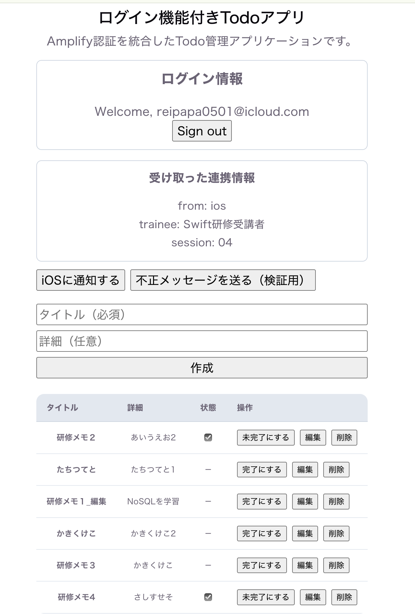
  - アカウントB
    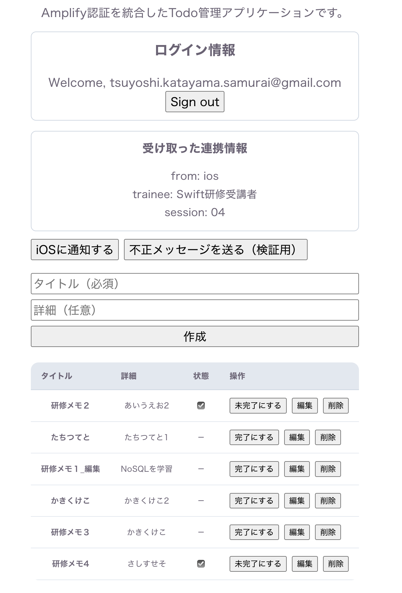

#### 0.5-2. AWSコンソールで関連パラメータを確認

1. AWSコンソールで **Cognito** を開く
2. 対象User Poolの **Users** を開く
3. テスト用アカウントA/Bが `CONFIRMED` であることを確認
    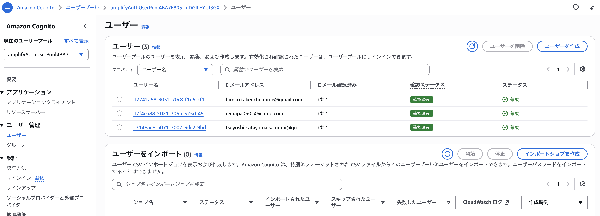
4. 同じUser Poolの **App integration** から App Client を開き、Webアプリが利用しているクライアントであることを確認する
    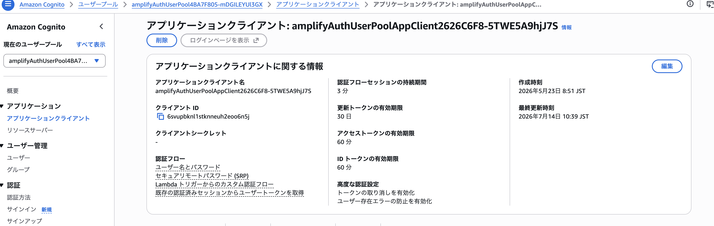
5. AWSコンソールで **AppSync** を開き、対象APIを選択する
6. **Settings** または認証設定画面で、既定の認証モードが `Amazon Cognito User Pool` であること、およびユーザプールIDを確認する
    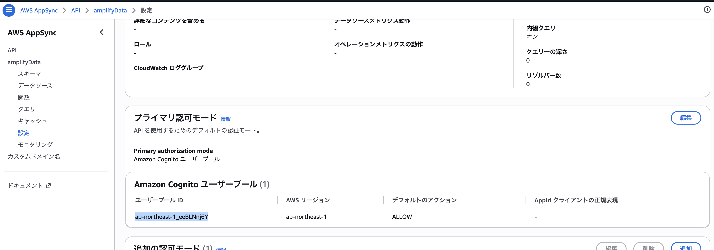
7. **Schema** 画面で `Todo` モデルが存在することを確認する
    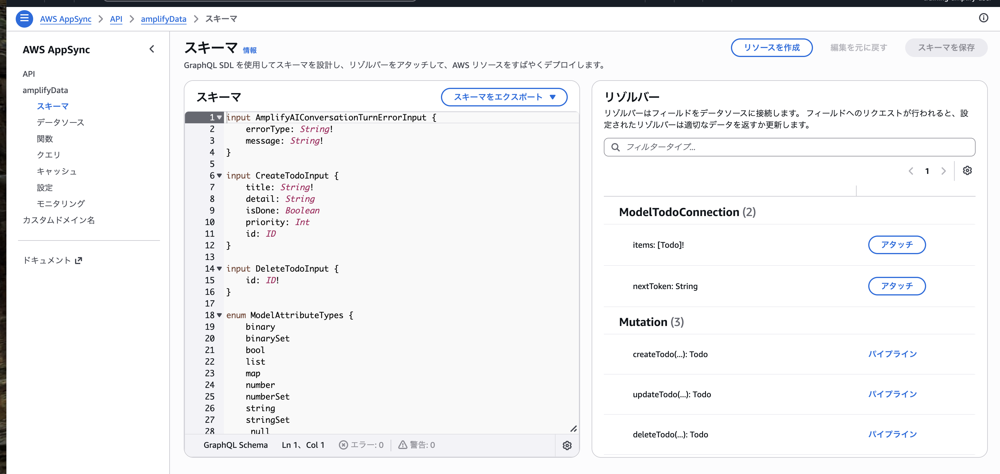
補足:

- `UNCONFIRMED` や無効ユーザーだと、認可検証より先に認証エラーになる
- AWSコンソールでは `allow.owner()` という文字列そのものは見えないことがある
- そのため、ここでは「User Pool認証が有効」「Todoモデルが対象APIに反映されている」という周辺パラメータを確認する
- Owner分離そのものの確認は、Step 0.5-1 と Step 3 / Step 4 のWebアプリ結果で行う

---

### Step 1: DataスキーマへOwnerルールを適用する

編集対象:

- `src/amplify-handson-01/web/amplify/data/resource.ts`

実装方針:

- Todoモデルの認可ルールを「認証済みなら全件」から「自分のレコードのみ」へ変更する
- 以降、`create` 時にOwner情報が自動付与され、`list`/`get`/`update`/`delete` 時にOwner条件が自動適用される

変更例:

```ts
import { type ClientSchema, a, defineData } from '@aws-amplify/backend';

const schema = a.schema({
    Todo: a
        .model({
            title: a.string().required(),
            detail: a.string(),
            isDone: a.boolean().default(false),
            priority: a.integer().default(0),
        })
        // .authorization((allow) => [
        //     allow.authenticated(),  // ← 認証済みユーザーのみアクセス可能に変更
        // ]),
        .authorization((allow) => [allow.owner()]), // 認証済みユーザーが作成したデータのみアクセス可能
});

export type Schema = ClientSchema<typeof schema>;

export const data = defineData({
    schema,
    authorizationModes: {
        defaultAuthorizationMode: 'userPool',
    },
});
```

補足:

- `allow.owner()` は「ログインユーザー自身がOwnerのレコードのみ許可」の意味
- Ownerフィールドはバックエンド側で管理されるため、通常はフロント側が明示的に書き込む必要はない

---

### Step 2: Sandboxへ反映し、API更新を確認する

`src/amplify-handson-01/web` で実行:

```bash
volta run npx ampx sandbox
```

確認ポイント:

- 差分デプロイが完了し、`[Sandbox] Watching for file changes...` が表示される
- `amplify_outputs.json` が更新される
  - L109が**private**から**owner**になっている
  - ```typescript
     "properties": {
        "rules": [
            {
            "provider": "userPools",
            "ownerField": "owner",
            "allow": "owner",
            .....
    ```
- エラーなく反映できる

#### 2-1. AWSコンソールで反映状態を確認する

1. AWSコンソールで **AppSync** を開く
2. 今回のSandbox環境で作成されたAPIを選択する
3. **Settings** または認証設定画面で、既定の認証モードが `Amazon Cognito User Pool` のままであることを確認する
4. **Schema** で `Todo` モデルが存在することを確認する
5. 必要に応じて最終更新時刻や関連リソースの更新時刻を確認し、Step 2 の反映後であることを確認する

確認観点:

- `amplify push` / Sandbox反映後のAPI設定が更新されている
- User Pool認証を利用するAPIとして引き続き動作している
- Webアプリ側で確認するOwner分離の前提条件が整っている

#### 2-2. Cognito側のユーザー確認

1. AWSコンソールで **Cognito** を開く
2. 対象User Poolの **Users** を開く
3. テスト用アカウントA/Bが作成済みで、`CONFIRMED` になっていることを確認する

補足:

- AppSyncの検証時に認証済みユーザーとして実行できない場合は、先にCognito側の状態を確認する
- ユーザー未確認や無効状態だと、Owner制御以前に認証エラーになる
- WebアプリでA/Bのログインが成功していれば、このStepではユーザー状態の再確認だけでよい

---

### Step 3: React側でOwner制御の挙動を確認する（アカウントA）

操作対象:

- `src/amplify-handson-01/web/src/App.jsx`（既存のままで可）

実施内容:

1. Webアプリへサインイン（アカウントA）
2. Todoを3件以上作成
3. 一覧表示・更新・削除が可能であることを確認

確認観点:

- Aが作成したデータはAには見える
- API呼び出し時にフロントでOwner条件を書かなくても、結果がAのデータに限定される
- Step 0.5 でA/Bに共通表示されていたデータが、反映後はAのデータだけに絞られている
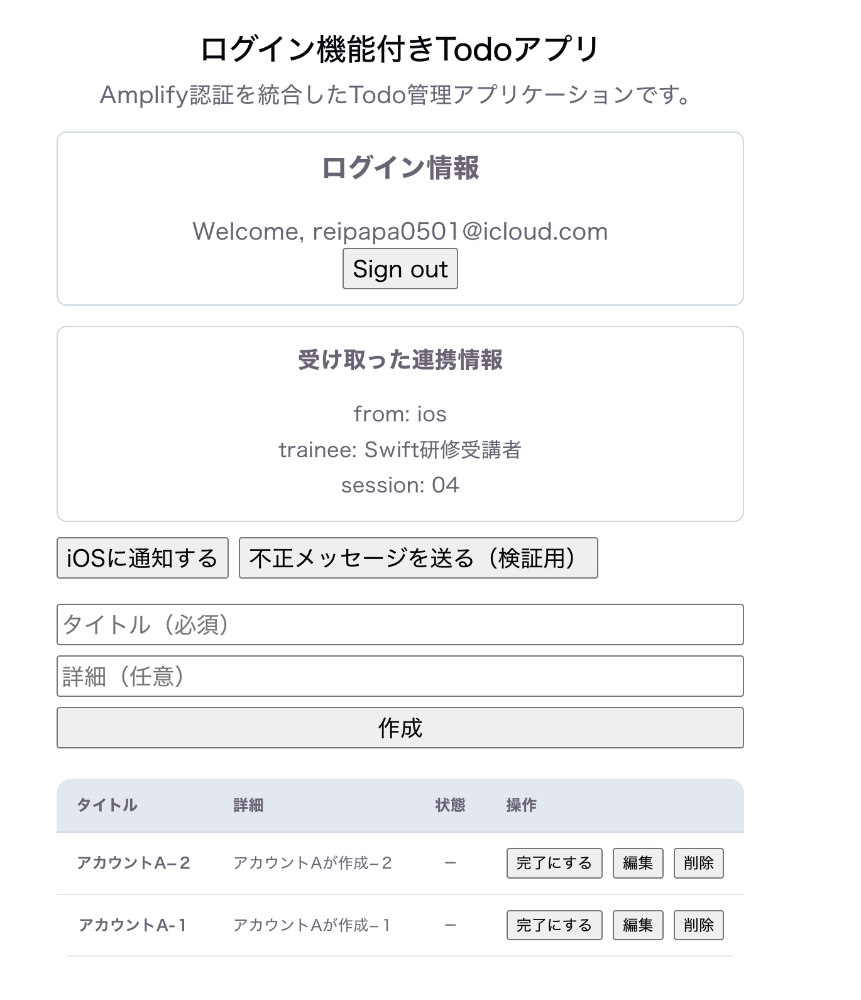

補足:

- これが「バックエンド側の自動フィルタリング」
- クライアントで `where owner == ...` を書かなくても、認可レイヤーで制限される

---

### Step 4: 別アカウントで非干渉を確認する（アカウントB）

実施内容:

1. Aをサインアウト
2. Bでサインイン
3. Todo一覧を確認
4. Bで新規Todoを作成
5. Aへ再ログインして一覧を再確認

期待結果:

- Bログイン直後、AのTodoは見えない
- Bで作成したTodoはBにのみ見える
- Aに戻ると、BのTodoは見えずAのTodoのみ見える
- Step 0.5 の反映前結果と比較して、A/Bで見えるデータが分離されたことが分かる

この時点で、ユーザー間のデータ非干渉が確認できる。

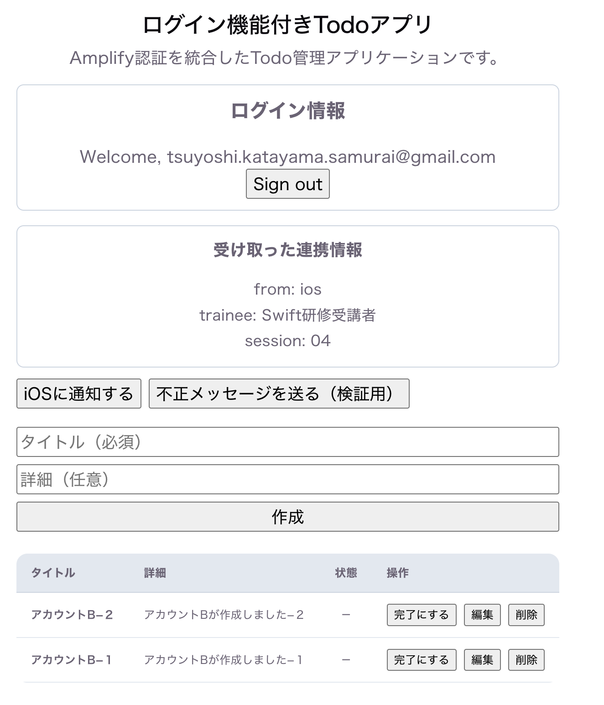

---

### Step 5: SwiftでAmplifyライブラリを使う準備をする

ここからはWebView経由ではなく、Swiftネイティブから直接GraphQL APIへアクセスします。

#### 5-1. Swift Packageを追加

5-1-1. Xcodeで `WebViewHandson02.xcodeproj` を開き、Package Dependenciesに以下を追加:

- `https://github.com/aws-amplify/amplify-swift`

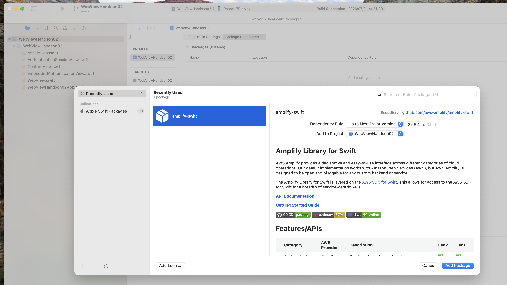

5-1-2. 推奨プロダクト:

- `Amplify`
- `AWSAPIPlugin`
- `AWSCognitoAuthPlugin`
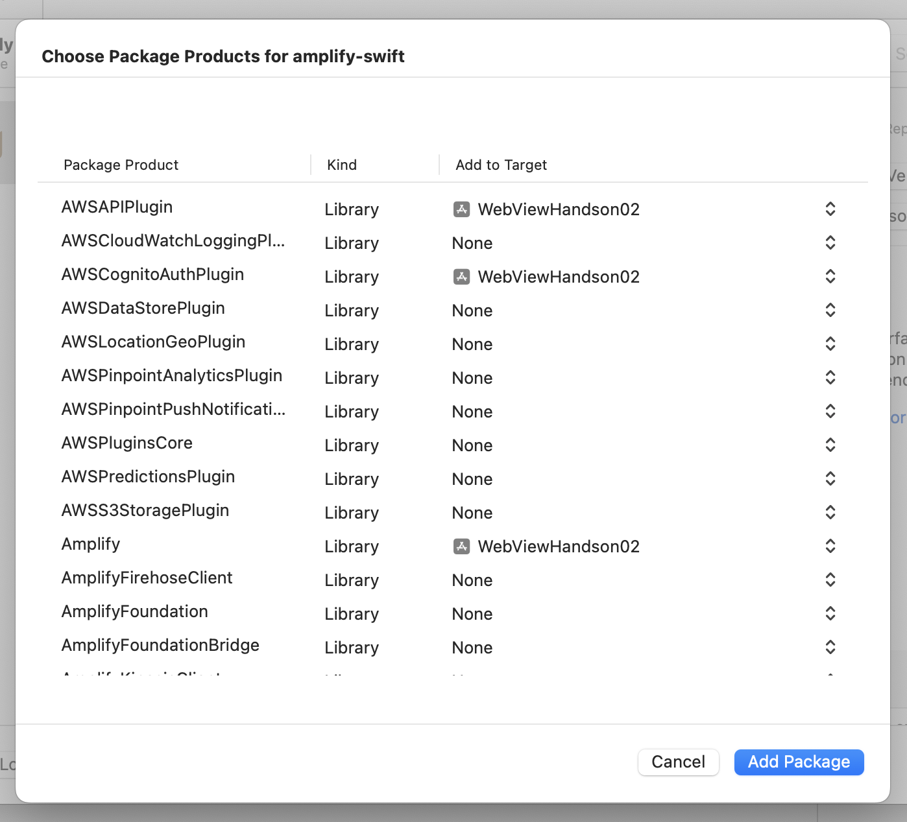

#### 5-2. Amplify設定ファイルをiOSターゲットへ含める

重要: Amplify Swift SDKは `amplifyconfiguration.json` (Gen 1形式) を探しますが、Amplify Gen 2では `amplify_outputs.json` (Gen 2形式) が生成されます。そのため、形式を変換する必要があります。

5-2-1. `amplify_outputs.json` の内容を確認

`src/amplify-handson-01/web/amplify_outputs.json` を開き、以下の値を控えておく:
- `auth.user_pool_id`
- `auth.user_pool_client_id`
- `auth.identity_pool_id`
- `auth.aws_region`
- `data.url`

5-2-2. `amplifyconfiguration.json` を作成
- ※ XCode上で作成でも可

`src/WebViewHandson02/WebViewHandson02/amplifyconfiguration.json` を新規作成し、以下の内容を記述:

```json
{
  "UserAgent": "aws-amplify-cli/2.0",
  "Version": "1.0",
  "auth": {
    "plugins": {
      "awsCognitoAuthPlugin": {
        "UserAgent": "aws-amplify/cli",
        "Version": "0.1.0",
        "IdentityManager": {
          "Default": {}
        },
        "CredentialsProvider": {
          "CognitoIdentity": {
            "Default": {
              "PoolId": "<identity_pool_id の値>",
              "Region": "<aws_region の値>"
            }
          }
        },
        "CognitoUserPool": {
          "Default": {
            "PoolId": "<user_pool_id の値>",
            "AppClientId": "<user_pool_client_id の値>",
            "Region": "<aws_region の値>"
          }
        },
        "Auth": {
          "Default": {
            "authenticationFlowType": "USER_SRP_AUTH"
          }
        }
      }
    }
  },
  "api": {
    "plugins": {
      "awsAPIPlugin": {
        "<data.url から抽出したAPI ID>": {
          "endpointType": "GraphQL",
          "endpoint": "<data.url の値>",
          "region": "<aws_region の値>",
          "authorizationType": "AMAZON_COGNITO_USER_POOLS"
        }
      }
    }
  }
}
```
```

**注意:** API ID は `data.url` から抽出します。例: `https://abc123.appsync-api.ap-northeast-1.amazonaws.com/graphql` の場合、API ID は `abc123` です。

5-2-3. Xcodeでファイルをプロジェクトに追加

Project navigatorで、フォルダを右クリックして Add Files to "WebViewHandson02"... を選択し、`amplifyconfiguration.json` を追加
    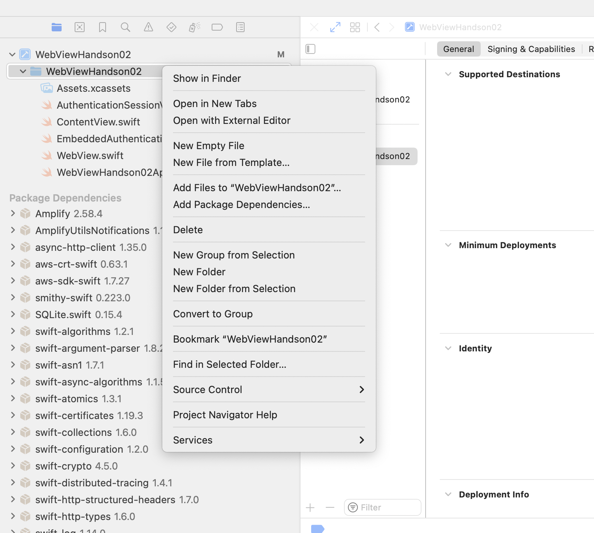

5-2-4. ダイアログで次を確認
    - ✅ "Copy items if needed" にチェック（既にファイルがある場合は不要）
    - ✅ Target: WebViewHandson02 にチェック
    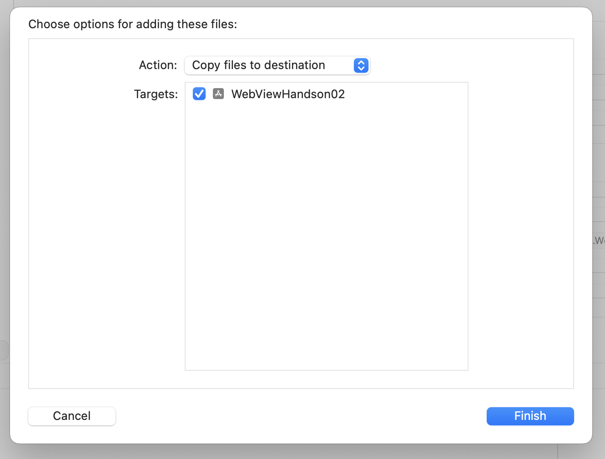

5-2-5. Project Navigator で `amplifyconfiguration.json` を選択し、右ペイン File Inspector を開く
5-2-6. Target Membershipが有効化されていることを確認
    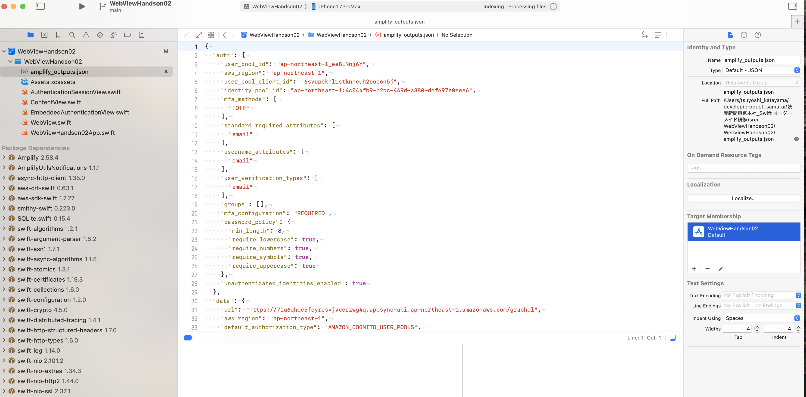
5-2-7. buildして確認
- 下記のダイアログが表示された場合は、`Trust & Enable` を押して再buildする
    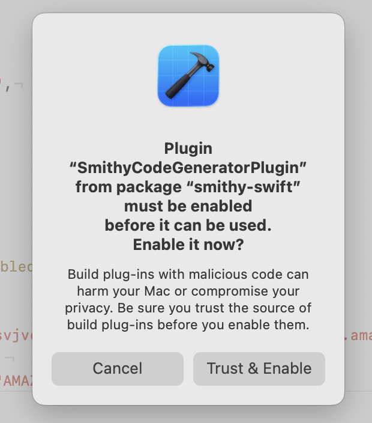
5-2-8. ファイルがバンドルに入っていることを確認
    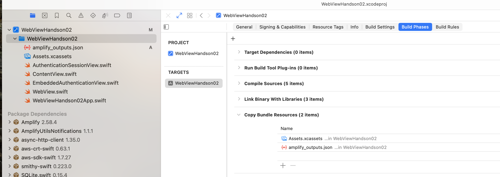

補足:
- Amplify Gen 2 は `amplify_outputs.json` (新形式) を生成
- Amplify Swift SDK は `amplifyconfiguration.json` (旧形式) を読み込む
- 上記のように手動で変換が必要
---

### Step 6: Amplify初期化コードを追加する

編集対象:

- `src/WebViewHandson02/WebViewHandson02/WebViewHandson02App.swift`

実装例:

```swift
import SwiftUI
import Amplify
import AWSAPIPlugin
import AWSCognitoAuthPlugin

class AppDelegate: NSObject, UIApplicationDelegate {
    func application(_ application: UIApplication, didFinishLaunchingWithOptions launchOptions: [UIApplication.LaunchOptionsKey : Any]? = nil) -> Bool {
        configureAmplify()
        return true
    }

    private func configureAmplify() {
        do {
            try Amplify.add(plugin: AWSCognitoAuthPlugin())
            try Amplify.add(plugin: AWSAPIPlugin())

            // amplifyconfiguration.json を自動検出して読み込む
            try Amplify.configure()

            print("✅ Amplify configured successfully")
        } catch {
            print("❌ Amplify configure failed: \(error)")
        }
    }
}

@main
struct WebViewHandson02App: App {
    @UIApplicationDelegateAdaptor(AppDelegate.self) var appDelegate

    var body: some Scene {
        WindowGroup {
            ContentView()
        }
    }
}
```

重要ポイント:

- `UIApplicationDelegate` を使うことで、アプリ起動時に確実にAmplifyを初期化できる
- `didFinishLaunchingWithOptions` は View の初期化前に呼ばれるため、API呼び出し時には設定が完了している
- `Amplify.configure()` は Bundle 内の `amplifyconfiguration.json` を自動検出する

---

### Step 7: SwiftネイティブのTodo一覧画面を作る

#### 7-1. Todoモデル用ファイルを追加

新規作成ファイル:

- `src/WebViewHandson02/WebViewHandson02/NativeTodo.swift`

```swift
import Foundation

struct NativeTodo: Identifiable, Decodable {
    let id: String
    let title: String
    let detail: String?
    let isDone: Bool?
    let priority: Int?
}
```

#### 7-2. ViewModelを追加

新規作成ファイル:

- `src/WebViewHandson02/WebViewHandson02/NativeTodoListViewModel.swift`

```swift
import Foundation
import Combine
import Amplify

@MainActor
final class NativeTodoListViewModel: ObservableObject {
    @Published var todos: [NativeTodo] = []
    @Published var errorMessage: String = ""
    @Published var isAuthenticated: Bool = false
    @Published var userEmail: String = ""
    @Published var isAwaitingMFA: Bool = false
    @Published var isLoading: Bool = false

    func checkAuthStatus() async {
        do {
            let session = try await Amplify.Auth.fetchAuthSession()
            self.isAuthenticated = session.isSignedIn

            if session.isSignedIn {
                // ユーザー情報を取得
                let user = try await Amplify.Auth.getCurrentUser()
                self.userEmail = user.username
            } else {
                self.userEmail = ""
            }
        } catch {
            self.isAuthenticated = false
            self.userEmail = ""
            print("❌ Auth status check failed: \(error)")
        }
    }

    func signIn(username: String, password: String) async {
        self.isLoading = true
        self.errorMessage = ""

        do {
            let signInResult = try await Amplify.Auth.signIn(
                username: username,
                password: password
            )

            // MFAが必要な場合
            if case .confirmSignInWithTOTPCode = signInResult.nextStep {
                self.isAwaitingMFA = true
                self.isLoading = false
                print("✅ MFA required")
            } else if signInResult.isSignedIn {
                // ログイン完了
                self.isAwaitingMFA = false
                self.isLoading = false
                await checkAuthStatus()
                await loadTodos()
                print("✅ Sign in successful")
            }
        } catch {
            self.errorMessage = "ログインエラー: \(error.localizedDescription)"
            self.isLoading = false
            self.isAwaitingMFA = false
            print("❌ Sign in failed: \(error)")
        }
    }

    func confirmSignIn(totpCode: String) async {
        self.isLoading = true
        self.errorMessage = ""

        do {
            let signInResult = try await Amplify.Auth.confirmSignIn(
                challengeResponse: totpCode
            )

            if signInResult.isSignedIn {
                self.isAwaitingMFA = false
                self.isLoading = false
                await checkAuthStatus()
                await loadTodos()
                print("✅ MFA confirmation successful")
            }
        } catch {
            self.errorMessage = "MFA認証エラー: \(error.localizedDescription)"
            self.isLoading = false
            print("❌ MFA confirmation failed: \(error)")
        }
    }

    func cancelSignIn() {
        self.isAwaitingMFA = false
        self.errorMessage = ""
    }

    func signOut() async {
        _ = await Amplify.Auth.signOut()
        self.isAuthenticated = false
        self.userEmail = ""
        self.todos = []
        self.errorMessage = ""
        self.isAwaitingMFA = false
        self.isLoading = false
    }

    func loadTodos() async {
        // 認証状態を確認
        await checkAuthStatus()

        guard isAuthenticated else {
            self.errorMessage = ""
            self.todos = []
            return
        }

        // GraphQL クエリを実行
        do {
            let document = """
            query ListTodos {
              listTodos {
                items {
                  id
                  title
                  detail
                  isDone
                  priority
                }
              }
            }
            """

            let request = GraphQLRequest<JSONValue>(
                document: document,
                responseType: JSONValue.self,
                decodePath: nil
            )

            let result = try await Amplify.API.query(request: request)
            switch result {
            case .success(let json):
                let parsed = Self.parseTodos(from: json)
                self.todos = parsed
                self.errorMessage = parsed.isEmpty ? "表示できるTodoがありません" : ""
            case .failure(let apiError):
                self.errorMessage = "API呼び出しエラー: \(apiError.errorDescription)"
                print("❌ API Error: \(apiError)")
            }
        } catch {
            self.errorMessage = "エラー: \(error.localizedDescription)"
            print("❌ Exception: \(error)")
        }
    }

    private static func parseTodos(from json: JSONValue) -> [NativeTodo] {
        guard
            case .object(let root) = json,
            case .object(let listTodos)? = root["listTodos"],
            case .array(let items)? = listTodos["items"]
        else {
            return []
        }

        return items.compactMap { item -> NativeTodo? in
            guard
                case .object(let object) = item,
                case .string(let id)? = object["id"],
                case .string(let title)? = object["title"]
            else {
                return nil
            }

            let detail: String?
            if case .string(let value)? = object["detail"] { detail = value } else { detail = nil }

            let isDone: Bool?
            if case .boolean(let value)? = object["isDone"] { isDone = value } else { isDone = nil }

            let priority: Int?
            if case .number(let value)? = object["priority"] { priority = Int(value) } else { priority = nil }

            return NativeTodo(id: id, title: title, detail: detail, isDone: isDone, priority: priority)
        }
    }
}
```

重要ポイント:
- Native Todoタブ専用のログイン機能を実装（ユーザー名・パスワード方式）
- MFA必須のため、2段階のログインフロー：
  1. `Amplify.Auth.signIn(username:password:)` でメール・パスワード認証
  2. `Amplify.Auth.confirmSignIn(challengeResponse:)` でTOTPコード認証
- `isAwaitingMFA` でMFA待ち状態を管理し、画面を切り替える
- `isLoading` でローディング中の状態を表示
- WKWebViewタブとは独立した認証セッション

#### 7-3. 一覧Viewを追加

作成ファイル:

- `src/WebViewHandson02/WebViewHandson02/NativeTodoListView.swift`

```swift
import SwiftUI

struct NativeTodoListView: View {
    @StateObject private var viewModel = NativeTodoListViewModel()
    @State private var username: String = ""
    @State private var password: String = ""
    @State private var totpCode: String = ""

    var body: some View {
        NavigationStack {
            Group {
                if !viewModel.isAuthenticated {
                    // 未ログイン時の表示
                    if viewModel.isAwaitingMFA {
                        // MFAコード入力画面
                        VStack(spacing: 20) {
                            Text("認証アプリのコードを入力してください")
                                .font(.headline)
                                .padding(.top)

                            TextField("TOTPコード", text: $totpCode)
                                .keyboardType(.numberPad)
                                .textFieldStyle(.roundedBorder)
                                .padding(.horizontal)

                            if !viewModel.errorMessage.isEmpty {
                                Text(viewModel.errorMessage)
                                    .foregroundStyle(.red)
                                    .font(.caption)
                                    .padding(.horizontal)
                            }

                            Button(action: {
                                Task {
                                    await viewModel.confirmSignIn(totpCode: totpCode)
                                    totpCode = ""
                                }
                            }) {
                                if viewModel.isLoading {
                                    ProgressView()
                                        .progressViewStyle(CircularProgressViewStyle(tint: .white))
                                        .frame(maxWidth: .infinity)
                                } else {
                                    Text("認証")
                                        .font(.headline)
                                        .frame(maxWidth: .infinity)
                                }
                            }
                            .padding()
                            .background(totpCode.isEmpty ? Color.gray : Color.blue)
                            .foregroundColor(.white)
                            .cornerRadius(10)
                            .disabled(totpCode.isEmpty || viewModel.isLoading)
                            .padding(.horizontal)

                            Button("キャンセル") {
                                viewModel.cancelSignIn()
                                totpCode = ""
                            }
                            .foregroundStyle(.secondary)
                        }
                        .padding()
                    } else {
                        // ログイン画面
                        VStack(spacing: 20) {
                            Text("Native Todoを表示するにはログインが必要です")
                                .font(.headline)
                                .multilineTextAlignment(.center)
                                .padding(.top)

                            VStack(spacing: 12) {
                                TextField("メールアドレス", text: $username)
                                    .textContentType(.username)
                                    .keyboardType(.emailAddress)
                                    .autocapitalization(.none)
                                    .textFieldStyle(.roundedBorder)

                                SecureField("パスワード", text: $password)
                                    .textContentType(.password)
                                    .textFieldStyle(.roundedBorder)
                            }
                            .padding(.horizontal)

                            if !viewModel.errorMessage.isEmpty {
                                Text(viewModel.errorMessage)
                                    .foregroundStyle(.red)
                                    .font(.caption)
                                    .padding(.horizontal)
                            }

                            Button(action: {
                                Task {
                                    await viewModel.signIn(username: username, password: password)
                                }
                            }) {
                                if viewModel.isLoading {
                                    ProgressView()
                                        .progressViewStyle(CircularProgressViewStyle(tint: .white))
                                        .frame(maxWidth: .infinity)
                                } else {
                                    Label("ログイン", systemImage: "person.circle")
                                        .font(.headline)
                                        .frame(maxWidth: .infinity)
                                }
                            }
                            .padding()
                            .background(username.isEmpty || password.isEmpty ? Color.gray : Color.blue)
                            .foregroundColor(.white)
                            .cornerRadius(10)
                            .disabled(username.isEmpty || password.isEmpty || viewModel.isLoading)
                            .padding(.horizontal)

                            Text("※ MFA必須のため、ログイン後にTOTPコードの入力が必要です")
                                .font(.caption)
                                .foregroundStyle(.secondary)
                                .padding(.horizontal)
                        }
                        .padding()
                    }
                } else {
                    // ログイン済み時の表示
                    if !viewModel.errorMessage.isEmpty {
                        Text(viewModel.errorMessage)
                            .foregroundStyle(.red)
                            .padding()
                    } else if viewModel.todos.isEmpty {
                        VStack(spacing: 16) {
                            Text("表示できるTodoがありません")
                                .foregroundStyle(.secondary)
                            Text("WKWebViewタブでTodoを作成してください")
                                .font(.caption)
                                .foregroundStyle(.secondary)
                        }
                    } else {
                        List(viewModel.todos) { todo in
                            VStack(alignment: .leading, spacing: 4) {
                                Text(todo.title)
                                    .font(.headline)
                                if let detail = todo.detail, !detail.isEmpty {
                                    Text(detail)
                                        .font(.subheadline)
                                }
                            }
                        }
                    }
                }
            }
            .navigationTitle("Native Todo")
            .toolbar {
                ToolbarItemGroup(placement: .navigationBarTrailing) {
                    if viewModel.isAuthenticated {
                        Menu {
                            Button(action: {
                                Task { await viewModel.loadTodos() }
                            }) {
                                Label("再読込", systemImage: "arrow.clockwise")
                            }

                            Button(role: .destructive, action: {
                                Task { await viewModel.signOut() }
                            }) {
                                Label("サインアウト", systemImage: "rectangle.portrait.and.arrow.right")
                            }
                        } label: {
                            Image(systemName: "ellipsis.circle")
                        }
                    } else {
                        Button("再読込") {
                            Task { await viewModel.checkAuthStatus() }
                        }
                    }
                }
            }
            .task {
                await viewModel.loadTodos()
            }
        }
    }
}

#Preview {
    NativeTodoListView()
}
```

重要ポイント:
- ユーザー名（メールアドレス）・パスワード入力フォーム
- MFA待ち状態では自動的にTOTPコード入力画面に切り替わる
- ローディング中はProgressViewを表示
- ログイン済み時はメニューから再読込・サインアウト可能

#### 7-4. タブへ追加

編集対象:

- `src/WebViewHandson02/WebViewHandson02/ContentView.swift`

変更例:

```swift
TabView {
    EmbeddedAuthenticationView(baseURL: hostedBaseURL)
        .tabItem {
            Label("WKWebView", systemImage: "globe")
        }

    AuthenticationSessionView(baseURL: hostedBaseURL)
        .tabItem {
            Label("認証セッション", systemImage: "lock.shield")
        }

    NativeTodoListView()
        .tabItem {
            Label("Native Todo", systemImage: "list.bullet.rectangle")
        }
}
```

---

### Step 8: Swift側でもアカウントA/Bの非干渉を確認する

重要: Native TodoタブはWKWebViewタブや認証セッションタブとは独立した認証セッションを持ちます。そのため、Native Todoタブでデータを表示するには、Native Todoタブ内でユーザー名・パスワードでログインする必要があります。

#### 8-1. アカウントAでログインして確認

実施内容:

1. **Native Todoタブ** を開く
2. メールアドレスとパスワードを入力
3. 「ログイン」ボタンをタップ
4. MFA画面が表示されるので、認証アプリ（Google Authenticator等）のTOTPコードを入力
5. 「認証」ボタンをタップ
6. ログイン成功後、自動的にAのTodoが表示される
7. WKWebViewタブで作成したTodoと同じデータが表示されることを確認

確認観点:
- Native TodoタブでもAが作成したTodoが見える
- React（WKWebView）とSwift（Native）で見えるデータが一致する
- 2段階認証（パスワード＋TOTP）が正常に動作する

#### 8-2. アカウントBで非干渉を確認

実施内容:

1. Native Todoタブの右上メニュー（…）から「サインアウト」をタップ
2. **アカウントB** のメールアドレスとパスワードを入力
3. 「ログイン」ボタンをタップ
4. アカウントBの認証アプリからTOTPコードを入力
5. 「認証」ボタンをタップ
6. BのTodoのみ表示されることを確認（AのTodoは見えない）
7. WKWebViewタブでもBアカウントに切り替えて、同じデータが表示されることを確認

確認観点:
- Native TodoタブでBのデータのみ表示される
- AのデータはBから見えない（Owner分離が機能）
- React画面とSwift画面で見えるデータ集合が一致する
- どちらのフロントからアクセスしてもOwner境界が崩れない

補足:
- WKWebViewタブと Native Todoタブは**別々の認証セッション**を持つ
- WKWebViewタブでログインしても、Native Todoタブでは別途ログインが必要
- ユーザー名・パスワード方式を使用（Hosted UI ではなく直接認証）
- MFA必須なので、毎回TOTPコードの入力が必要
- これは技術的な制約であり、実際のアプリでは認証トークンの共有などで統合可能

---

## 5. 仕組みの整理（重要）

### 5-1. なぜOwnerで分離できるか

- Todo作成時に、バックエンドが作成ユーザーをOwnerとして記録
- 読み取り/更新/削除時に、認証済みユーザーとOwnerを照合
- 一致しないレコードはレスポンスから除外または拒否される

### 5-2. フロントを増やしても安全性を保てる理由

- 認可はフロントではなくバックエンドで判定
- React/Swiftなどクライアント実装が違っても、同じ認可ポリシーが適用される

---

## 6. この回の完了チェック

- `amplify/data/resource.ts` がOwnerルールになっている
- アカウントA/Bで相互にデータが見えない
- SwiftネイティブListでTodoが取得できる
- ReactとSwiftの表示結果がユーザー単位で一致している

---

## 7. トラブルシューティング

### 7-1. BでAのデータが見えてしまう

確認事項:

- `authorization((allow) => [allow.owner()])` になっているか
- Sandboxの再デプロイが成功しているか
- 古い環境へ接続していないか（`amplify_outputs.json` の取り違え）

### 7-2. ログインエラーが発生する

#### パターン1: メールアドレスまたはパスワードが間違っている

エラーメッセージ例:
```
ログインエラー: Incorrect username or password.
```

解決方法:
- 正しいメールアドレスとパスワードを入力
- WKWebViewタブで使用しているのと同じアカウント情報を使用
- パスワードをリセットする場合は、AWS Cognitoコンソールから

#### パターン2: TOTPコードが間違っている

エラーメッセージ例:
```
MFA認証エラー: Invalid code
```

解決方法:
- 認証アプリで最新のコードを確認
- コードは30秒ごとに更新されるため、新しいコードを入力
- 6桁の数字を正確に入力

#### パターン3: Native Todoタブで「ログインが必要です」と表示される

原因:
- Native TodoタブはWKWebViewタブや認証セッションタブとは**独立した認証セッション**を持つ
- WKWebViewタブでログインしても、Native Todoタブには認証情報が共有されない
- これはiOSのセキュリティモデルによる技術的な制約

解決方法:
1. **Native Todoタブ内でログイン:**
   - メールアドレスとパスワードを入力
   - 「ログイン」ボタンをタップ
   - TOTPコードを入力して認証
   - ログイン成功後、自動的にTodoが読み込まれる

2. **認証の仕組みを理解:**
   - WKWebView = ブラウザのCookie・セッションを使用
   - Native Swift = iOSのKeychain・アプリ内トークンを使用
   - この2つは別々の領域に保存されるため共有されない

3. **開発時の対処:**
   - 各タブでそれぞれログインする（検証用）
   - 実際のアプリでは認証トークンを共有する実装が可能

### 7-3. Swift画面が空のまま（エラーメッセージなし）

確認事項:

- まずWeb（React）で同一アカウントのデータが存在するか
  - WKWebViewタブでログイン後、Todoを作成
  - 作成したTodoが表示されることを確認
- GraphQLドキュメントの `listTodos` フィールド名がバックエンド定義と一致しているか
  - Backend スキーマが `Todo` モデルを定義しているか
  - Sandbox がデプロイされているか
- エラーメッセージを画面に表示して原因を確認できているか
  - NativeTodoListView で `errorMessage` を表示しているか
  - Xcodeのコンソールログを確認
- ログイン状態を確認
  - 別タブでログインしてから Native Todo タブに切り替えているか
  - 「再読込」ボタンを押しているか

---

## 8. 振り返り

この回では、以下を一連で検証しました。

- Owner認可の設定
- バックエンド自動フィルタリング
- ReactとSwiftネイティブの共通DBアクセス
- 別ユーザーとの非干渉

これにより、複数フロントエンドを持つ構成でも、バックエンドの認可ルールを中心に安全性を担保できることを確認できました。

---

## 9. 発展: Native TodoタブにCRUD機能を追加

ここまでのステップでNative TodoタブではTodoの表示のみ実装していました。このセクションでは、Create（作成）・Update（更新）・Delete（削除）機能を追加し、完全なTodo管理アプリケーションを実装します。

### 9-1. 実装する機能

1. **作成機能**
   - 青色の「＋」ボタンで新規Todo作成
   - タイトル・詳細・完了状態・優先度を入力

2. **更新機能**
   - 各Todoの編集ボタンで既存Todoを編集
   - チェックボックスで完了/未完了を切り替え

3. **削除機能**
   - 削除ボタンまたはスワイプで削除
   - 削除前に確認アラートを表示

4. **パスワード表示切り替え**
   - ログイン画面で目のアイコンをタップ
   - パスワードの伏せ字/平文表示を切り替え

### 9-2. ViewModelにCRUD機能を追加

編集対象:
- `src/WebViewHandson02/WebViewHandson02/NativeTodoListViewModel.swift`

既存の`loadTodos()`メソッドに加えて、以下のメソッドを追加します：

```swift
import Foundation
import Combine
import Amplify

@MainActor
final class NativeTodoListViewModel: ObservableObject {
    @Published var todos: [NativeTodo] = []
    @Published var errorMessage: String = ""
    @Published var isAuthenticated: Bool = false
    @Published var userEmail: String = ""
    @Published var isAwaitingMFA: Bool = false
    @Published var isLoading: Bool = false

    func checkAuthStatus() async {
        do {
            let session = try await Amplify.Auth.fetchAuthSession()
            self.isAuthenticated = session.isSignedIn

            if session.isSignedIn {
                // ユーザー情報を取得
                let user = try await Amplify.Auth.getCurrentUser()
                self.userEmail = user.username
            } else {
                self.userEmail = ""
            }
        } catch {
            self.isAuthenticated = false
            self.userEmail = ""
            print("❌ Auth status check failed: \(error)")
        }
    }

    func signIn(username: String, password: String) async {
        self.isLoading = true
        self.errorMessage = ""

        do {
            let signInResult = try await Amplify.Auth.signIn(
                username: username,
                password: password
            )

            // MFAが必要な場合
            if case .confirmSignInWithTOTPCode = signInResult.nextStep {
                self.isAwaitingMFA = true
                self.isLoading = false
                print("✅ MFA required")
            } else if signInResult.isSignedIn {
                // ログイン完了
                self.isAwaitingMFA = false
                self.isLoading = false
                await checkAuthStatus()
                await loadTodos()
                print("✅ Sign in successful")
            }
        } catch {
            self.errorMessage = "ログインエラー: \(error.localizedDescription)"
            self.isLoading = false
            self.isAwaitingMFA = false
            print("❌ Sign in failed: \(error)")
        }
    }

    func confirmSignIn(totpCode: String) async {
        self.isLoading = true
        self.errorMessage = ""

        do {
            let signInResult = try await Amplify.Auth.confirmSignIn(
                challengeResponse: totpCode
            )

            if signInResult.isSignedIn {
                self.isAwaitingMFA = false
                self.isLoading = false
                await checkAuthStatus()
                await loadTodos()
                print("✅ MFA confirmation successful")
            }
        } catch {
            self.errorMessage = "MFA認証エラー: \(error.localizedDescription)"
            self.isLoading = false
            print("❌ MFA confirmation failed: \(error)")
        }
    }

    func cancelSignIn() {
        self.isAwaitingMFA = false
        self.errorMessage = ""
    }

    func signOut() async {
        _ = await Amplify.Auth.signOut()
        self.isAuthenticated = false
        self.userEmail = ""
        self.todos = []
        self.errorMessage = ""
        self.isAwaitingMFA = false
        self.isLoading = false
    }

    func loadTodos() async {
        // 認証状態を確認
        await checkAuthStatus()

        guard isAuthenticated else {
            self.errorMessage = ""
            self.todos = []
            return
        }

        // GraphQL クエリを実行
        do {
            let document = """
            query ListTodos {
              listTodos {
                items {
                  id
                  title
                  detail
                  isDone
                  priority
                }
              }
            }
            """

            let request = GraphQLRequest<JSONValue>(
                document: document,
                responseType: JSONValue.self,
                decodePath: nil
            )

            let result = try await Amplify.API.query(request: request)
            switch result {
            case .success(let json):
                let parsed = Self.parseTodos(from: json)
                self.todos = parsed
                self.errorMessage = parsed.isEmpty ? "表示できるTodoがありません" : ""
            case .failure(let apiError):
                self.errorMessage = "API呼び出しエラー: \(apiError.errorDescription)"
                print("❌ API Error: \(apiError)")
            }
        } catch {
            self.errorMessage = "エラー: \(error.localizedDescription)"
            print("❌ Exception: \(error)")
        }
    }

    func createTodo(title: String, detail: String?, isDone: Bool, priority: Int?) async {
        let document = """
        mutation CreateTodo($title: String!, $detail: String, $isDone: Boolean, $priority: Int) {
          createTodo(input: {
            title: $title
            detail: $detail
            isDone: $isDone
            priority: $priority
          }) {
            id
            title
            detail
            isDone
            priority
          }
        }
        """

        let variables = buildVariables(title: title, detail: detail, isDone: isDone, priority: priority)
        await executeMutation(document: document, variables: variables, operationName: "作成")
    }

    func updateTodo(id: String, title: String, detail: String?, isDone: Bool, priority: Int?) async {
        let document = """
        mutation UpdateTodo($id: ID!, $title: String!, $detail: String, $isDone: Boolean, $priority: Int) {
          updateTodo(input: {
            id: $id
            title: $title
            detail: $detail
            isDone: $isDone
            priority: $priority
          }) {
            id
            title
            detail
            isDone
            priority
          }
        }
        """

        let variables = buildVariables(id: id, title: title, detail: detail, isDone: isDone, priority: priority)
        await executeMutation(document: document, variables: variables, operationName: "更新")
    }

    // MARK: - Private Helper Methods

    private func buildVariables(
        id: String? = nil,
        title: String,
        detail: String?,
        isDone: Bool,
        priority: Int?
    ) -> [String: Any] {
        let detailValue = detail?.isEmpty == false ? detail : nil

        var variables: [String: Any] = [
            "title": title,
            "detail": detailValue as Any,
            "isDone": isDone,
            "priority": priority as Any
        ]

        if let id = id {
            variables["id"] = id
        }

        return variables.compactMapValues { $0 }
    }

    private func executeMutation(
        document: String,
        variables: [String: Any],
        operationName: String
    ) async {
        guard isAuthenticated else {
            self.errorMessage = "ログインが必要です"
            return
        }

        self.isLoading = true
        self.errorMessage = ""

        do {
            let request = GraphQLRequest<JSONValue>(
                document: document,
                variables: variables,
                responseType: JSONValue.self
            )

            let result = try await Amplify.API.mutate(request: request)
            switch result {
            case .success:
                await loadTodos()
                print("✅ Todo \(operationName) successfully")
            case .failure(let apiError):
                self.errorMessage = "\(operationName)エラー: \(apiError.errorDescription)"
                print("❌ \(operationName) Error: \(apiError)")
            }
        } catch {
            self.errorMessage = "エラー: \(error.localizedDescription)"
            print("❌ Exception: \(error)")
        }

        self.isLoading = false
    }

    func deleteTodo(id: String) async {
        let document = """
        mutation DeleteTodo($id: ID!) {
          deleteTodo(input: {
            id: $id
          }) {
            id
          }
        }
        """

        let variables: [String: Any] = ["id": id]
        await executeMutation(document: document, variables: variables, operationName: "削除")
    }

    func toggleTodoDone(todo: NativeTodo) async {
        await updateTodo(
            id: todo.id,
            title: todo.title,
            detail: todo.detail,
            isDone: !(todo.isDone ?? false),
            priority: todo.priority
        )
    }

    private static func parseTodos(from json: JSONValue) -> [NativeTodo] {
        guard
            case .object(let root) = json,
            case .object(let listTodos)? = root["listTodos"],
            case .array(let items)? = listTodos["items"]
        else {
            return []
        }

        return items.compactMap { item -> NativeTodo? in
            guard
                case .object(let object) = item,
                case .string(let id)? = object["id"],
                case .string(let title)? = object["title"]
            else {
                return nil
            }

            let detail: String?
            if case .string(let value)? = object["detail"] { detail = value } else { detail = nil }

            let isDone: Bool?
            if case .boolean(let value)? = object["isDone"] { isDone = value } else { isDone = nil }

            let priority: Int?
            if case .number(let value)? = object["priority"] { priority = Int(value) } else { priority = nil }

            return NativeTodo(id: id, title: title, detail: detail, isDone: isDone, priority: priority)
        }
    }
}
```

重要ポイント:
- **リファクタリング**: 共通ロジックを`buildVariables()`と`executeMutation()`に抽出
- **型安全性**: オプショナル型の明示的な変換（`as Any`）でWarningを解消
- **一貫性**: すべてのmutation操作が同じパターンで実装される

### 9-3. ViewにCRUD UIを追加

編集対象:
- `src/WebViewHandson02/WebViewHandson02/NativeTodoListView.swift`

#### 9-3-1. 状態変数を追加

```swift
struct NativeTodoListView: View {
    @StateObject private var viewModel = NativeTodoListViewModel()
    @State private var username: String = ""
    @State private var password: String = ""
    @State private var totpCode: String = ""
    @State private var showingCreateSheet = false
    @State private var editingTodo: NativeTodo?
    @State private var deletingTodo: NativeTodo?
    @State private var isPasswordVisible = false

    // ... 以下省略
}
```

#### 9-3-2. Todoリスト表示をCRUD対応に変更

```swift
List {
    ForEach(viewModel.todos) { todo in
        HStack {
            // チェックボックス
            Button(action: {
                Task {
                    await viewModel.toggleTodoDone(todo: todo)
                }
            }) {
                Image(systemName: todo.isDone == true ? "checkmark.circle.fill" : "circle")
                    .foregroundStyle(todo.isDone == true ? .green : .gray)
                    .font(.title3)
            }
            .buttonStyle(.plain)

            // タイトルと詳細
            VStack(alignment: .leading, spacing: 4) {
                Text(todo.title)
                    .font(.headline)
                    .strikethrough(todo.isDone == true)
                if let detail = todo.detail, !detail.isEmpty {
                    Text(detail)
                        .font(.subheadline)
                        .foregroundStyle(.secondary)
                }
            }

            Spacer()

            // 編集・削除ボタン
            HStack(spacing: 16) {
                Button(action: {
                    editingTodo = todo
                }) {
                    Image(systemName: "pencil.circle.fill")
                        .foregroundStyle(.blue)
                        .font(.title2)
                }
                .buttonStyle(.plain)

                Button(action: {
                    deletingTodo = todo
                }) {
                    Image(systemName: "trash.circle.fill")
                        .foregroundStyle(.red)
                        .font(.title2)
                }
                .buttonStyle(.plain)
            }
        }
        .swipeActions(edge: .trailing, allowsFullSwipe: false) {
            Button(role: .destructive) {
                deletingTodo = todo
            } label: {
                Label("削除", systemImage: "trash")
            }
        }
    }
}
```

#### 9-3-3. 作成ボタンを追加

```swift
.toolbar {
    if viewModel.isAuthenticated {
        ToolbarItem(placement: .navigationBarLeading) {
            Button(action: {
                showingCreateSheet = true
            }) {
                Image(systemName: "plus")
                    .foregroundColor(.white)
                    .padding(8)
                    .background(Circle().fill(Color.blue))
            }
        }

        // ... メニューボタンなど
    }
}
```

#### 9-3-4. シートとアラートを追加

```swift
.sheet(isPresented: $showingCreateSheet) {
    TodoFormView(viewModel: viewModel, todo: nil)
}
.sheet(item: $editingTodo) { todo in
    TodoFormView(viewModel: viewModel, todo: todo)
}
.alert(item: $deletingTodo) { todo in
    Alert(
        title: Text("削除の確認"),
        message: Text("\"\(todo.title)\"を削除しますか？\nこの操作は取り消せません。"),
        primaryButton: .destructive(Text("削除")) {
            Task {
                await viewModel.deleteTodo(id: todo.id)
            }
        },
        secondaryButton: .cancel(Text("キャンセル"))
    )
}
```

#### 9-3-5. パスワード表示切り替えを追加

```swift
HStack {
    if isPasswordVisible {
        TextField("パスワード", text: $password)
            .textContentType(.password)
            .autocapitalization(.none)
    } else {
        SecureField("パスワード", text: $password)
            .textContentType(.password)
    }

    Button(action: {
        isPasswordVisible.toggle()
    }) {
        Image(systemName: isPasswordVisible ? "eye.slash.fill" : "eye.fill")
            .foregroundStyle(.gray)
    }
    .buttonStyle(.plain)
}
.padding(.horizontal, 8)
.padding(.vertical, 6)
.background(Color(.systemBackground))
.overlay(
    RoundedRectangle(cornerRadius: 5)
        .stroke(Color(.systemGray4), lineWidth: 1)
)
```

#### 9-3-6. NativeTodoListView.swift（全体）
```swift
//
//  NativeTodoListView.swift
//  WebViewHandson02
//
//  Created by tsuyoshi_katayama on 2026/07/14.
//

import SwiftUI

struct NativeTodoListView: View {
    @StateObject private var viewModel = NativeTodoListViewModel()
    @State private var username: String = ""
    @State private var password: String = ""
    @State private var totpCode: String = ""
    @State private var showingCreateSheet = false
    @State private var editingTodo: NativeTodo?
    @State private var deletingTodo: NativeTodo?
    @State private var isPasswordVisible = false

    var body: some View {
        NavigationStack {
            Group {
                if !viewModel.isAuthenticated {
                    // 未ログイン時の表示
                    if viewModel.isAwaitingMFA {
                        // MFAコード入力画面
                        VStack(spacing: 20) {
                            Text("認証アプリのコードを入力してください")
                                .font(.headline)
                                .padding(.top)

                            TextField("TOTPコード", text: $totpCode)
                                .keyboardType(.numberPad)
                                .textFieldStyle(.roundedBorder)
                                .padding(.horizontal)

                            if !viewModel.errorMessage.isEmpty {
                                Text(viewModel.errorMessage)
                                    .foregroundStyle(.red)
                                    .font(.caption)
                                    .padding(.horizontal)
                            }

                            Button(action: {
                                Task {
                                    await viewModel.confirmSignIn(totpCode: totpCode)
                                    totpCode = ""
                                }
                            }) {
                                if viewModel.isLoading {
                                    ProgressView()
                                        .progressViewStyle(CircularProgressViewStyle(tint: .white))
                                        .frame(maxWidth: .infinity)
                                } else {
                                    Text("認証")
                                        .font(.headline)
                                        .frame(maxWidth: .infinity)
                                }
                            }
                            .padding()
                            .background(totpCode.isEmpty ? Color.gray : Color.blue)
                            .foregroundColor(.white)
                            .cornerRadius(10)
                            .disabled(totpCode.isEmpty || viewModel.isLoading)
                            .padding(.horizontal)

                            Button("キャンセル") {
                                viewModel.cancelSignIn()
                                totpCode = ""
                            }
                            .foregroundStyle(.secondary)
                        }
                        .padding()
                    } else {
                        // ログイン画面
                        VStack(spacing: 20) {
                            Text("Native Todoを表示するにはログインが必要です")
                                .font(.headline)
                                .multilineTextAlignment(.center)
                                .padding(.top)

                            VStack(spacing: 12) {
                                TextField("メールアドレス", text: $username)
                                    .textContentType(.username)
                                    .keyboardType(.emailAddress)
                                    .autocapitalization(.none)
                                    .textFieldStyle(.roundedBorder)

                                HStack {
                                    if isPasswordVisible {
                                        TextField("パスワード", text: $password)
                                            .textContentType(.password)
                                            .autocapitalization(.none)
                                    } else {
                                        SecureField("パスワード", text: $password)
                                            .textContentType(.password)
                                    }

                                    Button(action: {
                                        isPasswordVisible.toggle()
                                    }) {
                                        Image(systemName: isPasswordVisible ? "eye.slash.fill" : "eye.fill")
                                            .foregroundStyle(.gray)
                                    }
                                    .buttonStyle(.plain)
                                }
                                .padding(.horizontal, 8)
                                .padding(.vertical, 6)
                                .background(Color(.systemBackground))
                                .overlay(
                                    RoundedRectangle(cornerRadius: 5)
                                        .stroke(Color(.systemGray4), lineWidth: 1)
                                )
                            }
                            .padding(.horizontal)

                            if !viewModel.errorMessage.isEmpty {
                                Text(viewModel.errorMessage)
                                    .foregroundStyle(.red)
                                    .font(.caption)
                                    .padding(.horizontal)
                            }

                            Button(action: {
                                Task {
                                    await viewModel.signIn(username: username, password: password)
                                }
                            }) {
                                if viewModel.isLoading {
                                    ProgressView()
                                        .progressViewStyle(CircularProgressViewStyle(tint: .white))
                                        .frame(maxWidth: .infinity)
                                } else {
                                    Label("ログイン", systemImage: "person.circle")
                                        .font(.headline)
                                        .frame(maxWidth: .infinity)
                                }
                            }
                            .padding()
                            .background(username.isEmpty || password.isEmpty ? Color.gray : Color.blue)
                            .foregroundColor(.white)
                            .cornerRadius(10)
                            .disabled(username.isEmpty || password.isEmpty || viewModel.isLoading)
                            .padding(.horizontal)

                            Text("※ MFA必須のため、ログイン後にTOTPコードの入力が必要です")
                                .font(.caption)
                                .foregroundStyle(.secondary)
                                .padding(.horizontal)
                        }
                        .padding()
                    }
                } else {
                    // ログイン済み時の表示
                    if !viewModel.errorMessage.isEmpty {
                        Text(viewModel.errorMessage)
                            .foregroundStyle(.red)
                            .padding()
                    } else if viewModel.todos.isEmpty {
                        VStack(spacing: 16) {
                            Text("表示できるTodoがありません")
                                .foregroundStyle(.secondary)
                            Text("WKWebViewタブでTodoを作成してください")
                                .font(.caption)
                                .foregroundStyle(.secondary)
                        }
                    } else {
                        List {
                            ForEach(viewModel.todos) { todo in
                                HStack {
                                    // チェックボックス
                                    Button(action: {
                                        Task {
                                            await viewModel.toggleTodoDone(todo: todo)
                                        }
                                    }) {
                                        Image(systemName: todo.isDone == true ? "checkmark.circle.fill" : "circle")
                                            .foregroundStyle(todo.isDone == true ? .green : .gray)
                                            .font(.title3)
                                    }
                                    .buttonStyle(.plain)

                                    // タイトルと詳細
                                    VStack(alignment: .leading, spacing: 4) {
                                        Text(todo.title)
                                            .font(.headline)
                                            .strikethrough(todo.isDone == true)
                                        if let detail = todo.detail, !detail.isEmpty {
                                            Text(detail)
                                                .font(.subheadline)
                                                .foregroundStyle(.secondary)
                                        }
                                    }

                                    Spacer()

                                    // 編集・削除ボタン
                                    HStack(spacing: 16) {
                                        Button(action: {
                                            editingTodo = todo
                                        }) {
                                            Image(systemName: "pencil.circle.fill")
                                                .foregroundStyle(.blue)
                                                .font(.title2)
                                        }
                                        .buttonStyle(.plain)

                                        Button(action: {
                                            deletingTodo = todo
                                        }) {
                                            Image(systemName: "trash.circle.fill")
                                                .foregroundStyle(.red)
                                                .font(.title2)
                                        }
                                        .buttonStyle(.plain)
                                    }
                                }
                                .swipeActions(edge: .trailing, allowsFullSwipe: false) {
                                    Button(role: .destructive) {
                                        deletingTodo = todo
                                    } label: {
                                        Label("削除", systemImage: "trash")
                                    }
                                }
                            }
                        }
                    }
                }
            }
            .navigationTitle("Native Todo")
            .toolbar {
                if viewModel.isAuthenticated {
                    ToolbarItem(placement: .navigationBarLeading) {
                        // 作成ボタン
                        Button(action: {
                            showingCreateSheet = true
                        }) {
                            Image(systemName: "plus")
                                .foregroundColor(.white)
                                .padding(8)
                                .background(Circle().fill(Color.blue))
                        }
                    }

                    ToolbarItem(placement: .navigationBarTrailing) {
                        Menu {
                            // 再読込ボタン
                            Button(action: {
                                Task { await viewModel.loadTodos() }
                            }) {
                                Label("再読込", systemImage: "arrow.clockwise")
                            }

                            // サインアウトボタン
                            Button(role: .destructive, action: {
                                Task { await viewModel.signOut() }
                            }) {
                                Label("サインアウト", systemImage: "rectangle.portrait.and.arrow.right")
                            }
                        } label: {
                            Image(systemName: "ellipsis.circle")
                        }
                    }
                } else {
                    ToolbarItem(placement: .navigationBarTrailing) {
                        Button("再読込") {
                            Task { await viewModel.checkAuthStatus() }
                        }
                    }
                }
            }
            .task {
                await viewModel.loadTodos()
            }
            .sheet(isPresented: $showingCreateSheet) {
                TodoFormView(viewModel: viewModel, todo: nil)
            }
            .sheet(item: $editingTodo) { todo in
                TodoFormView(viewModel: viewModel, todo: todo)
            }
            .alert(item: $deletingTodo) { todo in
                Alert(
                    title: Text("削除の確認"),
                    message: Text("\"\(todo.title)\"を削除しますか？\nこの操作は取り消せません。"),
                    primaryButton: .destructive(Text("削除")) {
                        Task {
                            await viewModel.deleteTodo(id: todo.id)
                        }
                    },
                    secondaryButton: .cancel(Text("キャンセル"))
                )
            }
        }
    }
}

#Preview {
    NativeTodoListView()
}
```

### 9-4. Todo作成/編集フォームを追加

#### 9-4-1. TodoFormViewを別ファイルとして作成

保守性とコードの整理のため、`TodoFormView`を独立したファイルとして実装します。

新規作成ファイル:
- `src/WebViewHandson02/WebViewHandson02/TodoFormView.swift`

```swift
//
//  TodoFormView.swift
//  WebViewHandson02
//
//  Created by tsuyoshi_katayama on 2026/07/14.
//

import SwiftUI

struct TodoFormView: View {
    @Environment(\.dismiss) private var dismiss
    @ObservedObject var viewModel: NativeTodoListViewModel
    var todo: NativeTodo?

    @State private var title: String
    @State private var detail: String
    @State private var isDone: Bool
    @State private var priority: String

    init(viewModel: NativeTodoListViewModel, todo: NativeTodo? = nil) {
        self.viewModel = viewModel
        self.todo = todo

        _title = State(initialValue: todo?.title ?? "")
        _detail = State(initialValue: todo?.detail ?? "")
        _isDone = State(initialValue: todo?.isDone ?? false)
        _priority = State(initialValue: todo?.priority != nil ? "\(todo!.priority!)" : "")
    }

    var body: some View {
        NavigationStack {
            Form {
                Section("基本情報") {
                    TextField("タイトル", text: $title)
                    TextField("詳細", text: $detail, axis: .vertical)
                        .lineLimit(3...6)
                }

                Section("ステータス") {
                    Toggle("完了", isOn: $isDone)
                }

                Section("優先度") {
                    TextField("優先度（数値）", text: $priority)
                        .keyboardType(.numberPad)
                }
            }
            .navigationTitle(todo == nil ? "Todo作成" : "Todo編集")
            .navigationBarTitleDisplayMode(.inline)
            .toolbar {
                ToolbarItem(placement: .cancellationAction) {
                    Button("キャンセル") {
                        dismiss()
                    }
                }

                ToolbarItem(placement: .confirmationAction) {
                    Button(todo == nil ? "作成" : "保存") {
                        Task {
                            let priorityValue = Int(priority)
                            if let existingTodo = todo {
                                await viewModel.updateTodo(
                                    id: existingTodo.id,
                                    title: title,
                                    detail: detail.isEmpty ? nil : detail,
                                    isDone: isDone,
                                    priority: priorityValue
                                )
                            } else {
                                await viewModel.createTodo(
                                    title: title,
                                    detail: detail.isEmpty ? nil : detail,
                                    isDone: isDone,
                                    priority: priorityValue
                                )
                            }
                            dismiss()
                        }
                    }
                    .disabled(title.isEmpty)
                }
            }
        }
    }
}

#Preview {
    TodoFormView(
        viewModel: NativeTodoListViewModel(),
        todo: NativeTodo(
            id: "preview-id",
            title: "サンプルTodo",
            detail: "これはプレビュー用のサンプルです",
            isDone: false,
            priority: 1
        )
    )
}
```

#### 9-4-2. ファイル分離のメリット

**ファイル構成:**
```
WebViewHandson02/
├── NativeTodoListView.swift      # リスト表示とナビゲーション
├── TodoFormView.swift             # Todo作成/編集フォーム（独立）
├── NativeTodoListViewModel.swift  # ビジネスロジック
└── NativeTodo.swift               # データモデル
```

**メリット:**

1. **単一責任の原則**
   - 各ファイルが特定の機能に集中
   - `NativeTodoListView`: リスト表示とナビゲーション
   - `TodoFormView`: フォーム入力と検証

2. **メンテナンス性の向上**
   - コードの見通しが良くなる
   - 変更の影響範囲が明確

3. **再利用性**
   - `TodoFormView`を他の画面からも利用可能
   - Previewが独立して動作

4. **チーム開発に適した構造**
   - ファイル単位での作業分担が容易
   - マージコンフリクトが発生しにくい

#### 9-4-3. Xcodeでファイルを追加

1. Project Navigatorで`WebViewHandson02`フォルダを右クリック
2. `New File...`を選択
3. `Swift File`を選択して`Next`
4. ファイル名を`TodoFormView.swift`に設定
5. `Create`をクリック
6. 上記のコードをコピー&ペースト

重要:
- `NativeTodoListView.swift`内に`TodoFormView`を残している場合は削除してください
- ファイルが重複するとコンパイルエラーになります

### 9-5. CRUD機能の動作確認

#### 9-5-1. 作成機能の確認

1. Native Todoタブでログイン
2. 左上の青い「＋」ボタンをタップ
3. タイトルに「テストTodo」と入力
4. 詳細に「CRUD機能のテスト」と入力
5. 「作成」をタップ
6. リストに新しいTodoが表示されることを確認

#### 9-5-2. 更新機能の確認

1. Todoの右側にある青い編集ボタン（鉛筆アイコン）をタップ
2. タイトルを変更
3. 「完了」トグルをONにする
4. 「保存」をタップ
5. リストで変更が反映され、タイトルに取り消し線が表示されることを確認

#### 9-5-3. チェックボックスの確認

1. Todo左側のチェックボックスをタップ
2. ✅マークが表示され、タイトルに取り消し線が表示される
3. もう一度タップすると未完了に戻る

#### 9-5-4. 削除機能の確認（ボタン）

1. Todoの右側にある赤い削除ボタン（ゴミ箱アイコン）をタップ
2. 確認アラートが表示される
3. 「削除」をタップ
4. Todoがリストから削除される

#### 9-5-5. 削除機能の確認（スワイプ）

1. Todoを左にスワイプ
2. 赤い「削除」ボタンが表示される
3. ボタンをタップ
4. 確認アラートが表示され、「削除」で削除される

#### 9-5-6. パスワード表示切り替えの確認

1. サインアウトしてログイン画面に戻る
2. パスワードを入力（伏せ字で表示される）
3. 目のアイコンをタップ
4. パスワードが平文で表示される
5. もう一度タップで伏せ字に戻る

### 9-6. Owner分離の確認

CRUD機能を追加した後も、Owner分離が正しく機能することを確認します：

1. **アカウントAでTodoを作成**
   - Native TodoタブでAでログイン
   - 「A専用Todo」を作成

2. **アカウントBで確認**
   - サインアウト
   - BでログインしてNative Todoタブを確認
   - AのTodoは表示されない

3. **BでTodoを作成**
   - 「B専用Todo」を作成
   - Bには「B専用Todo」のみ表示される

4. **Aに戻って確認**
   - サインアウトしてAで再ログイン
   - Aには「A専用Todo」のみ表示され、「B専用Todo」は見えない

### 9-7. React画面との同期確認

Native TodoとWKWebViewタブで同じデータが表示されることを確認します：

1. **Native TodoでTodoを作成**
   - Native TodoタブでAでログイン
   - 「ネイティブで作成」というTodoを作成

2. **WKWebViewで確認**
   - WKWebViewタブに切り替え
   - Aでログイン（MFA認証も実施）
   - 「ネイティブで作成」Todoが表示されることを確認

3. **逆方向も確認**
   - WKWebViewタブで「Webで作成」というTodoを作成
   - Native Todoタブに切り替え
   - 右上メニューから「再読込」をタップ
   - 「Webで作成」Todoが表示されることを確認

重要ポイント:
- React（Web）とSwift（Native）は同じGraphQL APIを使用
- Owner認可ルールはどちらのクライアントにも適用される
- どちらで作成したデータも、同じユーザーであれば両方から見える

### 9-8. 完了チェック

CRUD機能の実装が完了したら、以下を確認してください：

**ファイル構成:**
- ✅ `TodoFormView.swift`が独立したファイルとして作成されている
- ✅ `NativeTodoListView.swift`から`TodoFormView`の定義が削除されている
- ✅ ファイルの重複によるコンパイルエラーがない

**機能:**
- ✅ 青い「＋」ボタンで新規Todoを作成できる
- ✅ 編集ボタンで既存Todoを更新できる
- ✅ チェックボックスで完了/未完了を切り替えられる
- ✅ 削除ボタンまたはスワイプで削除できる
- ✅ 削除前に確認アラートが表示される
- ✅ パスワードの表示/非表示を切り替えられる

**データ分離:**
- ✅ アカウントAとBでデータが分離されている
- ✅ Native TodoとWKWebViewで同じデータが表示される
- ✅ どちらで作成したTodoも両方から見える（同じユーザーの場合）

---

## 10. まとめ

この回では、Owner権限によるデータ保護とSwiftネイティブ連携について学習し、さらにCRUD機能を持つ完全なTodoアプリケーションを実装しました。

**達成したこと:**

1. **Owner認可の実装**
   - `allow.owner()` によるユーザーごとのデータ分離
   - バックエンド側での自動フィルタリング

2. **マルチプラットフォーム対応**
   - React（WebView）からのアクセス
   - Swift（Native）からの直接アクセス
   - どちらも同じ認可ルールを適用

3. **完全なCRUD機能**
   - Create: 青い「＋」ボタンで新規作成
   - Read: Todoリストの表示と認証状態の管理
   - Update: 編集ボタンとチェックボックス
   - Delete: 削除ボタンとスワイプ、確認アラート

4. **ユーザビリティの向上**
   - パスワードの表示/非表示切り替え
   - 見やすい編集・削除ボタン（円形塗りつぶしアイコン）
   - 削除前の確認アラート

5. **コード品質の向上**
   - TodoFormViewを独立したファイルに分離
   - 単一責任の原則に基づいたファイル構成
   - ViewModelのリファクタリング（共通ロジックの抽出）
   - 再利用可能なコンポーネント設計

**技術的な学び:**

- Amplify Gen 2のOwner認可ルール
- amplify_outputs.json（Gen 2）とamplifyconfiguration.json（Gen 1）の違い
- SwiftからのGraphQL API直接呼び出し
- WKWebViewとNative認証の分離
- リファクタリングによるコード品質向上
- SwiftUIにおけるコンポーネント分離のベストプラクティス
- 保守性と拡張性を考慮したファイル構成

これにより、セキュアでマルチプラットフォーム対応の実用的なアプリケーションを構築できました。
